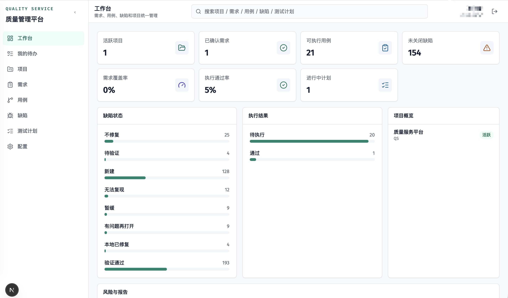
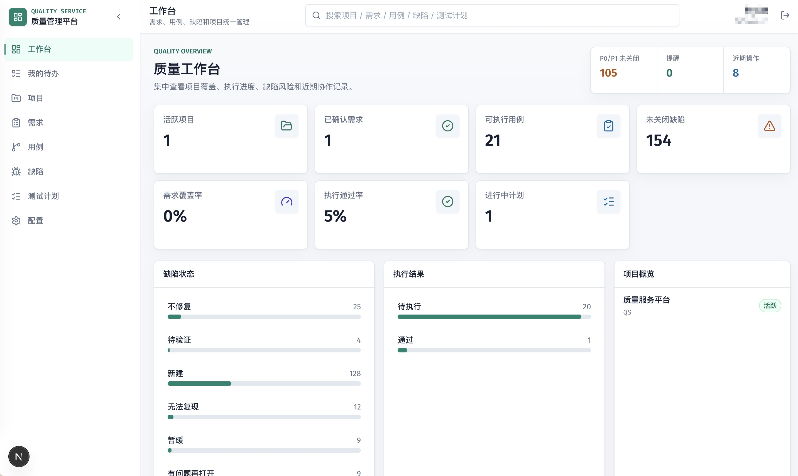
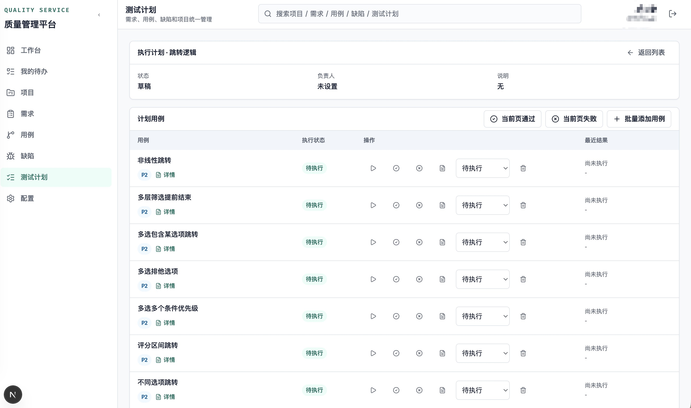
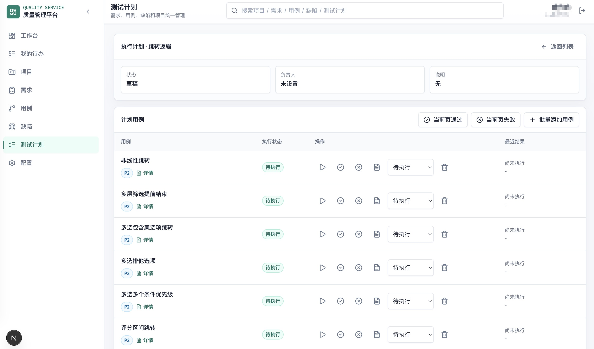

# Refactoring UI Design Skill

A Codex skill for designing, redesigning, polishing, and reviewing interfaces with the practical heuristics from *Refactoring UI* by Adam Wathan and Steve Schoger.

This skill turns the book's design judgment into an execution checklist for AI coding agents: start from the real feature, clarify hierarchy, constrain visual systems, then tune spacing, typography, color, depth, imagery, and finishing details.

## What It Helps With

- UI redesigns and polish passes
- Frontend CSS and component styling
- Dashboard, SaaS admin, form, table, and empty-state reviews
- Visual hierarchy, spacing, typography, color, shadow, icon, and screenshot decisions
- Concrete design critique with implementable fixes

## Install

Clone or copy this repository into your Codex skills directory:

```bash
mkdir -p ~/.codex/skills
git clone https://github.com/KuthorX/refactoring-ui-design.git ~/.codex/skills/refactoring-ui-design
```

Then invoke it explicitly:

```text
Use $refactoring-ui-design to review this dashboard and suggest concrete UI changes.
```

Or use it while implementing:

```text
Use $refactoring-ui-design to redesign this settings page. Apply the changes in code and verify desktop and mobile layouts.
```

## Repository Layout

```text
.
├── SKILL.md
├── agents/
│   └── openai.yaml
├── references/
│   └── refactoring-ui-principles.md
├── doc/
│   ├── before_1.jpg
│   ├── after_1.jpg
│   ├── before_2.jpg
│   └── after_2.jpg
├── skill.json
├── LICENSE
└── README.md
```

`SKILL.md` is the lean entry point. The longer design checklist lives in `references/refactoring-ui-principles.md` so agents can load it only when a UI task needs it.

## Example Output Style

When reviewing a UI, the skill should produce issues ordered by impact:

```text
1. Primary and secondary actions compete
   Principle: Actions should be styled by importance, not by component type.
   Fix: Keep the true primary action as the only solid brand button. Change secondary actions to neutral outline or ghost buttons, and use link-like treatments for tertiary actions.
   Check: Verify keyboard focus, hover, disabled, and mobile wrapping states.
```

## Application Reference

The screenshots in `doc/` show a quality management SaaS UI before and after a Refactoring UI style pass.

### Dashboard Polish

Before:



After:



The improved dashboard makes the page purpose clearer, introduces a stronger product header, gives metrics more breathing room, reduces visual clutter, and uses quieter supporting UI so the main quality metrics carry the screen.

### Test Plan Table Polish

Before:



After:



The improved table layout gives metadata and actions clearer grouping, makes the side navigation and active page state more deliberate, softens the table structure, and leaves more room for scanning repeated rows.

## Publishing Checklist

Before publishing this skill to GitHub or a skill hub:

- Confirm `SKILL.md` frontmatter has only `name` and `description`.
- Keep the skill name folder as `refactoring-ui-design`.
- Keep generated or local files out of the repository, especially `.DS_Store`.
- Include example screenshots only when they are safe to publish.
- Verify the skill with the Codex skill creator validator:

```bash
python ~/.codex/skills/.system/skill-creator/scripts/quick_validate.py .
```

If your Python environment does not have `PyYAML`:

```bash
uv run --with pyyaml python ~/.codex/skills/.system/skill-creator/scripts/quick_validate.py .
```

## Attribution

This skill is an original AI-agent workflow and checklist inspired by the design principles in *Refactoring UI* by Adam Wathan and Steve Schoger. It does not include the book text and is not affiliated with the authors.

## License

MIT. See [LICENSE](LICENSE).
