# ACTUALIZACIÓN MAESTRA — TESIS CIUDADANÍA ACTIVA

**Proyecto:** Ciudadanía Activa<br>
**Carrera:** Ingeniería en Informática<br>
**Institución:** Universidad Columbia del Paraguay<br>
**Autores:** Monty Pohl y Guadalupe Galeano

> **Propósito.** Este documento es la fuente de conciliación entre el texto académico y el estado técnico verificable del proyecto. No es un changelog ni reemplaza la redacción final de la tesis: indica qué conservar, qué corregir, qué agregar y qué todavía no puede presentarse como resultado.
>
> **Corte de auditoría original:** 13 de septiembre de 2026, después del release gate final de S10; estado operativo actualizado después de la reconciliación del PR #39.<br>
> **Regla de lectura:** una funcionalidad se distingue entre integrada en `main`, implementada en
> la rama S10 y desplegada. S10 está implementado y reconciliado con `main` en la rama del PR #39,
> pero no está integrado en `main` ni activo en producción; S11–S13 no comenzaron.

**Estado de S10:** ADR-0013 permanece `ACCEPTED` e inalterado. La rama
`feat/s10-implementation` implementa ciclos monotónicos, migraciones y backfill determinista,
flujo institucional, evidencia privada, cierre manual/automático, reversión compensatoria,
auditoría administrativa y sus interfaces. Los blockers B01/B02 del primer gate fueron remediados
y el release gate final quedó verde. Durante un intento posterior se aplicaron únicamente las
migraciones aditivas `reports_app.0003` y `rewards_app.0002`; no se ejecutaron el backfill 0004 ni
las migraciones posteriores, no se modificaron datos de negocio y no se restauró el respaldo. La
aplicación fue revertida a S9 mediante Heroku rollback y el despliegue final no está autorizado.
S10 no envía
notificaciones y no adelanta ranking/créditos visibles (S11), canje (S12) ni dashboards/ingesta
(S13).

## Convenciones de estado

| Etiqueta | Significado en este documento |
|---|---|
| ✅ IMPLEMENTADO | Existe en el código del alcance indicado y está respaldado por pruebas o evidencia verificable. |
| 🟡 PARCIAL | Existe una parte funcional, pero faltan capas, flujos o evidencia para sostener la capacidad completa. |
| 📋 DISEÑADO | Hay modelo, ADR, contrato o planificación, pero no una implementación funcional completa. |
| 🧪 PREREGISTRADO | El protocolo quedó fijado antes de su ejecución; no equivale a resultado. |
| ❌ NO IMPLEMENTADO | No se encontró implementación funcional verificable. |
| ⚠️ NO DEMOSTRADO | La capacidad o afirmación podría ser plausible, pero falta evidencia de ejecución o medición. |
| 🔮 FUTURO | Está expresamente diferido a un sprint o trabajo posterior. |

## 1. Estado del repositorio analizado

### 1.1 Identificación Git y alcance del corte

| Elemento | Estado verificado |
|---|---|
| Repositorio local | `/home/monty/proyectos/ciudadania-activa` |
| Rama de cierre documental | `docs/s09-cierre-final-s11-preflight`, creada desde `main` sin modificar su historia |
| Base de la rama | `730d69ede7033c3487b68f79b1828fe6f2f43180` — `main` vigente al iniciar este cierre |
| `origin/main` actualizado | `730d69ede7033c3487b68f79b1828fe6f2f43180` — commit administrativo autorizado posterior a S9 |
| Commit inicial de S9-B3 | `da2eb2984e2882a744c119ac9404f20d3a18cfb9` — implementación inicial y cierre documental. |
| Commit de fixes post-review | `2088587cd32509e866fc2d1e171d1d6e1ccc556d` — corrige el estado de integración y las secuencias transaccionales; fue el `HEAD` verificado antes del ajuste final de trazabilidad. |
| Fix final de trazabilidad | `41babc681181baf4c9ac805e3eb04edf9f8ab188` — registra la evolución acumulativa del PR; correspondía al `HEAD` al iniciar esta revisión post-review. |
| Corrección final documental | `4472e459f8054f77fd0bff810264700f5206d284` — cierra los hallazgos de revisión y correspondía al `HEAD` al iniciar esta corrección final de trazabilidad. |
| Corrección final de trazabilidad histórica | `f87ae07bab5675bb07b99b590ee7df8b955f2485` — incorpora `4472e459` a la historia documental; no añade cambios funcionales. |
| Resolución de D-07 | `c99e769b6a72833301d7dbd142fa8a5bd47f5ada` — documenta `justification` y `model_name` como implementados y reconoce la migración `0002_aiclassification_justification_and_more.py` como existente. |
| Merge de S9-B3 | PR #38, `MERGED` mediante `7e95856c1b494d562ce1c267c06d5bebaec28cc8`. |
| Commits posteriores ajenos a S9 | `f0e8ce1` y `730d69e`, cambios administrativos autorizados. |
| Divergencia inicial | La rama fue creada directamente desde `origin/main`, sin divergencia inicial. |
| Estado inicial del working tree | Limpio. |
| PR de S9-B2 | PR #37, mergeado; Backend CI, Frontend CI, E2E y despliegues automáticos exitosos. |

Los commits de integración de Sprint 9 son: S9-A mediante PR #34; S9-B1 mediante PR #35 y
merge `a89b9efe676abfae0401e48145831383f6beaf3f`; S9-B2 mediante PR #37 y merge
`4ecf502361156281cbec51764310c67f50ace449`; y S9-B3 mediante PR #38 y merge
`7e95856c1b494d562ce1c267c06d5bebaec28cc8`. S9-B3 documenta este cierre sin modificar código.

La cadena histórica integrada es
`main@4ecf5023 → da2eb298 → 2088587 → 41babc6 → 4472e45 → f87ae07 → c99e769b → a089d3b
→ 7e95856`. Ningún commit intermedio representa por sí solo el estado completo de la rama. Después
del merge, `main` avanzó linealmente mediante `f0e8ce1 → 730d69e`, cambios administrativos
autorizados y ajenos a S9.

**Consecuencia académica:** S9-A, S9-B1, S9-B2 y S9-B3 pueden narrarse como integrados. Los estados de
GitHub y de los despliegues automáticos prueban integración técnica, no adopción institucional,
uso ciudadano real, impacto urbano ni validación de campo.

### 1.2 Estado de sprints y evidencia

| Elemento | Estado al corte | Evidencia y lectura correcta |
|---|---|---|
| Sprint 8 | **EN CURSO** | La infraestructura de clasificación y evaluación está integrada, pero falta una ejecución canónica válida del proveedor. Fuentes: `docs/PROGRESO_SPRINTS.md`, `backend/apps/ai_client_app/`, `backend/apps/ai_client_app/evaluation/`. |
| S8-E2-R1 | **ABORTED / sin resultado recuperable** | Sólo llegó al primer lote por cuota y no dejó evidencia apta para resultado académico. Fuente: `docs/PROGRESO_SPRINTS.md`. |
| S8-E2-R2 | 🧪 **PREREGISTERED / NOT_EXECUTED** | El protocolo está integrado en `main` por `d18b77a`, pero no fue ejecutado. Fuente: `backend/apps/ai_client_app/evaluation/recovery.py`, `evaluation/README.md` y documentación de Sprint 8. |
| CA-4 | ⚠️ **NOT_DEMONSTRATED** | No existe ejecución canónica que demuestre el criterio de aceptación del proveedor. |
| Sprint 9 | ✅ **COMPLETADO E INTEGRADO** | S9-A, S9-B1, S9-B2 y S9-B3 están integrados; PR #38 fue mergeado mediante `7e95856c`. |
| S9-A | ✅ **COMPLETADO E INTEGRADO** | PR #34: lectura institucional, contexto multiinstitución y tenancy efectivo. |
| S9-B1 | ✅ **COMPLETADO E INTEGRADO** | PR #35 / merge `a89b9efe`: dominio transaccional de validación/rechazo y ledger. |
| S9-B2 | ✅ **COMPLETADO E INTEGRADO** | PR #37 / merge `4ecf5023`: API, autorización linealizable, panel institucional y E2E. |
| S9-B3 | ✅ **COMPLETADO E INTEGRADO** | PR #38 / merge `7e95856c`: trazabilidad de S9 y diferimiento explícito de créditos visibles, ranking, recompensas, dashboards, ingesta y notificaciones completas. |
| Sprint 10 | ✅ **IMPLEMENTADO Y RECONCILIADO EN RAMA / RELEASE GATE APROBADO** | ADR-0013 `ACCEPTED`; B01/B02 y la clasificación de `report.confirmed` remediados. No está integrado ni activo en producción: la aplicación está revertida a S9, con sólo `reports_app.0003` y `rewards_app.0002` aplicadas y sin backfill ni datos de negocio modificados. Requiere revisión y autorización explícita posterior. |

Este cierre actualiza en conjunto `PROGRESO_SPRINTS.md`, `API.md` y `DICCIONARIO_DATOS.md` para
que la frontera de Sprint 9 no se confunda con funcionalidades planificadas para S11–S13.

### 1.3 Corpus documental localizado y legibilidad

Se localizaron y pudieron leerse razonablemente los cuatro documentos académicos binarios:

| Documento | Función identificada | Lectura en la auditoría |
|---|---|---|
| `docs/Tesis_Ciudadania_Activa_Revisada_Recompensas.docx` | Documento principal revisado y referencia académica vigente. | Texto extraído y contrastado; aproximadamente 13.109 palabras. |
| `docs/Tesis_Ciudadania_Activa.pdf` | Versión original/histórica de la tesis. | Texto extraído de 76/77 páginas; usado para detectar conceptos heredados. |
| `docs/Matriz_Modificaciones_Ciudadania_Activa.docx` | Matriz de cambios académicos. | Texto extraído y contrastado. |
| `docs/Cronograma_Ciudadania_Activa_Anexo_F.docx` | Cronograma académico. | Texto extraído y contrastado. |

También se revisaron `README.md`, `docs/PLAN_DESARROLLO.md`, `docs/PROGRESO_SPRINTS.md`, `docs/BACKLOG.md`, `docs/CAMBIOS_TESIS_PENDIENTES.md`, `docs/DICCIONARIO_DATOS.md`, `docs/API.md`, `docs/AI_CLASSIFICATION_CONTRACT.md`, `docs/decisiones-incentivos.md`, los 15 archivos presentes en `docs/adr/`, modelos, migraciones, servicios, vistas, permisos, configuración, workflows y pruebas. El corte S10 contiene 471 archivos visibles mediante `rg --files` y 21 migraciones de aplicación. No se encontraron fuentes gráficas independientes Mermaid/Draw.io bajo `docs/`, pero el DOCX revisado **sí incorpora 13 PNG internos**: un logotipo, ocho diagramas técnicos y cuatro wireframes. Se inspeccionaron; varios contienen componentes o capacidades futuras (PostgreSQL 15, Beat, FCM, ranking/canje/resolución), por lo que son activos reales pero desactualizados, no meros marcadores.

### 1.4 Jerarquía de fuentes aplicada

Para resolver contradicciones se aplicó este orden: código integrado en `origin/main`;
migraciones/modelos; servicios; pruebas; ADR aceptados; documentación técnica; README; tesis
revisada; materiales históricos. Los tests se interpretan como evidencia de comportamiento
controlado, no como prueba automática de desempeño, adopción, disponibilidad o corrección en
producción.

## 2. Resumen ejecutivo de cambios desde la documentación anterior

La actualización académica necesaria no consiste en cambiar un framework aislado. El prototipo real ya tiene un núcleo funcional considerable, pero su frontera actual no coincide con varios flujos completos descritos por la tesis revisada.

1. **Arquitectura real.** El sistema es un monorepo con frontend Next.js 16/React 19 y backend modular Django 5.2/DRF, PostgreSQL/PostGIS, Redis y Celery. Se despliega en Vercel, Railway y Supabase. S10 incorpora configuración versionada de Celery Beat para autocierre, todavía no desplegada; no hay PWA, Cloudflare ni Flower. Fuentes: `frontend/package.json`, `frontend/next.config.ts`, `backend/requirements/base.txt`, `backend/config/settings/`, `backend/config/celery.py`, `infra/docker-compose.yml`, `.github/workflows/` y `docs/adr/ADR-0003-postgis-y-alojamiento-en-supabase.md`.
2. **Identidad y acceso.** Se usa Google Identity Services para acreditar la cuenta Google y JWT propios para la sesión; la verificación ciudadana posterior es un flujo separado con HMAC-SHA256 del documento, selfie privada y revisión administrativa. No existe OCR, biometría ni consulta a un registro estatal. Fuentes: `backend/apps/auth_app/`, `backend/apps/admin_app/views.py`, `frontend/src/app/api/auth/`, ADR-0005 y ADR-0006.
3. **Reportes ciudadanos.** Crear reporte, detectar posibles duplicados, consultar los propios, ver historial, confirmar reportes y consultar el mapa público están implementados. La fotografía se normaliza y almacena en un bucket privado, con compensación ante fallo transaccional. Fuentes: `backend/apps/reports_app/views.py`, `backend/apps/reports_app/services/reports.py`, `confirmations.py`, `photos.py`, ADR-0007 y ADR-0012.
4. **Consulta institucional.** S9-A agregó listados y detalles institucionales con contexto de
institución, separación de tenants, filtros, orden de prioridad, coordenadas exactas y URL firmada
de la primera fotografía. S9-B2 añadió la bandeja y el detalle frontend. Fuentes:
`backend/apps/reports_app/operator_views.py`, `operator_serializers.py`, `selectors.py` y sus pruebas.
5. **Validación y rechazo.** S9-B1 implementó servicios transaccionales para
`CREADO | CLASIFICADO → ASIGNADO` y `CREADO | CLASIFICADO → RECHAZADO`, con historial,
auditoría, ledger y bloqueos. S9-B2 publicó las rutas HTTP, revalidó rol y membresía dentro de la
misma transacción y añadió la interfaz de operador. Fuentes: `services/validation.py`,
`operator_views.py` y sus pruebas.
6. **Recompensas.** Son dos magnitudes en un mismo ledger: puntos de impacto globales, no consumibles, y créditos atribuibles a la institución definitiva, conceptualmente consumibles. Creación `+20/+20`, confirmación `+10/+10`, bonus por validación `+30/+30`, bonus de resolución `+50/+50` y reversión compensatoria por ciclo están implementados. Ranking, saldo visible y canje siguen en S11/S12. Fuentes: `backend/apps/rewards_app/models.py`, `services/ledger.py`, ADR-0004, ADR-0010, ADR-0011 y ADR-0013.
7. **IA como asistencia, no autoridad.** Existe un adaptador desacoplado a Gemini Interactions API, ejecución asíncrona, parser estricto, allowlist de entrada, auditoría y proveedor falso. No hay modelo entrenado ni fine-tuning. Una salida válida puede aplicarse automáticamente por umbral como clasificación operativa inicial; la validación institucional posterior es la decisión humana de autoridad. R2 no se ejecutó y CA-4 no se demostró. Fuentes: `backend/apps/ai_client_app/`, `docs/AI_CLASSIFICATION_CONTRACT.md`, ADR-0008 y ADR-0009.
8. **Diferencia crítica del contrato IA.** La documentación dice que una respuesta inválida deja una clasificación placeholder y avanza a `CLASIFICADO`; el código actual captura `ClassificationParseError`, no persiste clasificación/historial/auditoría y conserva `CREADO`. Debe prevalecer el código y sus pruebas hasta que el equipo decida lo contrario. Fuente: `backend/apps/ai_client_app/orchestration.py` y sus tests.
9. **Estados.** No existe un estado `VALIDADO`: validar es un evento registrado mediante `validated_at` y `validated_by`, lleva a `ASIGNADO` e inicia un ciclo. La rama S10 implementa el avance hasta `CERRADO` y la reversión administrativa a `CLASIFICADO`. Fuente: `backend/apps/core/enums.py` y `backend/apps/reports_app/services/`.
10. **Auditoría e historial.** Hay un `AuditLog` transversal y un historial específico de estados. No son sinónimos: el primero explica acciones/decisiones y el segundo reconstruye cambios de estado. S10 agrega API/UI administrativa de sólo lectura y eventos de ciclo; sigue siendo una política de aplicación, no inmutabilidad criptográfica o WORM. Fuentes: `backend/apps/admin_app/`, `backend/apps/core/services/audit.py`, `backend/apps/reports_app/models.py`.
11. **Ingesta social.** No hay integración real con X ni procesamiento de `#ReportePY`; `XMockMessage` y `TelegramIngestedMessage` son tablas sin pipeline funcional. La decisión vigente mueve Telegram fuera del alcance y deja X simulado como trabajo futuro. Fuente: `backend/apps/social_ingestion_app/models.py` y CT-43 en `docs/CAMBIOS_TESIS_PENDIENTES.md`.
12. **Despliegue.** Aunque la tesis declara que no se contempla despliegue productivo, existen despliegues técnicos automáticos. Esto no equivale a implantación institucional, operación con usuarios reales o validación de campo. El alcance debe distinguir “artefacto desplegado” de “puesta en producción institucional”.
13. **Pruebas verificables.** El corte S9-B2 ejecutó 1.807 pruebas backend, 341 Vitest y 48
Playwright; Backend CI, Frontend CI y E2E volvieron a finalizar exitosamente sobre el merge en
`main`. Los E2E usan APIs interceptadas y no prueban una integración contra backend o producción.
El cierre documental volvió a ejecutar 153 pruebas backend S9, 14 pruebas frontend institucionales
y 2 E2E de operador.
14. **Documentación derivada.** `docs/API.md` y `docs/DICCIONARIO_DATOS.md` describen S9
implementado. El Anexo B del DOCX debe regenerarse desde esas rutas; este documento no modifica
los binarios académicos.
15. **Resultados y alcance científico.** La encuesta, los resultados empíricos y las métricas de proveedor no deben reconstruirse a partir del código. La tesis revisada presenta los resultados técnicos esperados como criterios futuros; deben mantenerse en modo prospectivo hasta contar con evidencia, y separarse de los resultados efectivamente observados en CI.

## 3. Estado funcional actual del sistema

### 3.1 Matriz de capacidades

| Área | Estado | Capacidad verificable | Límite que debe constar en la tesis | Fuentes principales |
|---|---|---|---|---|
| Autenticación | ✅ IMPLEMENTADO en `main` | Login Google, emisión/refresh JWT, consulta de usuario y BFF frontend con refresh en cookie HttpOnly. | No hay rotación, blacklist ni revocación server-side del refresh; logout elimina la copia del cliente. | `backend/apps/auth_app/views.py`, `backend/apps/auth_app/services/google.py`, `frontend/src/app/api/auth/`, ADR-0005. |
| Verificación ciudadana | ✅ IMPLEMENTADO en `main` | Envío/reenvío, selfie privada, HMAC del documento, cola/detalle/revisión administrativa y correo. | No valida identidad contra registro civil; no OCR/biometría. | `backend/apps/auth_app/`, `backend/apps/admin_app/views.py`, ADR-0006, ADR-0015. |
| Catálogos e instituciones | 🟡 PARCIAL | Modelos, seed de tres instituciones/diez categorías, membresías y administración técnica Django. | No hay módulo funcional propio de gestión institucional para el usuario final. | `backend/apps/admin_app/models.py`, `migrations/0002_seed_catalogs.py`, `admin.py`. |
| Creación de reporte | ✅ IMPLEMENTADO en `main` | Ciudadano verificado crea reporte geolocalizado con foto y recibe movimiento pendiente `20/20`. | El POST no ofrece clave explícita de idempotencia/replay; el origen ciudadano es el flujo implementado. | `backend/apps/reports_app/services/reports.py`, `views.py`, `backend/apps/rewards_app/services/ledger.py`. |
| Posibles duplicados | ✅ IMPLEMENTADO en `main` | Consulta espacial por categoría, estados activos y radio configurable; devuelve como máximo cinco candidatos sin datos sensibles. | Es una advertencia consultiva: no bloquea la creación ni decide por IA. | `backend/apps/reports_app/selectors.py`, `views.py`, ADR-0012. |
| Mapa y detalle público | ✅ IMPLEMENTADO en `main` | BBox limitada, coordenadas redondeadas, whitelist de campos y detalle de reportes públicos. | No muestra fotos ni identidad; no es un GIS analítico. | `backend/apps/map_app/views.py`, `serializers.py`, `selectors.py`, `bbox.py`. |
| Panel ciudadano | ✅ IMPLEMENTADO en `main` | Reportes propios, detalle contextual, historial, confirmaciones y resumen de puntos pendientes/acreditados. | No expone aún saldo institucional de créditos, ranking ni canje. | `backend/apps/reports_app/views.py`, `serializers.py`, `selectors.py`, frontend en `frontend/src/app/(citizen)/`. |
| Confirmación | ✅ IMPLEMENTADO en `main` | Ciudadano verificado confirma reporte activo ajeno una vez; genera `10/10`. | Sólo aplica a `CREADO`, `CLASIFICADO`, `ASIGNADO` o `EN_PROCESO`. | `backend/apps/reports_app/services/confirmations.py`, sus tests. |
| Clasificación IA | 🟡 PARCIAL | Adaptador, parser, orquestación, tarea Celery, fake, auditoría y evaluación sintética. | Proveedor real/CA-4 no demostrado; flag apagado por defecto; error estructural conserva `CREADO`. | `backend/apps/ai_client_app/`, ADR-0008/0009. |
| Consulta institucional | ✅ IMPLEMENTADO en `main` | Lista/detalle de reportes dentro de la institución efectiva, filtros, foto privada firmada y panel frontend de operador. | La bandeja se limita a `CREADO`/`CLASIFICADO`; no es un dashboard analítico. | `backend/apps/reports_app/operator_views.py`, `operator_serializers.py`, `selectors.py`, frontend `(operator)/bandeja`. |
| Validar/rechazar | ✅ IMPLEMENTADO | Servicios de dominio atómicos, rutas HTTP y UI con locks, historial, auditoría y ledger; S10 añade revalidación por ciclos. | Las notificaciones completas siguen diferidas. | `backend/apps/reports_app/services/validation.py`, `operator_views.py`, pruebas y frontend de operador. |
| Resolución/evidencia/cierre | ✅ IMPLEMENTADO EN RAMA S10 | Flujo por ciclo, evidencia privada, `resolution_cycle`, `resolved_at`, `closed_at`, cierre manual y autocierre Celery. | No desplegado; el autocierre requiere worker y una única instancia de Beat. | ADR-0013, `backend/apps/reports_app/services/`, modelos, API y frontend. |
| Ledger de participación | 🟡 PARCIAL | Creación, confirmación, acreditación/anulación, bonus de validación/resolución y reversión compensatoria por ciclo están implementados. | No hay saldos visibles, ranking ni canje funcional (S11/S12). | `backend/apps/rewards_app/services/ledger.py`, ADR-0004/0010/0013. |
| Ranking y créditos visibles | 📋 DISEÑADO | Preferencia de privacidad y esquema/índice para agregación. | No hay cálculo/API/UI de ranking ni saldo de créditos. | `backend/apps/auth_app/views.py`, `backend/apps/rewards_app/models.py`, ADR-0011. |
| Recompensas/canje | 📋 DISEÑADO | Modelos `Reward` y `RewardRedemption`. | Sin catálogo API/UI ni servicio transaccional de canje; costo 1.000 es diseño futuro del MVP. | `backend/apps/rewards_app/models.py`, `services/ledger.py`. |
| Notificaciones | 🟡 PARCIAL | Correo de aprobación/rechazo de identidad mediante Brevo, registro de estado y reenvío manual. | Los demás tipos son enum/esquema; no hay FCM ni retry automático general. | `backend/apps/notifications_app/`, ADR-0015. |
| Auditoría | 🟡 PARCIAL | Registro transversal, admin de sólo lectura y API/UI administrativa paginada en la rama S10. | No todas las lecturas generan eventos y no hay garantía criptográfica de inmutabilidad. | `backend/apps/admin_app/`, `frontend/src/features/audit/`. |
| X/Telegram | ❌ NO IMPLEMENTADO como integración | Dos modelos de persistencia. | Sin API, importador, tarea, webhook ni proveedor real; Telegram debe salir del alcance y X queda simulado/futuro. | `backend/apps/social_ingestion_app/models.py`, CT-43. |
| Analítica/dashboard | ❌ NO IMPLEMENTADO | Existe esqueleto de `analytics_app`. | No hay dashboard analítico funcional. | `backend/apps/analytics_app/`. |
| PWA | ❌ NO IMPLEMENTADO | Aplicación web responsive. | No se encontró manifest, service worker ni configuración PWA. | `frontend/next.config.ts`, árbol `frontend/src/`. |

### 3.2 Instituciones y categorías efectivas

El seed versionado crea exactamente estas instituciones activables: **Municipalidad de Asunción** (`municipalidad-de-asuncion`), **ANDE** (`ande`) y **ESSAP** (`essap`). Las “otras instituciones configurables” son una posibilidad del modelo, no parte del seed actual.

| Categoría (`slug`) | Institución predeterminada | Prioridad predeterminada |
|---|---|---|
| `baches` | Municipalidad de Asunción | MEDIA |
| `basura-acumulada` | Municipalidad de Asunción | MEDIA |
| `alumbrado-publico` | ANDE | MEDIA |
| `agua-potable-perdidas` | ESSAP | MEDIA |
| `drenaje-desague-cloaca` | ESSAP | MEDIA |
| `semaforos` | Municipalidad de Asunción | MEDIA |
| `escombros` | Municipalidad de Asunción | MEDIA |
| `arbol-caido` | Municipalidad de Asunción | MEDIA |
| `cables-expuestos-riesgo-electrico` | ANDE | MEDIA |
| `otros` | Municipalidad de Asunción | MEDIA |

Fuente: `backend/apps/admin_app/migrations/0002_seed_catalogs.py`. La lista histórica “baches, cortes de energía, pérdidas de agua, basura y otros” debe adaptarse a estos diez nombres canónicos. La prioridad **CRÍTICA** no existe en el enum actual; sólo `BAJA`, `MEDIA` y `ALTA` (`backend/apps/core/enums.py`).

### 3.3 Lectura correcta del alcance

El prototipo es funcional en autenticación, verificación, creación/consulta/confirmación de reportes, mapa público, procesamiento IA desacoplado y consulta, validación y rechazo institucionales. S9 está integrado en `main`; la rama S10 completa localmente proceso, evidencia, resolución, cierre y reversión, con controles de concurrencia y tenancy. Ranking/créditos visibles y canje siguen pendientes en S11/S12. S10 no está desplegado. Hay despliegues técnicos anteriores, pero no evidencia de adopción institucional, operación con ciudadanos reales, prueba de campo, SLA, capacidad o impacto urbano.

## 4. Cambios que debe recibir el documento principal

### 4.1 Introducción

**Conservar:** el problema de fragmentación de canales, falta de trazabilidad y dificultad de coordinación ciudad–instituciones. También puede mantenerse el valor de participación ciudadana georreferenciada.

**Modificar:** presentar Ciudadanía Activa como **prototipo web modular con despliegue técnico**, no como una plataforma institucional ya adoptada. Explicar desde el inicio que la IA es un componente externo de apoyo sujeto a revisión institucional y que los incentivos están implementados por etapas. Evitar que “inteligente” implique modelo propio entrenado.

**Agregar:** una breve delimitación de evidencia: las afirmaciones técnicas se apoyan en código, pruebas y CI; las afirmaciones empíricas se apoyarán exclusivamente en encuesta/dataset/evidencia ejecutada. Fuentes: `README.md`, `docs/PLAN_DESARROLLO.md`, ADR-0008 y este corte.

### 4.2 Planteamiento del problema

La necesidad académica puede conservarse, pero debe evitarse presentar como hechos medidos cualquier tiempo de respuesta, volumen de incidencias, porcentaje de frustración o adopción que no provenga de la encuesta real. Vincular el problema con cuatro necesidades demostrables de diseño: canal estructurado, localización geográfica, trazabilidad de cambios y coordinación por competencia institucional.

La clasificación asistida y los incentivos son **hipótesis de solución**. No son, por sí mismos, evidencia de mejora de tiempos, calidad de clasificación o participación. Los resultados de encuesta deben copiarse de su fuente original y no inferirse del repositorio. Fuentes académicas: `docs/Tesis_Ciudadania_Activa_Revisada_Recompensas.docx`, Anexo G de ese documento y material de encuesta que el equipo agregue como evidencia.

El DOCX estima una población de aproximadamente 800.000 personas y calcula una muestra mínima cercana a 150, pero él mismo indica que la cifra poblacional debe contrastarse con la publicación oficial vigente. Esta auditoría documental del repositorio no verificó fuentes estadísticas externas: ambos valores deben conservar la marca **PENDIENTE DE VERIFICACIÓN ACADÉMICA** hasta revisar la fuente INE, el cálculo y la muestra efectivamente obtenida.

### 4.3 Objetivos

Los objetivos específicos sí están disponibles en la tesis revisada. Se recomienda conservar su texto literal y ajustar sólo la evaluación de cumplimiento:

**Objetivo general**

> Diseñar e implementar un prototipo funcional de la plataforma Ciudadanía Activa que demuestre la viabilidad técnica de un modelo de gestión urbana participativa con verificación de identidad, geolocalización, Inteligencia Artificial vía API, transparencia e incentivos a la participación ciudadana, sustentado por evidencia empírica recogida mediante encuesta y validado mediante escenarios de uso con datos sintéticos.

**Objetivos específicos**

1. “Caracterizar empíricamente la percepción ciudadana sobre la gestión de reportes urbanos en Asunción, la disposición de uso de una plataforma centralizada y la aceptación de mecanismos de confirmación e incentivos.”
2. “Identificar y caracterizar los requerimientos funcionales y no funcionales relacionados con verificación de identidad, geolocalización, clasificación inteligente, trazabilidad e incentivos.”
3. “Diseñar la arquitectura del prototipo, incluyendo el modelo de datos, los flujos asíncronos, las interfaces y los mecanismos de seguridad, garantizando modularidad y escalabilidad.”
4. “Diseñar e implementar el módulo de incentivos con puntos pendientes y acreditados, créditos por institución, confirmaciones ciudadanas, ranking mensual, privacidad configurable y canje simulado.”
5. “Implementar el prototipo funcional con frontend, backend, base de datos geoespacial, procesamiento asíncrono e integración con IA vía API.”
6. “Validar técnicamente el prototipo mediante pruebas unitarias, integración, carga y flujos end-to-end sobre un dataset sintético representativo del contexto urbano de Asunción.”

**Corrección de cumplimiento:** los objetivos 2, 3 y gran parte del 5 cuentan con evidencia técnica; el 4 es parcial porque ranking/canje y parte del ciclo del ledger faltan; el 6 es parcial porque existen pruebas unitarias/integración/concurrencia/E2E sintético, pero no prueba de carga ni ejecución canónica R2; el 1 requiere evidencia académica de encuesta que no debe deducirse del software. “Garantizando escalabilidad” debe evaluarse como propiedad diseñada, no demostrada mediante carga.

### 4.4 Alcance

Reemplazar la frase absoluta “No se contempla un despliegue productivo”. Existen despliegues automáticos técnicamente catalogados como producción para frontend/backend en Vercel/Railway y servicios gestionados en Supabase. La formulación recomendada es:

> El alcance comprende la construcción y el despliegue técnico de un prototipo funcional. No comprende la implantación oficial en instituciones públicas, la operación sostenida con ciudadanía real, la integración con registros estatales, una campaña pública ni la demostración de niveles de servicio productivos.

Incluir dentro del alcance: Google + JWT, verificación manual, reportes con foto y geolocalización, mapa público con privacidad geográfica, confirmaciones, clasificación asistida vía API, consulta y decisión institucional, trazabilidad y ledger parcial. S9-A, S9-B1, S9-B2 y S9-B3 están integrados en `main`. Excluir o mover a futuro: Telegram; X real; PWA/offline; dashboard; ranking/canje completos; resolución/cierre/reversión hasta su implementación; notificaciones completas fuera del correo de identidad; OCR/biometría; RLS no verificado; prueba de carga; implantación institucional real.

### 4.5 Marco teórico

Actualizar el marco conceptual en cinco ejes:

1. **Participación/civic tech:** distinguir reporte, confirmación comunitaria y decisión institucional.
2. **Información geoespacial:** explicar SRID 4326, consultas espaciales de proximidad y minimización por redondeo en la publicación, sin convertir una implementación en afirmación de rendimiento.
3. **IA vía API:** modelos fundacionales externos, salida estructurada, incertidumbre, validación humana, riesgos de disponibilidad, privacidad y reproducibilidad. Retirar teoría de entrenamiento supervisado propio si ya no sustenta la solución.
4. **Incentivos:** separar reputación/puntos globales de créditos institucionales; explicar ledger por eventos, atribución histórica y prevención de doble emisión.
5. **Integridad transaccional:** atomicidad, bloqueo pesimista y serialización de decisiones concurrentes como fundamento del dominio.

Fuentes técnicas para vincular conceptos con diseño: ADR-0003, ADR-0004, ADR-0008, ADR-0009, ADR-0010, ADR-0011, ADR-0012 y ADR-0013.

### 4.6 Metodología

La tesis revisada usa un enfoque de prototipo y validación por escenarios. Debe describir explícitamente:

- análisis documental y levantamiento de requisitos;
- diseño incremental por ADR y sprints;
- implementación monorepo;
- pruebas automatizadas en CI con PostgreSQL/PostGIS y Redis reales en el job backend;
- dobles/fakes para aislar proveedores externos;
- escenarios sintéticos para frontend y evaluación IA;
- prerregistro previo a la evaluación canónica del proveedor;
- distinción entre verificación técnica, evidencia empírica y resultado no demostrado.

Corregir la cronología: la sección 3.4 de la tesis menciona primer/segundo trimestre de 2026, mientras `docs/Cronograma_Ciudadania_Activa_Anexo_F.docx` programa el desarrollo entre **01/08/2026 y 15/11/2026**. La tesis y su cronograma deben adoptar una sola línea temporal real. Fuente complementaria: CT-27 en `docs/CAMBIOS_TESIS_PENDIENTES.md`.

### 4.7 Requisitos

Sustituir el catálogo histórico por las secciones 5, 6 y 7 de este documento. Cada requisito debe separar:

- obligación del sistema;
- actor y precondición;
- resultado observable;
- estado al corte;
- evidencia de verificación;
- futura aceptación, cuando aún no esté implementado.

No redactar los requisitos como si los estados de tablas o el despliegue probaran la capacidad completa. Por ejemplo, la existencia de `RewardRedemption` no satisface el canje y la existencia de `ResolutionEvidence` no satisface la resolución.

### 4.8 Casos de uso

Reemplazar el catálogo histórico de nueve casos y el catálogo de 18 casos del DOCX por la propuesta normalizada de la sección 8. Los flujos de consultar, validar y rechazar institucionalmente deben quedar separados; “auditar IA” debe ampliarse a “consultar trazabilidad administrativa y decisiones automatizadas”; y “resolver” debe permanecer marcado como futuro. Telegram debe retirarse. X debe denominarse **ingesta sintética/simulada**, nunca integración real.

### 4.9 Arquitectura

Actualizar las figuras y texto con:

- frontend Next.js App Router en Vercel;
- BFF sólo para la sesión web y API Django para el dominio;
- backend Django/DRF con nueve apps de dominio más `core` transversal;
- PostgreSQL/PostGIS y Storage privados en Supabase;
- Redis como caché/broker y worker Celery en Railway;
- Brevo por HTTPS para correo y Gemini Interactions API como dependencia opcional;
- despliegue backend/worker en Railway.

No incluir Cloudflare, Flask, Firebase/FCM, Flower, Celery Beat ni PWA como componentes actuales. Fuentes: `frontend/package.json`, `frontend/src/app/`, `backend/config/settings/`, `backend/config/celery.py`, `backend/apps/`, `infra/docker-compose.yml`, ADR-0002, ADR-0003 y ADR-0015.

### 4.10 Base de datos

Reemplazar el DER y el diccionario a partir de las 18 entidades persistentes descritas en la sección 10. Corregir PostgreSQL 15 por el entorno realmente documentado: Supabase PostgreSQL 17.6/PostGIS 3.3.7 en el corte de ADR-0003; local y CI usan imagen `postgis/postgis:17-3.5`. Explicar que las versiones de producto y CI pueden diferir en el parche de PostGIS y registrar ambas.

La contradicción D-07 se detectó durante la revisión documental y quedó resuelta en
`docs/DICCIONARIO_DATOS.md` mediante `c99e769b`: `AiClassification` documenta `justification` y
`model_name` como implementados y reconoce la migración
`backend/apps/ai_client_app/migrations/0002_aiclassification_justification_and_more.py` como
existente. Ya no constituye un bloqueo actual. Al actualizar el DER, evitar SQL histórico con
enums nativos si el esquema real usa `varchar` + choices/checks de Django; la tabla `BaseModel` no
existe porque es abstracta.

### 4.11 Inteligencia artificial

Usar la descripción completa de la sección 12. El texto central recomendado es:

> La plataforma integra un proveedor externo de IA generativa como asistente de clasificación. A partir de una descripción, una imagen normalizada sin metadatos y catálogos permitidos, solicita una salida estructurada con sugerencias de categoría, institución y prioridad. La aplicación valida sintáctica y semánticamente esa salida. Cuando se cumplen el umbral y las reglas configuradas puede aplicar una clasificación operativa inicial; la validación institucional humana conserva la autoridad sobre la institución definitiva y los efectos económicos. El prototipo no entrena un modelo propio.

No informar precisión, latencia o tasa de éxito de Gemini: R2 está prerregistrado/no ejecutado y CA-4 no demostrado. Corregir también el prompt del Anexo H: los campos actuales son `category_slug`, `institution_slug`, `priority`, `confidence`, `inconsistency` y `justification`; `has_changes` se deriva internamente, no se solicita como `hubo_cambio`.

### 4.12 Seguridad

Documentar por capas:

- validación del token Google (firma, emisor, audiencia, expiración, `sub` y correo verificado) antes de emitir JWT propio;
- access token de 15 minutos en memoria y refresh de 7 días en cookie first-party HttpOnly, SameSite=Lax, ruta `/api/auth` y `Secure` en producción;
- permisos deny-by-default en DRF y roles consultados desde base de datos;
- membresía institucional activa para lectura de operador y separación de scopes;
- HMAC-SHA256 del documento con secreto separado, comparación constante y selfie privada con URL firmada de 300 segundos;
- fotografías de reportes privadas, normalizadas, sin metadatos y con hash SHA-256 de los bytes originales;
- CORS por entorno, redirección HTTPS en producción, hosts explícitos y manejo de proxy;
- throttles existentes y minimización de campos/coordenadas en endpoints públicos;
- secretos por variables de entorno.

Registrar límites: sin rotación/blacklist de refresh; sin CSP/HSTS explícitos verificados; sin OCR/biometría; sin política implementada de retención de identidad; sin RLS de base de datos verificable; sin pentest; el `RoleGuard` frontend es UX y la autoridad está en backend. El CSRF middleware existe, pero las APIs de dominio usan Bearer; la cookie de refresh se consume a través del BFF same-site. Fuentes: `backend/config/settings/`, `backend/apps/core/permissions.py`, `backend/apps/auth_app/`, `frontend/src/lib/auth/`, ADR-0005/0006/0007.

**Precisión sobre la cédula:** el valor textual no se persiste en claro, pero la selfie exige que la persona sostenga el documento y puede contener el número visible. La imagen sigue siendo PII sensible. Se admite JPEG/PNG de hasta 5 MiB, se verifica el contenido y se rechazan bombas de descompresión; la clave de objeto la genera el servidor. A diferencia de la foto de reporte, el servicio de identidad verifica la selfie pero no declara una normalización que elimine metadatos. Fuente: `backend/apps/auth_app/services/identity.py`, `backend/config/settings/base.py`.

### 4.13 Auditoría

Separar `AuditLog` de `ReportStatusHistory`. El log transversal guarda actor, tipo de actor, acción, objeto implícito en el payload y contexto de decisión; el historial registra transición, responsable, razón y momento. Las acciones reales están inventariadas en la sección 14.

No describir el log como “inmutable” en sentido criptográfico: el admin usa una política de sólo lectura y las escrituras pasan por un servicio, pero no se encontró firma, hash encadenado ni trigger que haga imposible la modificación directa en base de datos. Tampoco existe aún pantalla/API específica de auditoría. Fuentes: `backend/apps/admin_app/models.py`, `admin.py`, `backend/apps/core/services/audit.py`.

### 4.14 Sistema de puntos y créditos

Reescribir la sección de incentivos con dos dimensiones:

- **puntos de impacto:** reconocimiento global, no consumible, sumado sólo desde movimientos acreditados;
- **créditos institucionales:** derecho atribuido históricamente a una institución final y destinado al canje dentro de esa institución.

La relación actual de emisión es 1:1 por evento, no una conversión posterior de saldo. La fila del ledger conserva ambas diferencias. Creación y confirmación nacen pendientes hasta que existe validación; el dominio integrado en Sprint 9 las acredita y fija la institución, añade el bonus `30/30`, o las anula si se rechaza antes de validar. No afirmar que ranking, saldo consumible o canje están operativos. Véase sección 13 y `backend/apps/rewards_app/services/ledger.py`.

### 4.15 Concurrencia e integridad

Agregar una subsección académica propia. La decisión relevante no es el detalle del ORM, sino que validar, rechazar y confirmar compiten por el mismo agregado `Report`. Sprint 9 serializa esas decisiones con transacción y un orden estable de locks: usuario, membresía institucional, reporte, categoría cuando corresponde, institución y movimientos del ledger. Esto evita revocaciones concurrentes de autoridad, doble validación, finales incompatibles y recompensas perdidas/dobles. Las pruebas concurrentes usan conexiones/hilos separados contra PostgreSQL real. Fuentes: `backend/apps/reports_app/operator_views.py`, `services/validation.py`, `services/confirmations.py`, `tests/test_operator_report_actions_api.py`, `tests/test_validation_service.py` y ADR-0010.

### 4.16 Pruebas

Sustituir cifras históricas por el corte trazable de la sección 16. Separar claramente:

- corte integrado S9-B2: 1.807 pruebas backend;
- frontend integrado: 341 Vitest y 48 Playwright;
- verificación focal de cierre S9-B3: 153 backend, 14 frontend y 2 Playwright;
- release gate S10 final: 1.984 backend con 99% de cobertura, 360 Vitest, 52 Playwright Chromium y
  8/8 carreras PostgreSQL; B01/B02 quedaron remediados y el despliegue sigue sujeto a autorización;
- E2E de navegador con APIs interceptadas, no flujo full-stack contra backend real;
- pruebas concurrentes PostgreSQL, que sí verifican carreras específicas;
- ausencia de prueba de carga/k6, validación de usuario, pentest y benchmark canónico de Gemini.

La cobertura no debe equipararse con cumplimiento funcional o calidad en producción.

### 4.17 Infraestructura y despliegue

Explicar dos topologías: local/CI y desplegada. Localmente `infra/docker-compose.yml` orquesta PostGIS, Redis, backend y worker; CI levanta servicios PostGIS/Redis. En despliegue, Vercel sirve el frontend, Railway el backend Gunicorn y worker, Supabase provee PostgreSQL/PostGIS y Storage, Redis actúa como broker/caché, Brevo envía correo y Gemini es opcional.

El flujo observable es `rama → PR → CI por rutas → merge a main → despliegue automático`. Los PR #34, #35 y #37 están integrados; el corte post-merge de S9-B2 registró CI backend/frontend/E2E y despliegues automáticos Vercel/Railway exitosos. No se encontraron manifiestos nativos integrales de Railway/Vercel en el repositorio, por lo que parte de la configuración vive en paneles externos. El predeploy aplica migraciones y ADR-0003 exige backup manual antes de cambios riesgosos; Supabase gratuito no aporta backup programado verificado y `sslmode=verify-full` continúa como mejora pendiente.

### 4.18 Resultados

Dividir el capítulo en tres categorías:

1. **Resultados técnicos observados:** capacidades efectivamente implementadas; estados de CI; cobertura reportada; despliegues técnicos exitosos; pruebas de concurrencia específicas.
2. **Resultados experimentales pendientes:** R2/CA-4, latencia/precisión/tasa de conformidad del proveedor, carga, capacidad y comportamiento full-stack desplegado.
3. **Resultados empíricos:** encuesta y cualquier prueba con usuarios; sólo se incluirán desde su evidencia académica, nunca desde fixtures o seeds.

La tesis revisada ya formula muchos resultados como “esperados”; conservar esa modalidad hasta ejecutarlos. La evaluación fake de S8-E1 sirve para probar la maquinaria y **no** representa desempeño de Gemini.

### 4.19 Limitaciones

Declarar al menos:

- ciclo institucional S10 implementado en rama pero todavía no integrado ni desplegado;
- dependencia externa opcional de IA y ausencia de resultado canónico;
- clasificación inválida actualmente sin registro placeholder, en contradicción documental;
- X/Telegram sin pipeline;
- saldo visible/ranking/canje incompletos (S11/S12);
- E2E sintético con interceptación y ausencia de prueba de carga;
- despliegue sin validación institucional o SLA;
- refresh sin revocación server-side;
- backups manuales y TLS `verify-full` pendiente;
- ausencia de política de retención, RLS verificado, observabilidad estructurada y pentest;
- datos seed/sintéticos que no prueban uso real.

### 4.20 Trabajo futuro

Ordenar el trabajo futuro por dependencia: completar resolución/evidencia/cierre/reversión; implementar en S11 la consulta de saldo/transacciones y ranking con privacidad; implementar catálogo/canje en S12; reservar dashboards e ingesta social para S13; ejecutar R2 sin cambiar el protocolo y publicar evidencia; definir antes de completar notificaciones sus destinatarios, contenido, privacidad, idempotencia, asociación con reportes, manejo de fallos del broker, momento de emisión y uso de `on_commit`; mejorar revocación, retención, CSP/HSTS, TLS y backups; ejecutar carga, E2E full-stack y evaluación con usuarios. Telegram debe figurar como **retirado del alcance**, no como compromiso futuro automático.

### 4.21 Conclusiones

La conclusión debe sostener sólo que el repositorio demuestra viabilidad técnica parcial y una arquitectura coherente para los flujos implementados. Puede destacar modularidad, privacidad por minimización, uso de ledger y control de concurrencia. No debe declarar demostrados impacto ciudadano, adopción, precisión de IA, escalabilidad, disponibilidad, reducción de tiempos institucionales ni ciclo integral mientras falten las respectivas evidencias.

## 5. Requisitos funcionales actualizados

Los siguientes IDs son una **propuesta canónica nueva**. Conviene mantener una tabla de equivalencias con la numeración histórica en lugar de reutilizar silenciosamente IDs cuyo significado cambió. “Acción” indica qué hacer con la especificación académica; “Estado” indica el producto al corte.

| ID | Acción | Nombre y descripción | Actor | Precondiciones principales | Resultado observable | Estado y fuente |
|---|---|---|---|---|---|---|
| RF-01 | MODIFICAR | **Autenticar con Google.** Aceptar un ID token válido de Google y emitir credenciales propias. | Visitante | Token con firma, emisor, audiencia, expiración, `sub` y correo verificado válidos. | Usuario creado/actualizado y par JWT emitido. | ✅ `backend/apps/auth_app/views.py`, `google.py`. |
| RF-02 | NUEVO | **Mantener sesión web.** Renovar el access token mediante refresh protegido por el BFF. | Usuario autenticado | Refresh JWT válido en cookie first-party. | Access nuevo; el refresh no rota. | ✅ `frontend/src/app/api/auth/`, `backend/apps/auth_app/views.py`. |
| RF-03 | MODIFICAR | **Consultar identidad y rol actuales.** Exponer el usuario autenticado y resolver permisos desde base de datos. | Usuario | Access JWT válido. | Perfil mínimo y rol vigente. | ✅ `backend/apps/auth_app/views.py`, `serializers.py`. |
| RF-04 | MODIFICAR | **Solicitar verificación ciudadana.** Recibir número de documento y selfie, protegerlos y dejar revisión pendiente. | Ciudadano | Sesión válida; imagen admisible; estado que permita envío/reenvío. | HMAC único, objeto privado y estado pendiente; auditoría. | ✅ `backend/apps/auth_app/views.py`, `services/identity.py`, ADR-0006. |
| RF-05 | NUEVO | **Consultar estado de verificación.** Informar estado y motivo de rechazo cuando corresponda. | Ciudadano | Sesión válida. | Estado actual sin revelar secretos ni clave privada. | ✅ `backend/apps/auth_app/views.py`. |
| RF-06 | MODIFICAR | **Revisar identidad.** Listar/detallar solicitudes y aprobar o rechazar con confirmación manual del documento. | Administrador | Privilegio administrativo; reingreso coincidente para aprobar o motivo para rechazar. | Estado de perfil/rol actualizado, auditoría y notificación encolada. | ✅ `backend/apps/admin_app/views.py`, `services/identity_review.py`. |
| RF-07 | NUEVO | **Configurar privacidad de ranking.** Consultar/cambiar alias y visibilidad entre `FULL_NAME`, `FIRST_INITIAL`, `ALIAS` y `PRIVATE`. | Ciudadano | Sesión válida; alias válido cuando corresponda. | Preferencia persistida. | ✅ para preferencia; ranking aún futuro. `backend/apps/auth_app/enums.py`, `views.py`. |
| RF-08 | MODIFICAR | **Administrar membresías y catálogos.** Mantener instituciones, categorías y operadores. | Administrador técnico | Acceso Django admin/is_staff. | Registros persistidos con relaciones y actividad. | 🟡 Sólo administración técnica, sin módulo de negocio. `backend/apps/admin_app/admin.py`. |
| RF-09 | MODIFICAR | **Consultar mapa público.** Listar incidencias visibles dentro de un bbox acotado. | Público | Bbox válido y dentro del límite. | Marcadores con campos permitidos y coordenadas reducidas. | ✅ `backend/apps/map_app/views.py`, `selectors.py`, `bbox.py`. |
| RF-10 | NUEVO | **Consultar detalle público.** Recuperar un reporte visible sin PII, fotografía ni posición exacta. | Público | UUID existente y estado visible. | Detalle minimizado; rechazado/inexistente resulta 404. | ✅ `backend/apps/map_app/views.py`, `serializers.py`. |
| RF-11 | NUEVO | **Consultar categorías públicas.** Exponer categorías activas necesarias para el formulario. | Público | Ninguna. | Catálogo activo sin configuración sensible. | ✅ `backend/apps/map_app/views.py`. |
| RF-12 | MODIFICAR | **Crear reporte.** Registrar descripción, categoría, coordenadas y fotografía. | Ciudadano verificado | Autenticado/verificado; categoría activa; foto JPEG/PNG ≤5 MiB; coordenadas válidas. | Reporte `CREADO`, media privada, historial, `20/20` pendiente y auditoría. | ✅ `backend/apps/reports_app/services/reports.py`, `views.py`. |
| RF-13 | NUEVO | **Consultar posibles duplicados.** Buscar reportes activos cercanos de igual categoría. | Ciudadano verificado | Categoría/coordenadas válidas. | Hasta cinco candidatos minimizados; no bloquea crear. | ✅ `backend/apps/reports_app/selectors.py`, `views.py`, ADR-0012. |
| RF-14 | NUEVO | **Consultar reportes propios.** Listar y abrir reportes del ciudadano con contexto privado. | Ciudadano | Autenticado. | Sólo recursos propios, con detalle acorde al rol. | ✅ `backend/apps/reports_app/views.py`, `selectors.py`. |
| RF-15 | NUEVO | **Consultar historial propio.** Mostrar los cambios registrados de un reporte accesible. | Ciudadano | Ser autor o tener contexto habilitado por el endpoint. | Secuencia cronológica autorizada. | ✅ `backend/apps/reports_app/views.py`, `serializers.py`. |
| RF-16 | MODIFICAR | **Confirmar reporte ajeno.** Crear una confirmación única. | Ciudadano verificado | Reporte ajeno en estado activo; sin confirmación previa. | Confirmación, auditoría y movimiento `10/10`, pendiente o acreditado según validación. | ✅ `backend/apps/reports_app/services/confirmations.py`. |
| RF-17 | MODIFICAR | **Clasificar con asistencia IA.** Procesar de forma asíncrona y validar una sugerencia estructurada. | Sistema/IA | Feature flag, clave/modelo/adaptador configurados y reporte aún `CREADO`. | Clasificación persistida y, si cumple reglas, actualización a `CLASIFICADO`; auditoría. | 🟡 técnica implementada; proveedor canónico no demostrado. `backend/apps/ai_client_app/`. |
| RF-18 | NUEVO | **Consultar bandeja institucional.** Listar reportes del scope efectivo con filtros y orden. | Operador institucional | Usuario operador; membresía activa; contexto inequívoco o `institution_id` válido. | Página filtrada sin fuga entre instituciones. | ✅ S9-A en `main`. `backend/apps/reports_app/operator_views.py`. |
| RF-19 | NUEVO | **Consultar detalle institucional.** Mostrar descripción/posición exacta, conteo, primera foto y última clasificación accesibles. | Operador institucional | Mismas condiciones de scope; reporte existente en el scope. | Detalle con URL firmada de 300 s y `Cache-Control: private, no-store`. | ✅ S9-A en `main`. `operator_serializers.py`, `selectors.py`. |
| RF-20 | NUEVO | **Validar institucionalmente.** Fijar institución final y acreditar participación. | Operador institucional autorizado | Reporte `CREADO`/`CLASIFICADO`, no validado, institución activa, membresía activa y scope coincidente. | `ASIGNADO`, marcas de validación, historial, auditoría, acreditaciones y bonus. | ✅ S9-B1/B2 integrados. `services/validation.py`, `operator_views.py`. |
| RF-21 | NUEVO | **Rechazar institucionalmente.** Rechazar antes de validar con motivo cerrado. | Operador institucional autorizado | Reporte `CREADO`/`CLASIFICADO`, no validado, membresía activa y scope correcto. | `RECHAZADO`, motivo, pendientes anulados, historial y auditoría. | ✅ S9-B1/B2 integrados. `services/validation.py`, `operator_views.py`. |
| RF-22 | NUEVO | **Gestionar conflictos de decisión.** Devolver conflicto semántico estable ante repetición/carrera. | Sistema | Dos decisiones concurrentes o estado ya cambiado. | Un solo resultado final; códigos como `ALREADY_VALIDATED`, `ALREADY_REJECTED` o `VALIDATION_REVERSAL_REQUIRED`. | ✅ dominio y API S9-B1/B2. `services/validation.py`, `operator_views.py`. |
| RF-23 | MODIFICAR | **Registrar historial de estados.** Crear una entrada por transición implementada. | Sistema | Transición de dominio exitosa. | Estado anterior/nuevo, actor, razón, ciclo y tiempo persistidos dentro de la transacción. | ✅ incluye el ciclo institucional S10. |
| RF-24 | MODIFICAR | **Registrar auditoría transversal.** Persistir actor/tipo, acción y payload minimizado de eventos críticos. | Sistema | Acción auditable exitosa. | Entrada consultable mediante API/UI administrativa privada. | 🟡 cobertura por acciones; inventario en §14. `backend/apps/core/services/audit.py`. |
| RF-25 | NUEVO | **Crear incentivos pendientes.** Emitir `20/20` por reporte y `10/10` por confirmación. | Sistema | Participación válida y atómica. | Una fila única por origen en el ledger. | ✅ en `main`. `backend/apps/rewards_app/services/ledger.py`. |
| RF-26 | NUEVO | **Acreditar por validación.** Atribuir movimientos pendientes a la institución definitiva y añadir `30/30` al autor. | Sistema | Validación institucional exitosa e invariantes del agregado satisfechas. | Movimientos acreditados con instante común; bonus único por ciclo válido. | ✅ S9-B1 integrado. `ledger.py`. |
| RF-27 | NUEVO | **Anular por rechazo.** Cambiar pendientes a `ANULADO` sin borrar ni revertir acreditados. | Sistema | Rechazo prevalidación exitoso. | `voided_at` común y trazabilidad conservada. | ✅ S9-B1 integrado. `ledger.py`. |
| RF-28 | MODIFICAR | **Mostrar resumen ciudadano de puntos.** Agregar puntos de impacto pendientes y acreditados. | Ciudadano | Autenticado. | Totales propios derivados del ledger. | ✅ limitado a puntos. `backend/apps/reports_app/selectors.py`. |
| RF-29 | MODIFICAR | **Calcular créditos y ranking mensual.** Derivar saldo por institución y ranking de acreditaciones respetando privacidad. | Ciudadano/Público | Movimientos acreditados y preferencia configurada. | Saldo/ranking consistente. | 📋 DISEÑADO, sin servicio/API/UI. ADR-0010/0011. |
| RF-30 | MODIFICAR | **Gestionar proceso, evidencia, resolución y cierre.** Avanzar el ciclo vigente y registrar evidencia institucional privada. | Operador institucional activo; sistema sólo para autocierre | Institución asignada, membresía y ciclo vigentes; resolver exige evidencia del ciclo actual. | Historia/auditoría por transición, evidencia ligada al ciclo, bonus de resolución único y cierre manual o automático tras 72 horas. | ✅ rama S10; no desplegado. |
| RF-31 | NUEVO | **Revertir validación.** Revertir el ciclo vigente sin borrar historia. | Administrador global | Reporte en `ASIGNADO`, `EN_PROCESO`, `RESUELTO` o `CERRADO`; ciclo esperado y motivo válido. | Retorno a `CLASIFICADO`; conserva institución, categoría, prioridad, historial y evidencia; limpia proyecciones vigentes y compensa el ledger conforme a ADR-0013. | ✅ rama S10; no desplegado. |
| RF-32 | MODIFICAR | **Listar y canjear recompensas simuladas.** Consumir créditos de la misma institución. | Ciudadano verificado | Saldo suficiente, recompensa activa y límites aplicables. | Vale simulado y movimiento de canje atómicos. | 📋 modelo diseñado; servicio/API/UI no implementados. `backend/apps/rewards_app/models.py`. |
| RF-33 | MODIFICAR | **Notificar eventos.** Registrar y enviar comunicaciones por canal disponible. | Sistema | Evento soportado y destinatario válido. | Estado `PENDIENTE/ENVIADO/FALLIDO`, con reenvío manual donde aplica. | 🟡 sólo email de identidad por Brevo. `backend/apps/notifications_app/`. |
| RF-34 | MODIFICAR | **Ingerir reporte social simulado.** Convertir un mensaje sintético de X en dato de entrada controlado. | Administrador/Sistema | Dataset/importador sintético válido. | Mensaje registrado y, en futuro, reporte no verificado sin incentivos. | 🔮 FUTURO; hoy sólo `XMockMessage`. |
| RF-35 | RETIRAR | **Ingerir Telegram.** El flujo histórico ya no pertenece al alcance vigente. | — | — | Eliminarlo del catálogo activo y mencionarlo sólo como decisión descartada. | ❌ Modelo residual sin pipeline; CT-43. |
| RF-36 | MODIFICAR | **Dashboard analítico.** Agregar métricas operativas autorizadas. | Administrador/Operador | Datos y permisos definidos. | Indicadores sin exponer PII. | 🔮 FUTURO; `analytics_app` es un esqueleto. |

### Requisitos que no deben considerarse satisfechos por estructura de datos

La mera presencia de enums, campos o tablas no satisface RF-29 a RF-32, RF-34 o RF-36. Para declararlos implementados deben existir servicio de dominio, autorización, interfaz/API según corresponda y pruebas del resultado observable. Esta regla evita que el DER se use como sustituto de evidencia funcional.

## 6. Requisitos no funcionales actualizados

| ID | Requisito académico propuesto | Estado de implementación/evidencia | Fuente o criterio de aceptación |
|---|---|---|---|
| RNF-01 | **Seguridad de autenticación:** validar tokens del proveedor y emitir credenciales propias de vida limitada. | ✅ Implementado; refresh sin rotación/revocación central. | ADR-0005; `backend/apps/auth_app/`. |
| RNF-02 | **Autorización restrictiva:** todo endpoint privado debe negar por defecto y autorizar por rol/contexto en backend. | ✅ Base y API institucional S9-B2 implementadas. | `backend/apps/core/permissions.py`, `operator_views.py`. |
| RNF-03 | **Aislamiento institucional:** respuestas de operador no deben revelar existencia ni datos de otro tenant. | ✅ Lectura y decisión S9 usan el mismo scope efectivo y verifican membresía activa. | `operator_views.py`, `tests/test_operator_reports_api.py`, `tests/test_operator_report_actions_api.py`. |
| RNF-04 | **Privacidad de identidad:** no persistir documento en claro y mantener selfies privadas con acceso temporal. | ✅ HMAC + bucket privado + firma de 300 s. | ADR-0006; `backend/apps/auth_app/services/identity.py`. |
| RNF-05 | **Privacidad geográfica:** la API pública debe minimizar campos y reducir precisión. | ✅ Redondeo a 0,001° con `ROUND_HALF_UP`; operador autorizado recibe exactitud. | `backend/apps/map_app/serializers.py`. |
| RNF-06 | **Integridad económica:** los deltas del ledger no se sobrescriben y todo saldo se deriva de movimientos acreditados. | 🟡 Modelo/servicios parciales; ADR-0013 aprueba la reversión por compensación, todavía no implementada; canje futuro. | ADR-0004, ADR-0013; `backend/apps/rewards_app/models.py`. |
| RNF-07 | **Atomicidad:** cambios de estado, ledger, historial y auditoría de una decisión deben confirmar o revertir juntos. | 🟡 Demostrado para flujos implementados/candidatos, no para flujos futuros. | `transaction.atomic()` en servicios y tests de rollback. |
| RNF-08 | **Consistencia concurrente:** decisiones incompatibles y cambios concurrentes de autoridad deben serializarse. | ✅ Demostrado en S9-B1/B2 e integrado. | `tests/test_validation_service.py`, `tests/test_operator_report_actions_api.py`. |
| RNF-09 | **Trazabilidad:** decisiones críticas deben registrar actor, acción y resultado sin incluir secretos o identificadores sensibles innecesarios. | 🟡 Cobertura de acciones parcial; IA raw puede reproducir contenido del reporte. | `backend/apps/core/services/audit.py`; §14. |
| RNF-10 | **Resiliencia a proveedores:** correo/IA/almacenamiento no deben mantener abiertas transacciones de base de datos y sus fallos deben quedar controlados. | 🟡 Patrones implementados por flujo; no hay SLO ni prueba de caos. | ADR-0007/0008/0009/0015. |
| RNF-11 | **Mantenibilidad:** separar dominios y dependencias externas mediante apps/adaptadores/servicios. | ✅ Estructura verificable de nueve apps de dominio más `core`. | ADR-0002; `backend/apps/`. |
| RNF-12 | **Testabilidad y reproducibilidad:** proveedores externos deben poder reemplazarse por fakes y los experimentos deben registrar protocolo/versión. | ✅ Maquinaria; ⚠️ resultado R2 ausente. | ADR-0008; `backend/apps/ai_client_app/evaluation/`. |
| RNF-13 | **Rendimiento geoespacial:** usar PostGIS/índices y limitar bbox/radio; cualquier umbral temporal debe medirse antes de afirmarse. | 🟡 Diseño e índices implementados; latencia/carga NO DEMOSTRADA. | ADR-0003/0012; modelos/tests de plan espacial. |
| RNF-14 | **Disponibilidad:** definir un SLO sólo cuando exista monitoreo y medición sostenida. | ⚠️ NO DEMOSTRADO; un deployment exitoso no prueba disponibilidad. | Requiere evidencia operativa nueva. |
| RNF-15 | **Escalabilidad:** permitir separación web/worker y servicios gestionados, pero validar capacidad con carga. | 📋 Arquitectura escalable; prueba de carga ausente. | `infra/docker-compose.yml`, Railway/Supabase; aceptación futura con herramienta definida. |
| RNF-16 | **Observabilidad:** usar logs estructurados, correlación, métricas y alertas sin PII. | ❌ No se encontró configuración integral; `AuditLog` no reemplaza observabilidad. | Futuro; revisar `backend/config/settings/`. |
| RNF-17 | **Recuperabilidad:** respaldar antes de migraciones y ensayar restauración. | 🟡 Procedimiento manual documentado; restauración periódica no demostrada. | ADR-0003, `README.md`. |
| RNF-18 | **Portabilidad:** parametrizar secretos/URLs y ofrecer entorno local reproducible. | ✅ Variables de entorno + Docker Compose; configuración de paneles externos no está versionada por completo. | `.env.example`, `infra/docker-compose.yml`, settings. |
| RNF-19 | **Accesibilidad:** interfaces clave deben cumplir criterios WCAG definidos y verificarse. | ⚠️ Hay prácticas/componentes accesibles parciales, pero no auditoría WCAG verificable. | Requiere evaluación nueva; frontend y tests. |
| RNF-20 | **Compatibilidad/migración:** cada cambio de esquema debe incluir migración y pasar `makemigrations --check`. | ✅ En CI para el alcance actual. | `.github/workflows/ci-backend.yml`. |
| RNF-21 | **Seguridad de transporte:** exigir HTTPS y validación robusta del certificado a servicios externos/base de datos. | 🟡 HTTPS/redirección y APIs HTTPS; `sslmode=verify-full` de DB figura pendiente. | `backend/config/settings/`, ADR-0003/0015. |

Los valores de throttling actuales —controles antiabuso, no garantías de capacidad— son: identidad 5/h, mapa público 120/min, creación 5/h, duplicados 60/min, reportes propios 120/h y confirmación 30/h. La consulta institucional S9-A no declara throttle específico. Fuente: `backend/config/settings/base.py` y las vistas correspondientes.

## 7. Reglas de negocio actualizadas

| ID | Regla vigente propuesta | Estado | Fuente |
|---|---|---|---|
| RN-01 | Los roles de dominio son `CITIZEN`, `OPERATOR` y `ADMIN`; no equivalen automáticamente a `is_staff`/`is_superuser`. | ✅ | `backend/apps/auth_app/models.py`, permisos. |
| RN-02 | Un token Google válido autentica una cuenta, pero no verifica la identidad cívica del ciudadano. | ✅ | ADR-0005/0006. |
| RN-03 | Sólo un ciudadano con verificación aprobada puede crear o confirmar reportes. | ✅ | `backend/apps/core/permissions.py`, vistas de reportes. |
| RN-04 | El documento se representa por HMAC-SHA256 único con secreto separado; no se almacena en claro. | ✅ | `backend/apps/auth_app/services/identity.py`. |
| RN-05 | Aprobar identidad exige que el administrador vuelva a introducir el número y que su HMAC coincida mediante comparación constante. | ✅ | `backend/apps/admin_app/services/identity_review.py`. |
| RN-06 | Las selfies y fotografías se almacenan de forma privada y se entregan sólo mediante URLs firmadas temporales a actores autorizados. | ✅ | ADR-0006/0007; storage services. |
| RN-07 | Una fotografía de reporte válida es JPEG/PNG, no supera 5 MiB y se normaliza para retirar metadatos antes de almacenarse/procesarse. | ✅ | `backend/apps/reports_app/services/photos.py`. |
| RN-08 | El SHA-256 de los bytes originales evita reutilizar exactamente la misma fotografía en más de un reporte. | ✅ | `backend/apps/reports_app/models.py`, ADR-0007. |
| RN-09 | La creación persiste reporte, media, historial, incentivo y auditoría en una transacción; si falla la DB se intenta compensar el objeto ya subido. | ✅ | `backend/apps/reports_app/services/reports.py`. |
| RN-10 | El envío de clasificación se registra con `transaction.on_commit`; un fallo del broker no revierte el reporte, que permanece `CREADO`. | ✅ | `backend/apps/reports_app/services/reports.py`, ADR-0009. |
| RN-11 | La búsqueda de duplicados compara igual categoría, estados activos y distancia configurable (100 m en configuración actual); es informativa y devuelve máximo cinco. | ✅ | `backend/apps/reports_app/selectors.py`, vistas y ADR-0012. |
| RN-12 | El endpoint de duplicados no revela ciudadano, coordenadas exactas, distancia, media ni identificadores de almacenamiento. | ✅ | serializers/tests de duplicados. |
| RN-13 | Un ciudadano no puede confirmar su propio reporte ni confirmar dos veces el mismo reporte. | ✅ | `services/confirmations.py`, constraint del modelo. |
| RN-14 | Sólo se confirman reportes `CREADO`, `CLASIFICADO`, `ASIGNADO` o `EN_PROCESO`; no `RESUELTO`, `CERRADO` o `RECHAZADO`. | ✅ | `services/confirmations.py`. |
| RN-15 | Los estados válidos son `CREADO`, `CLASIFICADO`, `ASIGNADO`, `EN_PROCESO`, `RESUELTO`, `CERRADO` y `RECHAZADO`. No existe `VALIDADO`. | ✅ | `backend/apps/core/enums.py`. |
| RN-16 | Una salida IA válida sólo se aplica si el reporte sigue `CREADO`, todos los slugs son permitidos, no hay inconsistencia y la confianza alcanza 0,75. | ✅ | `backend/apps/ai_client_app/orchestration.py`, parser/config. |
| RN-17 | La IA sólo puede proponer prioridades `BAJA`, `MEDIA` o `ALTA`; `CRÍTICA` no forma parte del dominio actual. | ✅ | `backend/apps/core/enums.py`, contrato/parser. |
| RN-18 | Una clasificación IA aplicada puede persistir categoría, institución y prioridad iniciales y llevar a `CLASIFICADO`; no valida ni acredita el reporte. | ✅ | `orchestration.py`. |
| RN-19 | Si la salida del proveedor no puede parsearse/validarse, el comportamiento actual es no crear `AiClassification`, historial ni auditoría y conservar `CREADO`. | ✅ pero contradice docs | `orchestration.py` y tests. |
| RN-20 | El scope institucional efectivo usa primero `Report.institution`; si es nula usa `Category.default_institution` como fallback provisional. La sugerencia IA no aplicada no determina scope. | ✅ S9-A | `backend/apps/reports_app/selectors.py`. |
| RN-21 | Con una sola membresía activa el contexto se selecciona automáticamente. Con varias y sin `institution_id` devuelve 400; un parámetro malformado también devuelve 400. Sin membresía activa o al pedir una institución no autorizada devuelve 403 genérico. | ✅ S9-A | `operator_views.py`, `operator_serializers.py`. |
| RN-22 | Un detalle inexistente y uno fuera del scope institucional deben ser indistinguibles (404). | ✅ S9-A | `operator_views.py`, pruebas. |
| RN-23 | La bandeja institucional ordena prioridad `ALTA`, `MEDIA`, `BAJA`, seguida de `created_at` e ID ascendentes; sólo admite los filtros cerrados documentados. | ✅ S9-A | `selectors.py`, `docs/API.md`. |
| RN-24 | El detalle institucional entrega la fotografía más antigua/primera con URL firmada de 300 segundos y prohíbe caché compartida. | ✅ S9-A | `operator_serializers.py`, `operator_views.py`. |
| RN-25 | Validar sólo admite `CREADO` o `CLASIFICADO`, exige `validated_at` nulo, institución activa y coincidencia con el scope bloqueado. | ✅ S9-B1/B2 | `services/validation.py`, `operator_views.py`. |
| RN-26 | Validar fija la institución definitiva, `validated_at`, `validated_by` y cambia el estado a `ASIGNADO` en un mismo instante de operación. | ✅ S9-B1/B2 | `services/validation.py`. |
| RN-27 | Rechazar sólo admite `CREADO` o `CLASIFICADO` sin validación previa y uno de cuatro motivos cerrados. | ✅ S9-B1/B2 | `services/validation.py`, `backend/apps/core/enums.py`. |
| RN-28 | Los motivos son `fuera_de_competencia`, `duplicado`, `informacion_insuficiente` y `contenido_inapropiado`. | ✅ S9-B1/B2 | `backend/apps/core/enums.py`. |
| RN-29 | Rechazar después de validar produce `VALIDATION_REVERSAL_REQUIRED`. ADR-0013 exige una reversión administrativa previa hacia `CLASIFICADO`; el rechazo posterior es una operación separada. | ✅ conflicto S9 y reversión S10 | `services/validation.py`, `services/reversal.py`, ADR-0013. |
| RN-30 | El rechazo no persiste una institución definitiva; registra en auditoría la institución que ejerció el scope. | ✅ S9-B1/B2 | `services/validation.py`. |
| RN-31 | Crear un reporte con autor produce exactamente un `REPORT_CREATED` de `+20` puntos y `+20` créditos en `PENDIENTE`. | ✅ | `ledger.py`, constraint parcial. |
| RN-32 | Confirmar produce exactamente un `CONFIRMATION_CREATED` de `+10/+10`; si ya estaba validado nace `ACREDITADO` con institución final, si no nace `PENDIENTE`. | ✅ | `ledger.py`, constraint parcial. |
| RN-33 | Validar acredita los movimientos de creación/confirmación pendientes con una institución y marca temporal comunes, después crea `VALIDATION_BONUS +30/+30` para el autor. | ✅ S9-B1 | `ledger.py`. |
| RN-34 | Un reporte sin autor no genera `REPORT_CREATED` ni bonus de validación, pero sus confirmaciones válidas sí pueden acreditarse. | ✅ S9-B1 | `ledger.py`, pruebas. |
| RN-35 | Rechazar antes de validar cambia movimientos pendientes a `ANULADO` y fija `voided_at`; no borra filas ni revierte acreditados. | ✅ S9-B1 | `ledger.py`. |
| RN-36 | Sólo movimientos `ACREDITADO` forman parte del saldo; `PENDIENTE`, `ANULADO` y `REVERTIDO` se excluyen. | 📋/parcial | `backend/apps/rewards_app/models.py`, ADR-0004. |
| RN-37 | Los puntos son globales y no consumibles; los créditos pertenecen históricamente a la institución fijada y están destinados al canje. | 📋/parcial | ADR-0010 integrado. |
| RN-38 | La emisión actual conserva relación 1:1 entre deltas de puntos y créditos en creación, confirmación y validación; no es una conversión de saldo posterior. | ✅ S9-B1 | `ledger.py`, ADR-0010. |
| RN-39 | Los deltas económicos no se modifican; la reversión usa estado/marcas y movimientos compensatorios enlazados al original. | ✅ rama S10 | `backend/apps/rewards_app/models.py`, `services/ledger.py`, ADR-0004/0013. |
| RN-40 | Resolución `+50/+50`, canje `0/-1000` y reversión negativa figuran en los contratos, pero sus funciones no están implementadas y no deben contarse como reglas operativas. | 🔮 | `ledger.py` (`NotImplementedError`), ADR-0013. |
| RN-41 | Ranking mensual y canje se derivarán por `credited_at` y créditos de institución, respetando la preferencia de privacidad; hoy no existen como capacidad. | 📋 | ADR-0010/0011, modelos. |
| RN-42 | Las fuentes no verificadas/simuladas no deben generar incentivos; no existe aún pipeline que materialice esta política. | 📋 | `ReportSource` en `backend/apps/core/enums.py`, planificación. |
| RN-43 | El mapa público sólo muestra estados visibles permitidos y nunca `RECHAZADO`; recursos rechazados/no existentes responden 404. | ✅ | `backend/apps/map_app/`. |
| RN-44 | Los registros seed en estados avanzados son demostraciones estáticas; no prueban que las transiciones correspondientes estén implementadas. | ✅ interpretación | migraciones/fixtures y ausencia de servicios. |
| RN-45 | Los llamados a proveedor/red de IA se realizan fuera de la transacción; antes de aplicar se relee y bloquea el reporte. | ✅ | `orchestration.py`, ADR-0009. |
| RN-46 | Los errores transitorios IA pueden reintentarse; el SDK se configura con un intento y Celery permite hasta cuatro llamadas totales contando la original. | ✅ | `backend/apps/ai_client_app/tasks.py`, adapter/config. |
| RN-47 | Un agotamiento de reintentos conserva el reporte `CREADO`; no se encontró barrido automático de trabajos perdidos. | ✅/limitación | `tasks.py`, ADR-0009. |
| RN-48 | La auditoría debe excluir documento, HMAC, storage keys, tokens, secretos, email y coordenadas; el contenido libre/raw de IA requiere cautela porque puede reproducir texto ciudadano. | 🟡 | servicios de auditoría y payloads actuales. |
| RN-49 | El correo transaccional funcional actual se limita a aprobación/rechazo de identidad; un fallo queda registrado y el reenvío es manual. | ✅ limitado | `backend/apps/notifications_app/`, ADR-0015. |
| RN-50 | Telegram queda fuera del alcance; X sólo podrá presentarse como simulación hasta existir pipeline verificable. | 📋 decisión | CT-43 y `social_ingestion_app/models.py`. |

## 8. Casos de uso actualizados

### 8.1 Catálogo propuesto

| CU | Nombre | Actor principal | Resultado | Estado | RF relacionados |
|---|---|---|---|---|---|
| CU-01 | Iniciar y renovar sesión | Visitante/usuario | Sesión propia emitida/renovada | ✅ | RF-01–03 |
| CU-02 | Enviar o reenviar verificación | Ciudadano | Solicitud pendiente protegida | ✅ | RF-04–05 |
| CU-03 | Revisar identidad | Administrador | Aprobación/rechazo, auditoría y correo | ✅ | RF-06, RF-33 |
| CU-04 | Configurar privacidad del ranking | Ciudadano | Preferencia almacenada | ✅ preferencia; ranking futuro | RF-07, RF-29 |
| CU-05 | Crear reporte urbano | Ciudadano verificado | Reporte, foto, historial y puntos pendientes | ✅ | RF-12, RF-25 |
| CU-06 | Consultar posibles duplicados | Ciudadano verificado | Candidatos próximos no sensibles | ✅ | RF-13 |
| CU-07 | Consultar mapa y detalle público | Público | Incidencias visibles minimizadas | ✅ | RF-09–11 |
| CU-08 | Consultar panel, detalle e historial propio | Ciudadano | Vista privada de actividad y puntos | ✅ | RF-14, RF-15, RF-28 |
| CU-09 | Confirmar un reporte | Ciudadano verificado | Confirmación única y movimiento `10/10` | ✅ | RF-16, RF-25 |
| CU-10 | Clasificar reporte con asistencia IA | Sistema/IA | Sugerencia validada y posible clasificación inicial | 🟡 | RF-17 |
| CU-11 | Consultar bandeja institucional | Operador | Lista filtrada dentro del scope | ✅ S9-A | RF-18 |
| CU-12 | Consultar detalle institucional | Operador | Detalle exacto y foto temporal | ✅ S9-A | RF-19 |
| CU-13 | Validar reporte institucionalmente | Operador | Institución final, `ASIGNADO`, acreditaciones | ✅ S9-B1/B2 | RF-20, RF-22, RF-26 |
| CU-14 | Rechazar reporte institucionalmente | Operador | `RECHAZADO`, anulación y motivo | ✅ S9-B1/B2 | RF-21, RF-22, RF-27 |
| CU-15 | Gestionar catálogos y operadores | Administrador | Catálogos/membresías actualizados | 🟡 admin técnico | RF-08 |
| CU-16 | Consultar trazabilidad administrativa | Administrador/auditor | Historial y eventos autorizados | 🟡 sin UI de dominio | RF-23–24 |
| CU-17 | Gestionar proceso, evidencia y resolución | Operador | Avance a resolución/cierre | 🔮 | RF-30 |
| CU-18 | Consultar puntos, créditos y ranking | Ciudadano/público | Saldos/ranking según privacidad | 🟡 sólo puntos/preferencia | RF-28–29 |
| CU-19 | Consultar y canjear recompensa | Ciudadano | Vale simulado y débito institucional | 🔮 | RF-32 |
| CU-20 | Importar publicaciones sintéticas de X | Administrador/sistema | Dataset social simulado trazable | 🔮 | RF-34 |

### 8.2 Equivalencia con el catálogo de 18 casos de la tesis revisada

| Caso anterior | Tratamiento recomendado |
|---|---|
| CU01 Verificar identidad | Dividir entre CU-01 sesión, CU-02 envío y CU-03 revisión. |
| CU02 Iniciar sesión | Integrar en CU-01. |
| CU03 Crear reporte | Renumerar a CU-05 y agregar ledger/privacidad de foto. |
| CU04 Consultar mapa | Renumerar a CU-07 e incorporar detalle público. |
| CU05 Gestionar institucionalmente | Dividir en CU-11, CU-12, CU-13, CU-14 y CU-17 según estado real. |
| CU06 Cambiar estado | Sustituir por decisiones/transiciones concretas; no existe un cambio genérico libre. |
| CU07 Adjuntar evidencia | Integrar en CU-17 y marcar futuro. |
| CU08 Clasificar con IA | Renumerar a CU-10 y describirla como asistencia. |
| CU09 Auditar | Ampliar a CU-16; la auditoría no se limita a IA. |
| CU10 Catálogos/operadores | Renumerar a CU-15 y marcar administración técnica parcial. |
| CU11 Dashboard | No mezclar con trazabilidad; mantener como futuro dentro de RF-36, no como CU satisfecho. |
| CU12 Telegram | Retirar del alcance activo. |
| CU13 X mock | Renumerar a CU-20 y marcar futuro/simulado. |
| CU14 Confirmar | Renumerar a CU-09. |
| CU15 Validar | Renumerar a CU-13 y señalar su implementación integrada en S9-B1/B2. |
| CU16 Puntos/créditos/ranking | Dividir efectos automáticos de ledger (CU-05/09/13) y consulta (CU-18). |
| CU17 Canjear | Renumerar a CU-19 y marcar futuro. |
| CU18 Recompensas | Integrar catálogo + canje en CU-19; esquema no equivale a implementación. |

Las fichas detalladas deben usar para cada CU: objetivo, actor, precondiciones, disparador, flujo básico, alternativos/conflictos, postcondiciones, datos afectados, auditoría, seguridad y evidencia de prueba. En CU-13/14 debe constar el servicio, la API y la interfaz integrados en S9-B1/B2, con autorización institucional revalidada dentro de la transacción.

## 9. Estados y transiciones

### 9.1 Catálogo de estados de `Report`

| Estado | Significado documental recomendado | ¿Hay entrada real al estado? |
|---|---|---|
| `CREADO` | Reporte persistido y aún no clasificado/decidido institucionalmente. | ✅ Creación. |
| `CLASIFICADO` | La sugerencia IA válida fue aplicada como clasificación inicial. | ✅ Orquestación IA. |
| `ASIGNADO` | Una institución validó y quedó como responsable definitiva. | ✅ S9-B1/B2. |
| `EN_PROCESO` | La institución inició tratamiento. | 📋 Enum/modelo; sin servicio verificado. |
| `RESUELTO` | La institución declaró resolución y debería adjuntar evidencia. | 📋 Enum/modelo; sin servicio verificado. |
| `CERRADO` | Ciclo cerrado manualmente o después de 72 horas según la política aceptada en ADR-0013, todavía sin implementar. | 📋 Enum/modelo; sin servicio verificado. |
| `RECHAZADO` | La institución rechazó antes de validar por motivo tipificado. | ✅ S9-B1/B2. |

La validación **no es un estado**. Es un evento humano representado por `validated_at`, `validated_by` e institución final; su transición resultante es `ASIGNADO` (`backend/apps/core/enums.py`, `backend/apps/reports_app/models.py`).

### 9.2 Transiciones reales y proyectadas

| Origen → destino | Actor | Precondiciones | Efectos secundarios | Auditoría/ledger | Estado de evidencia |
|---|---|---|---|---|---|
| ∅ → `CREADO` | Ciudadano verificado | Categoría activa, foto/coords válidas | `Report`, `ReportMedia`, historial; almacenamiento privado | `report.created`; `REPORT_CREATED 20/20 PENDIENTE` | ✅ `services/reports.py` |
| `CREADO` → `CLASIFICADO` | Sistema/IA | Respuesta válida; reporte aún creado; slugs/umbral/inconsistencia admisibles | `AiClassification`; posibles categoría/institución/prioridad | `ai.report.classified`; sin acreditación | ✅ `orchestration.py` |
| `CREADO` → `CLASIFICADO` sin cambiar categoría/institución/prioridad | Sistema/IA | Respuesta válida, pero requiere revisión humana o no altera campos | Se conserva `AiClassification` como sugerencia | `ai.report.classified`; sin ledger | ✅ `orchestration.py` |
| `CREADO`/`CLASIFICADO` → `ASIGNADO` | Operador institucional | Rol/membresía activos; no validado; institución activa y scope exacto | Institución final, marcas, historial | `report.validated`; acredita pendientes y crea `30/30` | ✅ S9-B1/B2 |
| `CREADO`/`CLASIFICADO` → `RECHAZADO` | Operador institucional | Rol/membresía activos; no validado; scope exacto; motivo cerrado | Motivo + historial; no fija institución final | `report.rejected`; pendientes → `ANULADO` | ✅ S9-B1/B2 |
| `ASIGNADO` → `EN_PROCESO` | Operador institucional activo | Institución asignada, membresía activa y ciclo vigente | Inicio de gestión del ciclo | `report.processing_started`; sin reward | ✅ rama S10 |
| `EN_PROCESO` → `RESUELTO` | Operador institucional activo | Institución asignada, ciclo vigente y al menos una evidencia de ese ciclo | `resolved_at`, historia y evidencia histórica del ciclo | `report.resolved`; bonus `50/50` único por reporte/ciclo | ✅ rama S10 |
| `RESUELTO` → `CERRADO` | Operador institucional activo o sistema | Mismo ciclo; manual por operador responsable o automático después de 72 horas transcurridas desde `resolved_at` | `closed_at` e historia; no elimina evidencia | `report.closed`; sin reward | ✅ rama S10 |
| `ASIGNADO`/`EN_PROCESO`/`RESUELTO`/`CERRADO` → `CLASIFICADO` | Administrador global | Ciclo esperado y motivo normalizado válido | Conserva institución, categoría, prioridad, historial y evidencia; limpia proyecciones vigentes; no incrementa `resolution_cycle` | `report.validation_reverted`; anula pendientes y revierte/compensa acreditados según ADR-0013 | ✅ rama S10 |

No existe una transición real desde salida IA inválida a `CLASIFICADO`. Tampoco se deben inferir transiciones desde registros seed que ya nacen en estados avanzados.

### 9.3 Interacción de confirmación con el estado

Confirmar no cambia el estado del reporte. Bloquea el `Report`, valida que esté activo y crea confirmación + ledger + auditoría. Si ocurre antes de validar, el movimiento nace pendiente y la validación lo acredita. Si ocurre después, nace acreditado con la institución final. Esta regla integrada es la base de la carrera `confirm/validate` (`backend/apps/reports_app/services/confirmations.py`, `backend/apps/rewards_app/services/ledger.py`).

## 10. Modelo de datos actualizado

### 10.1 Inventario de entidades persistentes

El modelo contiene **18 tablas de dominio**, además de tablas propias de Django. `BaseModel` es abstracto y no genera tabla. Los nombres conceptuales y cardinalidades son:

| Entidad | Propósito y campos de negocio | Relaciones/cardinalidad y restricciones relevantes | Fuente |
|---|---|---|---|
| `users` (`User`) | UUID, email, Google `sub`, nombre completo, rol, estado de verificación y flags de acceso Django. | 1:0..1 con perfil; 1:N con reportes, confirmaciones, ledger y acciones. Email/Google ID únicos según modelo. | `backend/apps/auth_app/models.py` |
| `citizen_profiles` (`CitizenProfile`) | Estado de verificación, HMAC único, clave de selfie, revisión/rechazo, alias y visibilidad. | Exactamente un perfil por usuario cuando existe; HMAC único/no nulo en solicitud persistida. | `auth_app/models.py` |
| `institutions` (`Institution`) | Nombre, slug, actividad. | 1:N categorías, membresías, reportes, rewards y transacciones. | `admin_app/models.py` |
| `categories` (`Category`) | Nombre/slug, institución y prioridad predeterminadas, actividad. | N:1 institución predeterminada; 1:N reportes/clasificaciones. | `admin_app/models.py` |
| `institution_operators` (`InstitutionOperator`) | Vincula operador e institución, con actividad. | N:M usuario–institución mediante tabla; unicidad del par. | `admin_app/models.py` |
| `audit_logs` (`AuditLog`) | Actor, tipo, acción, payload y tiempo. | N:1 usuario opcional; JSON de contexto minimizado. | `admin_app/models.py` |
| `reports` (`Report`) | Autor opcional, categoría, institución opcional, `Point(4326)`, estado, prioridad, fuente, descripción y marcas de validación/resolución/rechazo. | N:1 con usuario/categoría/institución; agregador de media, historia, confirmaciones, IA y ledger. | `reports_app/models.py` |
| `report_media` (`ReportMedia`) | Tipo, clave privada, hash, metadatos controlados. | N:1 reporte; hash fotográfico único bajo la condición definida. | `reports_app/models.py` |
| `report_status_history` (`ReportStatusHistory`) | Estado anterior/nuevo, actor y razón. | N:1 reporte; orden temporal. | `reports_app/models.py` |
| `resolution_evidences` (`ResolutionEvidence`) | Evidencia privada asociada a un ciclo de resolución. | N:1 reporte; máximo cinco por ciclo en el servicio, idempotencia por clave y acceso efímero. | `reports_app/models.py`, `services/resolution_evidence.py` |
| `report_confirmations` (`ReportConfirmation`) | Ciudadano confirma reporte. | N:1 a reporte y usuario; unicidad reporte–ciudadano. | `reports_app/models.py` |
| `ai_classifications` (`AiClassification`) | Sugerencias de categoría/institución/prioridad, confianza, inconsistencia, justificación y modelo. | N:1 reporte; FKs sugeridas opcionales y check de confianza. La versión de prompt y la respuesta cruda truncada están en el payload de auditoría, no en esta tabla. | `ai_client_app/models.py`, `ai_client_app/orchestration.py` |
| `rewards` (`Reward`) | Recompensa institucional simulada, costo positivo (default 1.000), actividad. | N:1 institución; nombre único por institución. | `rewards_app/models.py` |
| `reward_transactions` (`RewardTransaction`) | Evento, deltas de puntos/créditos, estado, institución histórica y marcas. | N:1 usuario; reporte/confirmación/institución opcionales; relación a transacción revertida; constraints parciales y de timestamps. | `rewards_app/models.py` |
| `reward_redemptions` (`RewardRedemption`) | Vale/código y créditos gastados. | N:1 usuario y recompensa; código único; servicio futuro. | `rewards_app/models.py` |
| `notifications` (`Notification`) | Usuario, reporte opcional, tipo, canal y estado de despacho. | N:1 usuario y N:0..1 reporte; estados `PENDIENTE/ENVIADO/FALLIDO` para envío/reenvío. El modelo no guarda cuerpo, proveedor ni detalle de error. | `notifications_app/models.py`, `enums.py` |
| `telegram_ingested_messages` (`TelegramIngestedMessage`) | Persistencia residual de mensaje Telegram. | Esquema sin pipeline; retirar del alcance funcional. | `social_ingestion_app/models.py` |
| `x_mock_messages` (`XMockMessage`) | Mensaje sintético atribuible a X. | Esquema sin loader/servicio/endpoint/tarea. | `social_ingestion_app/models.py` |

### 10.2 Restricciones que deben verse en el DER/diccionario

- `Report.location` es `PointField(srid=4326)`, no dos columnas sin semántica geoespacial.
- `Report.institution` es nullable porque antes de validación puede derivarse provisionalmente desde la categoría.
- `Report.citizen` es nullable para fuentes futuras no verificadas; el flujo web implementado exige autor verificado.
- `ReportConfirmation` impide la dupla repetida reporte–ciudadano.
- `RewardTransaction` impide más de un `REPORT_CREATED` por reporte y más de un `CONFIRMATION_CREATED` por confirmación mediante restricciones únicas parciales.
- El check `reward_tx_status_timestamps_coherentes` relaciona estado con `credited_at`, `voided_at` y `reversed_at`.
- Los saldos no se almacenan en una tabla `balances`: se calculan agregando movimientos acreditados.
- Los deltas son enteros con signo; ADR-0013 exige que la futura implementación de reversión cree trazabilidad compensatoria sin editar la historia.
- `AiClassification` admite varias ejecuciones por reporte; “la última” es una selección de consulta, no una relación 1:1.
- Los timestamps heredados de `BaseModel` deben incluirse en el diccionario cuando sean relevantes para ranking, locks, orden o evidencia; no necesitan saturar el DER conceptual.

Fuentes: modelos y migraciones bajo `backend/apps/*/models.py` y `backend/apps/*/migrations/`; correcciones CT-06, CT-07, CT-19, CT-39–42 en `docs/CAMBIOS_TESIS_PENDIENTES.md`.

### 10.3 Datos semilla versus datos de validación

Las tres instituciones y diez categorías del §3.2 son configuración semilla. Los reportes, usuarios y estados que pudieran cargarse para demostración no son resultados empíricos ni prueban transiciones. El Anexo H debe identificar por separado: catálogo semilla, dataset sintético de escenarios, resultados de tests y futura ejecución R2.

## 11. Arquitectura actualizada

### 11.1 Arquitectura lógica

| Capa | Componentes reales | Responsabilidad | Fuente |
|---|---|---|---|
| Presentación web | Next.js 16.3.0, React/React DOM 19.2.8, TypeScript 5, Tailwind CSS 4 | Páginas públicas, ciudadanas y administrativas; estado de sesión; formularios. | `frontend/package.json`, `frontend/src/app/`, `frontend/src/features/`. |
| Mapa cliente | Leaflet 1.9.4, React Leaflet 5.0.0, Supercluster 9.0.0, OpenStreetMap | Selección de ubicación, consulta por bbox y agrupación/presentación de marcadores. | `frontend/package.json`, `frontend/src/features/map/`, `frontend/src/features/location/`. |
| BFF de sesión | Route handlers de Next.js | Intercambio Google, refresh y logout manteniendo el refresh fuera de JavaScript del navegador. | `frontend/src/app/api/auth/`, `frontend/src/lib/auth/`. |
| API de dominio | Django ≥5.2,<5.3 y DRF ≥3.15,<3.16 sobre Python 3.11 | Autenticación/autorización, validación, serialización y exposición REST. | `backend/requirements/base.txt`, `backend/config/urls.py`, `backend/Dockerfile`. |
| Dominio | Servicios y selectores por app | Reglas transaccionales de identidad, reportes, ledger, IA y notificaciones. | `backend/apps/*/services/`, `backend/apps/reports_app/selectors.py`. |
| Persistencia | GeoDjango + PostgreSQL/PostGIS | Entidades transaccionales, constraints, índices geoespaciales y bloqueos. | modelos/migraciones, ADR-0003. |
| Asincronía | Celery ≥5.4,<5.5 y Redis 7 | Clasificación IA y envío de email fuera de la petición. | `backend/config/celery.py`, tareas de IA/notificaciones, `infra/docker-compose.yml`. |
| Integraciones | Google Identity Services, Supabase Storage REST, Gemini Interactions API, Brevo HTTPS | Identidad federada, objetos privados, clasificación opcional y correo. | ADR-0005/0006/0007/0008/0015 y adaptadores. |

No es correcto dibujar el navegador accediendo directamente a PostgreSQL, Storage privado o Gemini. Django usa credenciales de servicio y entrega sólo vistas/URLs temporales autorizadas. Tampoco debe dibujarse el BFF como proxy universal: los route handlers encontrados cubren autenticación; el cliente consume la API Django para el dominio.

### 11.2 Apps backend y madurez

La arquitectura contiene **nueve apps de dominio y una app transversal `core`**. La tesis debe evitar decir “diez módulos de negocio” sin esta distinción.

| App | Responsabilidad real | Madurez al corte |
|---|---|---|
| `auth_app` | Usuario, sesión, perfil/verificación y preferencia de ranking. | Funcional. |
| `admin_app` | Instituciones, categorías, membresías, auditoría y revisión administrativa. | Funcional en identidad/admin técnico; gestión de catálogo de negocio parcial. |
| `reports_app` | Reportes, media, historia, confirmación, consulta ciudadana/institucional y decisiones de Sprint 9. | Funcional hasta validación/rechazo; ciclo de resolución incompleto. |
| `map_app` | Catálogo, listado y detalle públicos con privacidad geográfica. | Funcional. |
| `ai_client_app` | Contrato, proveedor, orquestación, tareas y evaluación IA. | Funcional técnicamente; benchmark canónico pendiente. |
| `rewards_app` | Ledger, recompensas y canjes. | Ledger parcial; catálogo/canje/ranking futuro. |
| `notifications_app` | Registro y despacho de notificaciones. | Correo de identidad funcional; demás eventos pendientes. |
| `social_ingestion_app` | Esquemas Telegram/X mock. | Sólo modelos; Telegram fuera de alcance. |
| `analytics_app` | Reserva modular para analítica. | Esqueleto sin capacidad funcional. |
| `core` | Base abstracta, enums, permisos, auditoría, health y excepciones. | Transversal; no es dominio autónomo. |

Fuente: `backend/config/settings/base.py`, `backend/apps/`, ADR-0002.

### 11.3 Superficie frontend real

Existen páginas para inicio, login, mapa y detalle público; panel, perfil, creación y verificación ciudadana; cola/detalle de identidad administrativa; y bandeja/detalle institucional con acciones de validar y rechazar. No hay rutas de ranking ni recompensas. Fuente: `frontend/src/app/`.

No hay manifest, service worker ni plugin/configuración PWA en `frontend/next.config.ts` o el árbol del frontend. Por tanto debe decirse “aplicación web responsive”, no PWA, offline-first ni instalable.

### 11.4 Superficie API real al corte

| Método y endpoint | Capacidad | Estado |
|---|---|---|
| `GET /api/v1/health/` | Salud de aplicación/DB/Redis. | ✅ |
| `POST /api/v1/auth/google/`, `POST …/refresh/`, `GET …/me/` | Autenticación y sesión backend. | ✅ |
| `POST /api/v1/identity/submit/`, `GET …/status/` | Flujo ciudadano de identidad. | ✅ |
| `GET/PATCH /api/v1/profile/ranking-visibility/` | Preferencia de ranking. | ✅ preferencia |
| `GET /api/v1/admin/identity/`, `GET …/{id}/`, `PATCH …/{id}/review/` | Cola, detalle y revisión de identidad. | ✅ |
| `GET /api/v1/public/reports/`, `GET …/{id}/`, `GET …/categories/` | Mapa, detalle y catálogo público. | ✅ |
| `POST /api/v1/reports/`, `GET …/possible-duplicates/`, `GET …/mine/` | Crear, consultar duplicados y reportes propios. | ✅ |
| `GET /api/v1/reports/{id}/`, `GET …/{id}/history/`, `POST …/{id}/confirm/` | Detalle contextual, historial y confirmación. | ✅ |
| `GET /api/v1/citizen/summary/` | Resumen ciudadano. | ✅ |
| `GET /api/v1/operator/reports/`, `GET …/{id}/` | Consulta institucional. | ✅ S9-A |
| `POST /api/v1/operator/reports/{id}/validate/`, `POST …/{id}/reject/` | Validación/rechazo institucional con contexto autorizado. | ✅ S9-B2 |
| endpoints de resolución/ranking/recompensa/canje/auditoría social | No existen. | ❌/futuro |

Fuente canónica: `backend/config/urls.py`, archivos `urls*.py` de cada app y `docs/API.md`. El Anexo B debe generarse desde esas rutas/serializadores y no desde una lista histórica.

**Detalle S9-A que debe conservarse:** la lista admite únicamente `institution_id`, `status`, `priority`, `category`, `created_from`, `created_to` y `page`; ordena primero `ALTA`, `MEDIA`, `BAJA` y luego `created_at`/`id` ascendentes para un orden total. El detalle selecciona la clasificación más reciente por `created_at`/`id`, pero no recalcula `requires_human_review` con la política vigente: recupera el valor histórico sólo cuando existe exactamente un `AuditLog` inequívoco que coincide con acción, reporte y clasificación; si falta o es ambiguo devuelve `null`. Un fallo al firmar la foto produce 503 redactado. Fuente: `backend/apps/reports_app/selectors.py`, `operator_serializers.py`, `operator_views.py` y `tests/test_operator_reports_api.py`.

S9-B2 añadió las rutas HTTP de validación/rechazo, sus códigos estables, revalidación transaccional de rol/membresía y la interfaz de operador. El Anexo B debe reflejar el contrato vigente de `docs/API.md`, no la restricción histórica de S9-A.

**Detalle público:** listado y detalle admiten estados activos más `RESUELTO`/`CERRADO`, nunca `RECHAZADO`; redondean coordenadas a 0,001° con `ROUND_HALF_UP`, limitan el bbox **de entrada** a 0,5° por eje y luego lo expanden a la cuadrícula canónica de privacidad. Usan throttle 120/min. Sólo el listado se cachea en Redis por 60 segundos, con claves generacionales/invalidadas por eventos; el detalle no expone ciudadanía ni media. Fuente: `backend/apps/map_app/bbox.py`, `selectors.py`, `serializers.py`, `cache.py`, `views.py` y sus pruebas.

### 11.5 Arquitectura física y despliegue

| Entorno/componente | Tecnología verificada | Observación académica |
|---|---|---|
| Frontend desplegado | Vercel | Build/deployment automático desde Git; previews en PR. |
| Backend HTTP | Railway + contenedor Python 3.11 + Gunicorn | Servicio separado; health endpoint. |
| Worker | Railway + Celery | Servicio separado conectado a Redis; no hay Beat/Flower. |
| Datos | Supabase PostgreSQL 17.6 + PostGIS 3.3.7, según verificación documentada | `search_path` incluye el esquema geoespacial; backups manuales por plan. |
| Objetos | Supabase Storage | Buckets privados para verificaciones y reportes; acceso de servicio desde backend. |
| Caché/broker | Redis 7 | Caché de mapa, health y broker Celery. |
| Correo | Brevo por API HTTPS | No SMTP. |
| Clasificación | Gemini Interactions API | Integración opcional, apagada si falta flag/clave/modelo. |
| Local/CI | `postgis/postgis:17-3.5`, Redis 7 y servicios Docker/GitHub Actions | El Compose fuerza una base local para no confundirla con producción. |

No se encontró evidencia de Cloudflare ni configuración versionada integral de paneles de Railway/Vercel; lo que vive fuera del repositorio debe documentarse con capturas controladas, sin secretos. Fuentes: `infra/docker-compose.yml`, `backend/Dockerfile`, `.github/workflows/`, ADR-0003, `README.md`, `docs/PROGRESO_SPRINTS.md`.

## 12. IA: implementación real y límites

### 12.1 Caracterización académica

La IA es una **integración zero-shot con proveedor externo**, no un modelo entrenado por el proyecto. El software encapsula al proveedor detrás de `AiClassificationAdapter`; las pruebas usan `FakeAiClassificationAdapter` con la misma interfaz. La implementación real usa el SDK `google-genai` y la **Interactions API** con salida JSON estructurada. No se encontró entrenamiento, fine-tuning, dataset de entrenamiento ni artefacto de modelo propio. Fuentes: `backend/apps/ai_client_app/adapters/base.py`, `fake.py`, `gemini.py`, `backend/requirements/base.txt`, ADR-0008.

### 12.2 Flujo implementado

1. La creación del reporte agenda `ai.classify_report` después del commit. Si falla el broker, el commit permanece y el callback robusto no rompe la respuesta (`backend/apps/reports_app/services/reports.py`).
2. La tarea resuelve un adaptador sólo si `AI_CLASSIFICATION_ENABLED` está activo y existen clave/modelo. El default es apagado; sin configuración sale sin red ni DB (`adapters/runtime.py`).
3. La orquestación verifica que el reporte siga `CREADO`, descarga la primera fotografía privada y construye una petición por allowlist (`orchestration.py`, `media.py`).
4. Descarga/llamada de red ocurren fuera de la transacción. Gemini recibe texto delimitado como contenido no confiable e imagen inline base64; `store=False` evita pedir persistencia de la interacción (`adapters/gemini.py`).
5. El parser local exige JSON y las seis claves exactas, tipos/rangos, prioridad admisible y justificación limitada. Structured output reduce errores, pero no reemplaza esta frontera (`parser.py`, `contracts.py`).
6. En una transacción se relee y bloquea el `Report`. Si otra ejecución ya lo movió, se descarta el resultado.
7. Toda respuesta válida crea `AiClassification` y mueve `CREADO → CLASIFICADO`. Si confianza ≥0,75, slugs resueltos y ausencia de inconsistencia, también aplica categoría, institución y prioridad; en caso contrario conserva esos campos y marca revisión humana en auditoría (`policy.py`, `orchestration.py`).
8. Se crea historial y `ai.report.classified`. La validación institucional posterior, no la IA, genera la institución definitiva y los efectos del ledger.

**Matiz de autoridad y enrutamiento:** una sugerencia guardada sólo en `AiClassification` no define el tenant. Sin embargo, cuando la política de autoaplicación se cumple, la IA escribe también `Report.institution`; S9-A y S9-B1 dan precedencia a ese valor persistido frente al default de categoría. Por tanto, la IA sí puede producir un **efecto operativo provisional de enrutamiento**, aunque no puede validar, rechazar ni acreditar. El servicio S9-B1 sólo permite validar desde la institución que coincide con ese scope; no permite elegir arbitrariamente otra. La tesis debe describir esta restricción y dejar la reasignación/corrección interinstitucional como política pendiente.

### 12.3 Lista blanca de entrada

| Dato enviado | Condición |
|---|---|
| Descripción del reporte | Sí; delimitada como contenido no confiable. Puede contener texto sensible introducido por el usuario, por lo que no debe llamarse “libre de PII” en términos absolutos. |
| Categoría/institución actuales | Sólo slugs. |
| Catálogos | Slugs activos permitidos y prioridades válidas. |
| Fotografía | Bytes normalizados, inline, con MIME; sin URL/clave/bucket. |
| Ciudadano, email, documento/HMAC | No. |
| Coordenadas/dirección estructurada | No. |
| UUID de reporte, storage key, hashes, puntos, confirmaciones, timestamps | No. |

Fuente: `backend/apps/ai_client_app/contracts.py`, `orchestration.py`, `adapters/gemini.py`.

### 12.4 Salida contractual

| Campo | Semántica |
|---|---|
| `category_slug` | Categoría sugerida o `null`; se resuelve sólo contra catálogo activo. |
| `institution_slug` | Institución sugerida o `null`; se resuelve sólo contra catálogo activo. |
| `priority` | Exactamente `BAJA`, `MEDIA` o `ALTA`. |
| `confidence` | Decimal entre 0 y 1. |
| `inconsistency` | Indicador del proveedor; el backend agrega inconsistencia efectiva si falla un mapeo. |
| `justification` | Texto justificativo validado, máximo 1.000 caracteres en parser. |

`has_changes`/“hubo cambio” se calcula comparando la sugerencia con el reporte. `model_name` proviene de configuración. `prompt_version`, `model_name`, decisión y `raw_response` truncada a 8.000 caracteres quedan en el payload de auditoría; la respuesta cruda puede repetir la descripción y merece controles de retención/acceso. Fuente: `contracts.py`, `policy.py`, `models.py`, `orchestration.py`.

### 12.5 Fallos, fallback e idempotencia

| Situación | Comportamiento real |
|---|---|
| Flag apagado o falta clave/modelo | No-op; no llama al proveedor. |
| Reporte inexistente/no `CREADO` antes de llamar | No-op y no gasta cuota. |
| Cambio concurrente después de llamar | Bajo lock no persiste el resultado. La llamada ya ocurrió, pero no sobrescribe una decisión posterior. |
| Timeout, transporte, HTTP 408/429/5xx | Error transitorio; Celery puede reintentar con backoff exponencial y jitter. |
| HTTP no transitorio/estado terminal/salida vacía | Error permanente/no reintentable; reporte conserva `CREADO`. |
| JSON/esquema inválido | Se registra warning redactado; **no** crea clasificación, historial ni auditoría; conserva `CREADO`. |
| Entrega repetida | Doble guarda de estado + lock hace idempotente la persistencia. |
| Reintentos agotados | Warning sin cuerpo sensible; conserva `CREADO`. |

El SDK se configura con `attempts=1`; `AI_MAX_RETRIES=3` permite, como máximo, la llamada original más tres reintentos de Celery. Fuente: `adapters/gemini.py`, `tasks.py`, `orchestration.py`. No se encontró un barrido periódico que reencole reportes cuyo callback de broker falló.

### 12.6 Estado experimental

| Elemento | Estado y afirmación permitida |
|---|---|
| S8-E1 con fake | La maquinaria de evaluación fue ejercitada; cualquier concordancia del fake es diagnóstica del arnés, no rendimiento del proveedor. |
| Corrida canónica inicial | Quedó `NOT_DEMONSTRATED`; no aporta benchmark válido. |
| S8-E2-R1 | `ABORTED`; sólo se ejecutó lote 1 y se perdieron artefactos necesarios. Puede documentarse como incidente/metodología, no combinarse con R2. |
| S8-E2-R2 | 🧪 Prerregistrado en `main`, no ejecutado: 28 casos, dos lotes de 14, modelo `gemini-3.6-flash`, prompt/contrato v1, pacing 20 s, timeout 60 s, `store=False` y evidencia persistente prevista. |
| CA-4 | ⚠️ `NOT_DEMONSTRATED`. No hay porcentaje válido que citar. |

Fuentes: `backend/apps/ai_client_app/evaluation/README.md`, `recovery.py`, `dataset_s8_v1.json`, commit `d18b77a` y `docs/PROGRESO_SPRINTS.md`. Aunque este último todavía dice que R2 está “local, sin publicar”, el prerregistro sí está integrado; **la ejecución continúa ausente**.

### 12.7 Qué NO debe afirmarse todavía en la tesis

- que el proyecto entrenó o ajustó un modelo;
- que Gemini “decide”, valida, rechaza o asigna autoridad institucional;
- que la IA tiene precisión, concordancia, latencia o disponibilidad de valor X;
- que CA-4 fue aprobado;
- que R2 fue ejecutado o que R1 ofrece resultado recuperable;
- que la integración real está siempre habilitada en producción;
- que la entrada o el audit raw son absolutamente libres de PII;
- que la clasificación elimina la revisión humana;
- que existe aprendizaje continuo, explicabilidad causal o control de sesgo demostrado;
- que la prioridad `CRÍTICA` forma parte del clasificador actual.

## 13. Sistema de recompensas / ledger

### 13.1 Dos dimensiones y una atribución histórica

Cada movimiento conserva `impact_delta` y `credit_delta`:

- **Puntos de impacto:** reconocimiento global acumulable; no se gastan.
- **Créditos institucionales:** saldo por usuario e institución, destinado a canje. La institución se fija al acreditar y queda congelada como atribución histórica aunque luego cambie el catálogo.

En los tres eventos operativos del corte los deltas son iguales, de ahí “1:1”. Esto significa **emisión simultánea en dos dimensiones**, no convertir posteriormente puntos existentes en créditos. Fuentes: `backend/apps/rewards_app/models.py`, `services/ledger.py`, ADR-0004 y ADR-0010.

### 13.2 Tabla académica recomendada

| Evento | Beneficiario | Puntos | Créditos | Estado inicial | Institución | Estado al corte |
|---|---|---:|---:|---|---|---|
| `REPORT_CREATED` | Autor | +20 | +20 | `PENDIENTE` | Nula hasta validar | ✅ en `main` |
| `CONFIRMATION_CREATED` antes de validar | Confirmador | +10 | +10 | `PENDIENTE` | Nula hasta validar | ✅ en `main` |
| `CONFIRMATION_CREATED` después de validar | Confirmador | +10 | +10 | `ACREDITADO` | Institución final | ✅ Sprint 9 integrado |
| `VALIDATION_BONUS` | Autor | +30 | +30 | `ACREDITADO` | Institución final | ✅ S9-B1 integrado |
| `RESOLUTION_BONUS` | Autor | +50 | +50 | Diseñado `ACREDITADO` | Institución final | 🔮 función no implementada |
| `REDEMPTION` | Ciudadano | 0 | −1.000 | Diseñado | Misma institución de recompensa | 🔮 función no implementada |
| `REVERSAL` | Beneficiario afectado | Negativo | Negativo | `REVERTIDO` | Histórica | ✅ rama S10 |

El costo 1.000 está como default del modelo `Reward`, pero su inmutabilidad de aplicación, límite mensual y débito todavía no están respaldados por un servicio de canje. No presentarlos como operativos.

### 13.3 Ciclo implementado

1. **Creación:** exige autor y crea una única fila pendiente `20/20`.
2. **Confirmación prevalidación:** crea una única fila pendiente `10/10`.
3. **Validación S9-B1:** bloquea todas las participaciones; valida que el movimiento de autor sea único/correcto y que cada confirmación pertenezca al usuario/delta correcto; acredita con institución y `operation_at` comunes; crea bonus `30/30` si hay autor.
4. **Confirmación postvalidación:** al bloquear el reporte observa `validated_at` e institución final; nace acreditada usando `confirmation.created_at`.
5. **Rechazo prevalidación:** valida las participaciones y cambia pendientes a `ANULADO`, con `voided_at`; no elimina nada.
6. **Reporte sin autor:** no tiene movimiento de creación ni bonus; las confirmaciones sí se procesan.
7. **Resolución:** exige evidencia del ciclo actual y crea un bonus `50/50` único por reporte/ciclo.
8. **Reversión postvalidación:** vuelve a `CLASIFICADO`, conserva el ciclo, marca los movimientos
   acreditados del ciclo como `REVERTIDO` y agrega compensaciones negativas enlazadas; una nueva
   validación incrementa el ciclo.
9. **Rechazo postvalidación:** sigue siendo una operación separada y exige primero la reversión
   administrativa hacia `CLASIFICADO`.

### 13.4 Integridad y cálculo

Los saldos conceptuales son agregados, no columnas mutables:

```text
puntos_globales(usuario) = Σ impact_delta donde status = ACREDITADO
creditos(usuario, institucion) = Σ credit_delta donde status = ACREDITADO
```

La base impone unicidad parcial por reporte/creación y confirmación/evento, y coherencia entre estado y timestamps. Los servicios vuelven a validar origen, sujeto y valores antes de acreditar/anular. Las claves foráneas económicas usan `PROTECT` para conservar referencias. Fuentes: `backend/apps/rewards_app/models.py`, `tests/test_models.py`, `tests/test_ledger_service.py`.

### 13.5 Frontera pendiente

No hay tabla separada de balance ni servicio/API/UI para saldo de créditos, ranking, catálogo de
recompensas o canje. En particular, `GET /api/v1/rewards/summary/`,
`GET /api/v1/rewards/transactions/` y la ruta frontend `/recompensas` quedan para S11; el canje
queda para S12. El bonus de resolución y la reversión sí están implementados en la rama S10.

## 14. Auditoría y trazabilidad

### 14.1 Dos registros complementarios

| Registro | Pregunta que responde | Contenido | Límite |
|---|---|---|---|
| `AuditLog` | ¿Quién/qué ejecutó una acción y con qué decisión/contexto? | `actor_user` opcional, `actor_type` (`human/ai/system`), acción, JSON y timestamp. | Cobertura explícita por servicio; no captura automáticamente todo. |
| `ReportStatusHistory` | ¿Cómo evolucionó el estado de este reporte? | Estado anterior/nuevo, actor opcional, razón y timestamp. | Sólo transiciones que los servicios registran. |

Fuentes: `backend/apps/admin_app/models.py`, `backend/apps/reports_app/models.py`, `backend/apps/core/services/audit.py`.

### 14.2 Acciones encontradas

| Acción | Actor | Payload conceptual | Alcance |
|---|---|---|---|
| `identity.submitted` | Humano/ciudadano | IDs de perfil y usuario | `main` |
| `identity.resubmitted` | Humano/ciudadano | IDs de perfil y usuario | `main` |
| `identity.approved` | Humano/admin | IDs; decisión | `main` |
| `identity.rejected` | Humano/admin | IDs y motivo | `main` |
| `user.role_promoted` | Sistema/comando | Identificación operativa de la promoción | `main` |
| `report.created` | Humano/ciudadano | Reporte, categoría y estado | `main` |
| `report.confirmed` | Humano/ciudadano | Reporte y confirmación | `main` |
| `ai.report.classified` | IA | Reporte/clasificación, prompt/modelo, raw truncado y decisión | `main` |
| `notification.resent` | Sistema/comando | Identificadores/resultado de reenvío | `main` |
| `report.validated` | Humano/operador | Reporte, institución y IDs de movimientos/bonus | `main`, S9-B1/B2 |
| `report.rejected` | Humano/operador | Reporte, institución de scope, motivo y movimientos anulados | `main`, S9-B1/B2 |
| `report.processing_started` | Humano/operador | Reporte, institución, ciclo y transición | rama S10 |
| `report.resolution_evidence_created` | Humano/operador | IDs de reporte/institución/ciclo/evidencia, sin bytes ni object key | rama S10 |
| `report.resolved` | Humano/operador | Transición, evidencia y bonus del ciclo | rama S10 |
| `report.closed` | Humano o sistema | Transición y modo manual/automático | rama S10 |
| `report.validation_reverted` | Humano/admin | Transición, motivo e IDs de movimientos afectados | rama S10 |

Fuentes: búsquedas de `audit.log` en `backend/apps/auth_app/`, `admin_app/`, `reports_app/`, `ai_client_app/` y `notifications_app/`.

### 14.3 Privacidad y garantías reales

Los payloads de identidad omiten documento, HMAC y object key. Creación/confirmación no registran coordenadas, descripción ni foto. Las decisiones institucionales usan IDs y motivo cerrado. La clasificación sí conserva hasta 8.000 caracteres de respuesta cruda para trazabilidad; como un modelo puede repetir la descripción, ese campo debe tratarse como contenido potencialmente sensible, aunque la request estructurada excluya PII de cuenta.

El modelo declara una política append-only y el Django admin aplica sólo lectura. Sin embargo, no hay hash encadenado, firma, WORM ni trigger de base de datos; por rigor debe llamarse **registro de auditoría de aplicación con política de no modificación**, no prueba criptográfica de inmutabilidad. El borrado de un usuario deja el evento mediante `SET_NULL`.

### 14.4 Cobertura faltante

No se auditan explícitamente login/refresh/me ni cada lectura; el envío normal de una notificación
se rastrea por estado de `Notification`, mientras sólo el reenvío manual genera
`notification.resent`. S10 añade una API/pantalla privada de sólo lectura para el rol `ADMIN` y los
eventos de inicio, evidencia, resolución, cierre y reversión. El canje continúa pendiente de su
contrato posterior.

## 15. Concurrencia y transaccionalidad

### 15.1 Unidad de consistencia

El agregado coordinador es `Report`. Confirmar, validar y rechazar lo bloquean primero. Esto asegura que la decisión sobre estado/validación y la decisión sobre el estado inicial de un incentivo observen una versión serializada del mismo reporte. La transacción agrupa estado, institución, ledger, historial y auditoría; cualquier excepción revierte el conjunto.

### 15.2 Orden de locks integrado en Sprint 9

1. `User` operador mediante `select_for_update()`.
2. `InstitutionOperator`, para revalidar rol y membresía activa dentro de la transacción.
3. `Report` mediante `select_for_update()`.
4. `Category` sólo si `Report.institution` es nula y se debe resolver el default.
5. `Institution` indicada, verificando que siga activa.
6. Filas relevantes de `RewardTransaction` mediante `select_for_update(of=("self",))`, materializadas con orden `created_at, id`.

Fuente: `backend/apps/reports_app/operator_views.py`, `services/validation.py`, `backend/apps/rewards_app/services/ledger.py`. El orden estable reduce ciclos de espera entre operaciones del mismo dominio; no equivale a una demostración universal de ausencia de deadlocks para código futuro.

### 15.3 Carreras cubiertas

| Carrera | Riesgo evitado | Garantía verificada | Evidencia |
|---|---|---|---|
| `validate / validate` | Dos bonus, dos instituciones o doble historia. | Una operación valida; la otra observa `ALREADY_VALIDATED`. Existe un solo final económico. | `test_validation_service.py`, conexiones/hilos PostgreSQL. |
| `validate / reject` | Estado final y ledger incompatibles. | El lock serializa; sólo una decisión terminal gana y la segunda recibe conflicto acorde al estado. | Mismo archivo. |
| `confirm / validate` | Confirmación pendiente perdida o acreditación duplicada. | Si confirma primero, validar la incluye; si valida primero, la confirmación nace acreditada. Nunca queda pendiente después de una validación terminada. | `services/confirmations.py`, pruebas concurrentes S9-B1. |
| `role/membership / validate-reject` | Ejecutar una decisión con autoridad revocada durante la petición. | La API bloquea y relee usuario/membresía antes de bloquear el reporte; si la autoridad dejó de estar activa, niega sin mutar dominio. | `test_operator_report_actions_api.py`. |

### 15.4 Rollback y conflictos

Las pruebas inyectan fallos en ledger, historial y auditoría y comprueban que no sobrevivan cambios parciales. Los códigos de conflicto distinguen validación previa, rechazo previo, necesidad de reversión y estado no permitido. Las restricciones SQL actúan como última defensa para confirmaciones y eventos únicos; el savepoint interno permite traducir la violación esperada sin inutilizar la transacción exterior.

### 15.5 Límites de la garantía

- Las garantías de S9-B1 y la capa de autorización S9-B2 están integradas en `main`.
- El servicio de dominio recibe `operator` e `institution`; la vista S9-B2 bloquea y revalida rol/membresía antes de invocarlo.
- PostgreSQL sí aplica `SELECT … FOR UPDATE`; una base diferente podría no preservar la misma semántica.
- Creación sube el objeto antes de abrir la transacción y compensa si la DB falla: no existe transacción distribuida con Storage.
- IA descarga/llama fuera de la transacción y usa una segunda comprobación bajo lock: prioriza no mantener locks durante red, aceptando que una llamada puede descartarse.
- S10 implementa ocho carreras de resolución/evidencia/cierre/reversión con conexiones PostgreSQL
  independientes en `READ COMMITTED`; las carreras de canje corresponden a S12.

## 16. Estrategia de pruebas

### 16.1 Evidencia cuantitativa al corte

| Corte | Resultado verificable | Interpretación permitida |
|---|---|---|
| S9-B2 integrado, PR #37, merge `4ecf5023` | **1.807 pruebas backend**, **341 Vitest** y **48 Playwright**; CI backend, frontend y E2E exitosos. | Evidencia integrada del cierre funcional de Sprint 9. |
| Verificación focal de S9-B3 desde `4ecf5023` | **153 backend**, **14 frontend** y **2 Playwright** relevantes aprobados. | Confirma consulta, decisiones, ledger y flujos de operador sin introducir cambios funcionales. |
| Release gate final de la rama S10 | **1.984 backend** (99%), **360 Vitest**, **52 Playwright Chromium** y **8/8 carreras PostgreSQL**; lint, tipos y build aprobados. | Demuestra regresión verde y cierre técnico local de B01/B02; no equivale a integración ni autorización de despliegue. |

Las cifras integradas provienen de las validaciones de S9-B2 y sus checks de GitHub; la verificación focal de S9-B3 se ejecutó localmente sobre el mismo commit base. Los conteos de archivos no sustituyen el número de casos recogidos por cada runner.

### 16.2 Capas cubiertas

| Capa | Ejemplos de lo verificado | Fuentes representativas |
|---|---|---|
| Modelos/migraciones | Constraints, enums, timestamps, semillas y schema. | `backend/apps/*/tests/test_models.py`, migrations. |
| Servicios de dominio | Identidad, creación, confirmación, ledger, validación/rechazo y notificación. | Tests junto a cada app. |
| API/permisos | Códigos, contratos, throttles, aislamiento ciudadano/admin/institucional. | `test_*_api.py`, `backend/apps/core/tests/test_permissions.py`. |
| Geoespacial/privacidad | Bbox, redondeo, proximidad, índices/plan y no fuga de datos. | `backend/apps/map_app/tests/`, tests de duplicados. |
| Transacciones/rollback | Compensación, callbacks postcommit, fallos de ledger/history/audit. | Tests de reportes, identidad y S9-B1. |
| Concurrencia | Reenvío de identidad, IA idempotente y carreras validate/reject/confirm. | `test_concurrency.py`, `test_validation_service.py`. |
| IA aislada | Parser, policy, mapping, fake, adapter Gemini simulado, errores/retries y arnés de evaluación. | `backend/apps/ai_client_app/tests/`. |
| Componentes frontend | Sesión, identidad, mapa, formulario, panel y confirmación. | `frontend/src/**/__tests__/`. |
| Navegador | Creación y confirmación mediante flujos de UI con respuestas de API interceptadas. | `frontend/e2e/`. |

### 16.3 Entorno de CI

Backend usa Ubuntu, Python 3.11, PostGIS 17-3.5 y Redis 7; instala GDAL/GEOS/PROJ, ejecuta Ruff, `makemigrations --check`, migración sobre base vacía y pytest con cobertura. Frontend usa Node 22, `npm ci`, Prettier, Vitest, ESLint, typecheck, build y un job separado Playwright/Chromium. Fuentes: `.github/workflows/ci-backend.yml`, `.github/workflows/ci-frontend.yml`.

### 16.4 Qué no prueban estas suites

- Los E2E frontend interceptan la API; no prueban navegador → backend → PostGIS/Storage/Celery desplegados.
- Los dobles de IA no miden Gemini; CI no debe llamar al proveedor real.
- Cobertura de líneas no prueba completitud de requisitos, seguridad ni ausencia de defectos.
- No se encontró k6, JMeter u otra prueba de carga versionada.
- No hay pentest, auditoría WCAG completa, prueba de restauración automatizada, resiliencia/caos o SLO.
- No hay evidencia de pruebas con usuarios/instituciones para los flujos actuales.
- Los tests concurrentes demuestran carreras específicas sobre PostgreSQL, no capacidad bajo volumen arbitrario.

## 17. CI/CD e infraestructura

### 17.1 Flujo verificable

```text
rama de trabajo → pull request → CI filtrada por rutas → revisión/merge a main
      → Vercel (frontend) y/o Railway (backend/worker) → verificación operativa
```

`ci-backend.yml` se activa cuando cambia `backend/**` o su workflow; `ci-frontend.yml` cuando cambia `frontend/**` o el suyo. Esto significa que “CI verde” debe leerse junto con qué jobs eran aplicables al cambio.

### 17.2 Estado de los cambios S9

| Unidad | Git/CI | Despliegue |
|---|---|---|
| S9-A | Integrada mediante PR #34. | Checks y despliegues automáticos verificados en su cierre. |
| S9-B1 | Integrada mediante PR #35, merge `a89b9efe`. | Checks y despliegues automáticos verificados en su cierre. |
| S9-B2 | Integrada mediante PR #37, merge `4ecf5023`. | Backend, frontend, E2E, Vercel y Railway reportaron `success`. |
| S9-B3 | Integrado mediante PR #38, merge `7e95856c`. | Sin cambios funcionales ni acciones manuales de producción; los despliegues asociados fueron automáticos. |

Los E2E de operador usan APIs interceptadas: verifican el comportamiento del navegador, pero no constituyen una prueba full-stack contra el backend desplegado.

### 17.3 Operación y riesgos

- Railway aloja Gunicorn y un worker Celery como servicios separados; Redis es dependencia de broker/caché.
- El predeploy documentado ejecuta `python manage.py migrate --noinput`.
- `docs/PROGRESO_SPRINTS.md` registra que una migración de `main` llegó a producción antes de finalizar la CI backend. Por tanto, se requiere backup/verificación previa y conviene revisar el gate del pipeline; no debe afirmarse que CI siempre antecede a toda mutación productiva.
- Supabase Free no ofrece backup programado accesible para el proyecto según ADR-0003; existe procedimiento `pg_dump` manual y se documentó una restauración, pero no un sistema continuo automatizado.
- Las variables y credenciales se configuran fuera del repositorio. Capturas académicas deben ocultarlas.
- No hay configuración versionada de autoscaling, monitoreo, alertas o Flower. S10 sí incorpora
  Beat para el autocierre, aún no desplegado; esto no constituye evidencia de SLA/capacidad.

### 17.4 Evidencia que conviene conservar

Para el anexo técnico: hash del commit, URL/número de ejecución, jobs y resultado; captura redactada de deployment y health; versión de servicios; migraciones aplicadas; y fecha. No copiar tokens, URLs firmadas, connection strings ni datos de personas. Las capturas deben ser evidencia de un corte, no presentarse como garantía permanente.

## 18. ADRs y decisiones arquitectónicas

Se leyeron los **15 ADR presentes en el baseline documental**. ADR-0010 declara estado
“Aceptada” y está integrado en `main`. ADR-0013 existe, declara estado `ACCEPTED` y su contrato
está implementado en la rama S10; el despliegue todavía no está autorizado.

| ADR | Decisión | Estado/corte | Impacto documental | Secciones afectadas |
|---|---|---|---|---|
| ADR-0001 — Monorepo frontend + backend | Mantener frontend/backend en un repositorio con evolución coordinada. | Aceptada, `main` | Reemplazar repositorios/stack separados y explicar CI por rutas. | Arquitectura, metodología, CI/CD, manual técnico. |
| ADR-0002 — Django modular por apps de dominio | Backend Django dividido por dominios con dependencias controladas. | Aceptada, `main` | Mostrar nueve apps + `core`, no una capa monolítica o Flask. | Arquitectura lógica/componentes. |
| ADR-0003 — PostgreSQL + PostGIS y Supabase | GeoDjango/PostGIS; Supabase DB/Storage; aislamiento local; TLS/backups. | Aceptada, `main` | Corregir versiones, deployment, `search_path`, riesgos y backups. | Base de datos, infraestructura, seguridad, limitaciones. |
| ADR-0004 — Ledger auditable con importes inmutables | Registrar eventos/deltas; derivar saldos; no sobrescribir economía. | Aceptada, `main` | Rehacer incentivos/DER/reglas e impedir descripción como contador mutable. | Recompensas, datos, auditoría, concurrencia. |
| ADR-0005 — Google Identity Services y JWT propio | Google acredita identidad federada; backend emite JWT; BFF protege refresh. | Aceptada, `main` | Corregir login/sesión/roles y límites de revocación. | Seguridad, CU/RF, arquitectura. |
| ADR-0006 — HMAC-SHA-256 y almacenamiento privado | Verificación manual, documento no reversible y selfie privada. | Aceptada, `main` | Retirar claims de OCR/biometría/registro civil; detallar retype. | Seguridad, identidad, privacidad, datos. |
| ADR-0007 — Fotografías privadas | Validar/normalizar/hash, bucket privado y compensación acotada. | Aceptada, `main` | Corregir media pública y flujo transaccional. | Reportes, seguridad, secuencia de creación. |
| ADR-0008 — Gemini desacoplado | Interfaz de adaptador y fake; proveedor real excluido de CI. | Aceptada, `main` | Sustituir ML propio por API externa desacoplada. | Marco teórico, IA, pruebas, arquitectura. |
| ADR-0009 — Clasificación asíncrona Celery | Postcommit, idempotencia, red fuera de transacción y retries acotados. | Aceptada, `main`, pero su semántica de salida inválida está desfasada respecto del código | Actualizar flujo y registrar explícitamente la contradicción. | IA, estados, concurrencia, discrepancias. |
| ADR-0010 — Créditos por institución y 1:1 | Puntos globales, créditos por institución final y deltas 1:1. | Aceptada e integrada en `main` mediante PR #35 | Distinguir los efectos de ledger implementados de las consultas/ranking/canje futuros. | Recompensas, ledger, RF/RN, DER. |
| ADR-0011 — Privacidad configurable del ranking | Alias/visibilidad configurables y resolución futura de nombre público. | Aceptada, `main` | Distinguir preferencia implementada de ranking no implementado. | Privacidad, ranking, CU-04/18. |
| ADR-0012 — Duplicados por proximidad | Warning PostGIS consultivo, misma categoría/estados/radio y respuesta minimizada. | Aceptada, `main` | Sustituir deduplicación automática/bloqueante. | Reportes, geoespacial, secuencia de creación. |
| ADR-0013 — Reversión, revalidación y ciclos de resolución | Reversión administrativa hacia `CLASIFICADO`, `resolution_cycle` monotónico y contratos de evidencia, cierre, concurrencia, auditoría y ledger. | `ACCEPTED`; implementada en rama S10, no desplegada | Distinguir implementación local verificada, integración y despliegue productivo. | Estados, resolución, evidencia, reversión, auditoría, concurrencia y ledger. |
| ADR-0014 — Custom User desde primera migración | Usar modelo `User` propio antes del primer migrate. | Aceptada, `main` | Corregir DER/autenticación y guía de instalación. | Datos, seguridad, manual técnico. |
| ADR-0015 — Brevo por HTTPS | Correo transaccional vía API HTTPS, no SMTP. | Aceptada, `main` | Corregir infraestructura/notificaciones y variables. | Arquitectura, seguridad, notificaciones, despliegue. |

### Inconsistencias internas de ADR que deben resolverse editorialmente

1. ADR-0009/`docs/AI_CLASSIFICATION_CONTRACT.md` describen placeholder y transición ante JSON inválido; `orchestration.py` y sus tests hacen no-op. Debe prevalecer la implementación o abrirse una decisión nueva, no afirmar ambas.
2. Un pasaje temprano de ADR-0003 alude a fotografías “públicas-firmadas”; ADR-0007, código y configuración establecen bucket privado. Debe prevalecer **privado + URL temporal autorizada**.
3. ADR-0010 puede citarse como decisión aceptada e integrada; sus efectos de validación/rechazo están operativos, pero consulta de créditos, ranking y canje siguen fuera del alcance de S9.
4. ADR-0013 resuelve la política normativa de reversión, saldo negativo, revalidación y vales ya
   emitidos. La rama S10 implementa el contrato, pero no debe describirse como desplegado u
   operativo en producción.

## 19. Diagramas Mermaid propuestos

Los siguientes bloques son **fuente editable**, no diagramas ya renderizados. Deben renderizarse con una versión compatible de Mermaid, revisar cortes de página/tipografía y exportarse a SVG/PNG para el documento académico. Los colores, numeración de figuras y leyendas finales requieren ajuste editorial manual.

### 19.1 Catálogo visual de casos de uso

Representa actores y capacidades, separando con texto de estado las que todavía no están completas. Es un diagrama de alcance en `flowchart`, no notación UML estricta.

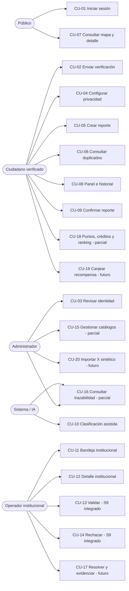

### 19.2 Arquitectura lógica

Muestra la frontera navegador/backend y las dependencias. El BFF sólo interviene en sesión.

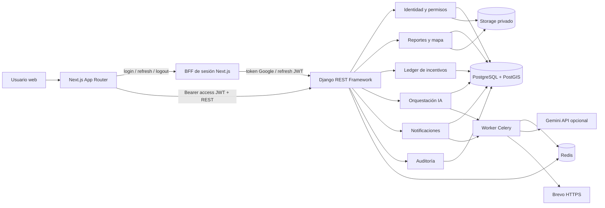

### 19.3 Arquitectura de despliegue

Refleja el despliegue técnico observado; no implica adopción institucional ni SLA.

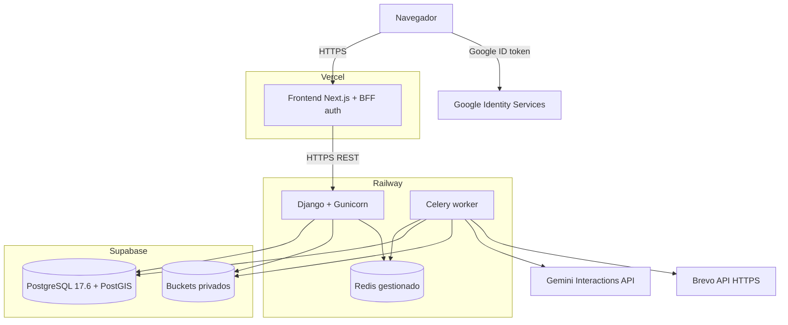

### 19.4 Componentes backend

Resume responsabilidades sin afirmar que los módulos esqueleto estén completos.

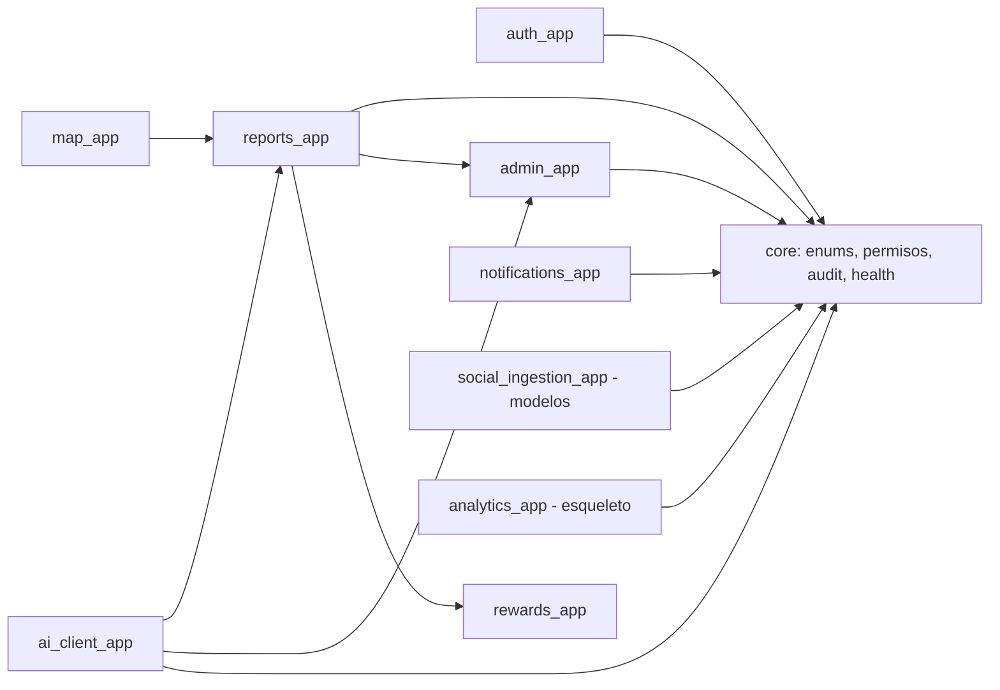

La flecha indica dependencia conceptual/importación principal, no una enumeración exhaustiva. Revisar este dibujo si cambian las fronteras antes de entregar la tesis.

### 19.5 DER conceptual actualizado

Incluye las 18 entidades de dominio. Los campos se reducen a claves conceptuales; constraints y campos completos pertenecen al diccionario.

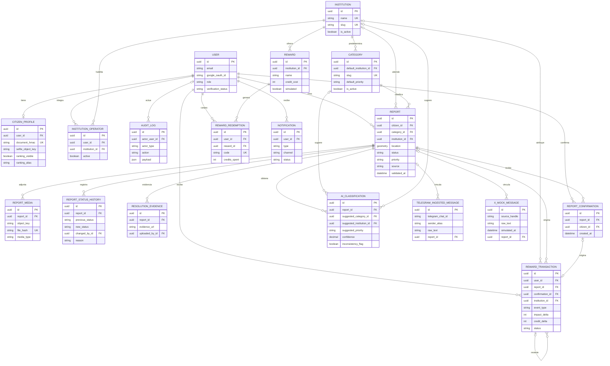

Las dos entidades sociales conservan una FK opcional a `Report`, pero no existe pipeline funcional que cree o procese esa relación. `TELEGRAM_INGESTED_MESSAGE` debe retirarse técnicamente en S13 según la decisión vigente.

### 19.6 Estados de `Report`

Las etiquetas “S9 integrado” y “futuro” separan las transiciones operativas de las todavía proyectadas.

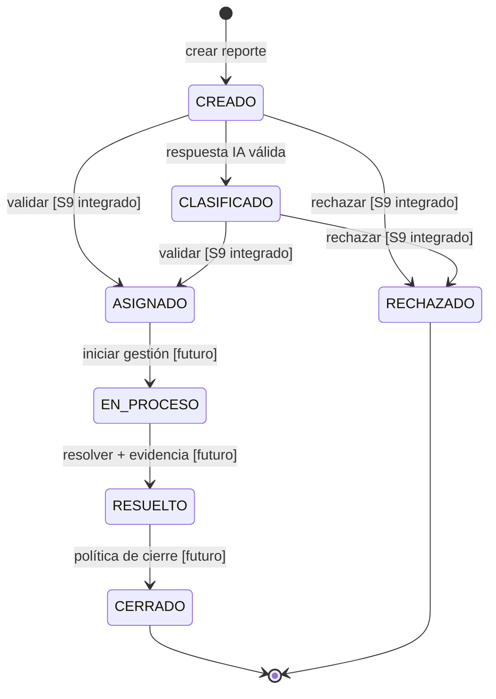

Una salida IA inválida no produce transición. La confirmación tampoco cambia estado.

### 19.7 Secuencia — crear reporte

```mermaid
sequenceDiagram
    actor C as Ciudadano verificado
    participant F as Frontend
    participant A as API Django
    participant S as Storage privado
    participant D as PostgreSQL
    participant Q as Redis/Celery

    opt Consulta previa
        F->>A: GET posibles duplicados
        A->>D: consulta PostGIS por categoría/radio
        D-->>A: hasta 5 candidatos
        A-->>F: respuesta minimizada
    end
    C->>F: descripción + categoría + foto + ubicación
    F->>A: POST /api/v1/reports/
    A->>A: autenticar, validar y normalizar foto
    A->>S: subir objeto privado
    S-->>A: object key
    A->>D: BEGIN; reporte + media + historia + 20/20 + audit
    alt persistencia correcta
        D-->>A: COMMIT
        A->>Q: on_commit: invalidar caché y encolar IA
        A-->>F: 201 CREADO
    else fallo de base
        D-->>A: ROLLBACK
        A->>S: compensar objeto subido
        A-->>F: error controlado
    end
```

El POST no tiene clave de idempotencia explícita; no dibujar retry automático del cliente.

### 19.8 Secuencia — confirmar reporte

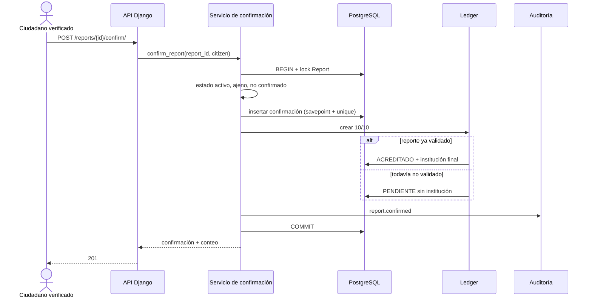

### 19.9 Secuencia — clasificar con IA

```mermaid
sequenceDiagram
    participant Q as Celery
    participant O as Orquestación
    participant D as PostgreSQL
    participant S as Storage privado
    participant G as Gemini API

    Q->>O: classify_report(report_id)
    O->>O: resolver runtime (flag + clave + modelo)
    O->>D: leer sólo si CREADO
    O->>S: descargar primera foto
    O->>G: contrato allowlist + imagen inline, store=false
    G-->>O: texto JSON
    O->>O: parser estricto + política
    alt respuesta inválida o fallo no persistible
        O-->>Q: false / error controlado; conserva CREADO
    else respuesta válida
        O->>D: BEGIN + lock Report + segunda guarda
        alt sigue CREADO
            O->>D: AiClassification + CLASIFICADO + history + audit
            opt elegible para aplicación automática
                O->>D: categoría + institución + prioridad sugeridas
            end
            O->>D: COMMIT
        else otra operación ya lo movió
            O->>D: ROLLBACK sin persistir resultado
        end
    end
```

### 19.10 Secuencia — consulta institucional S9-A

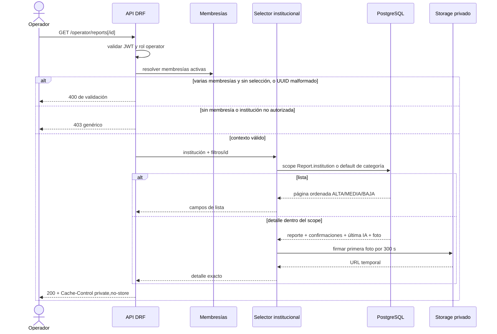

Para detalle inexistente o fuera de scope el resultado es el mismo 404; añadir ese alternativo al diagrama renderizado si el espacio lo permite.

### 19.11 Secuencia — validar institucionalmente (S9-B1/B2 integrado)

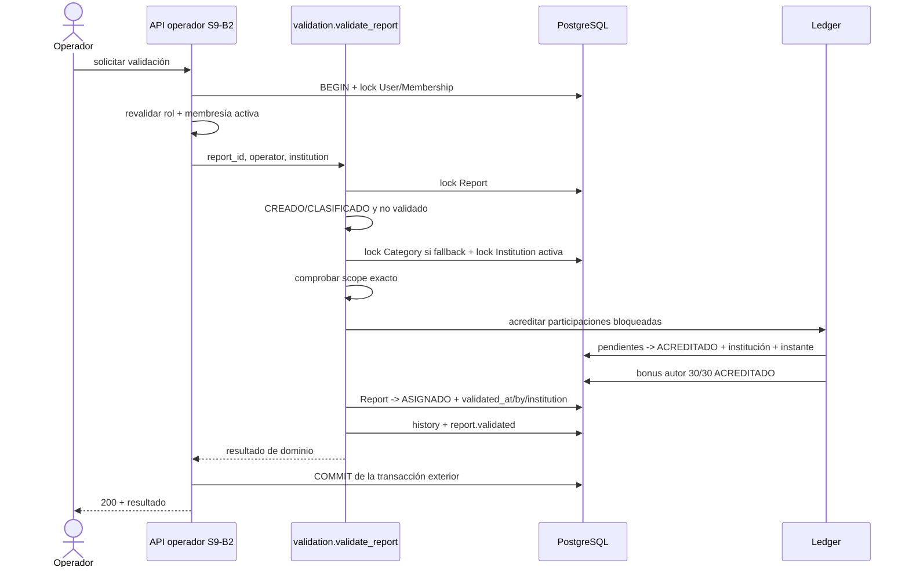

### 19.12 Secuencia — rechazar institucionalmente (S9-B1/B2 integrado)

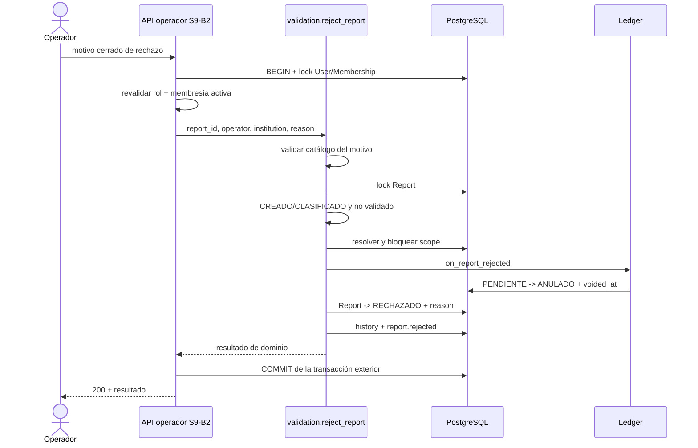

### 19.13 Secuencia — resolver reporte (implementación S10 no desplegada)

Este diagrama resume la implementación local del contrato `ACCEPTED` en ADR-0013. Las APIs, la
evidencia privada, el autocierre y el ledger existen en la rama S10, pero no fueron desplegados.

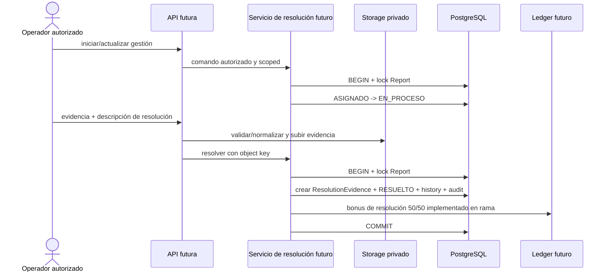

ADR-0013 cierra autorización, formatos, compensación de Storage, transición de cierre, idempotencia
e interacción con reversión. El diseño está implementado y verificado localmente en la rama S10;
el diagrama no constituye evidencia de integración o despliegue productivo.

### 19.14 Ciclo del ledger

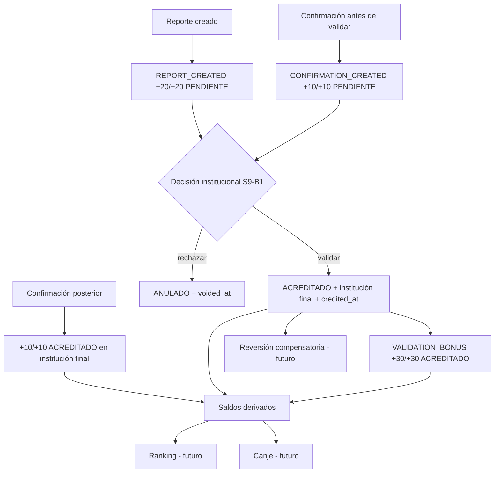

### 19.15 Flujo de auditoría y trazabilidad

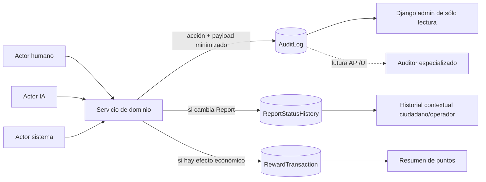

`AuditLog`, historia y ledger tienen propósitos diferentes y deben conservarse correlacionables por IDs, no fusionarse.

### 19.16 Concurrencia — confirmar versus validar

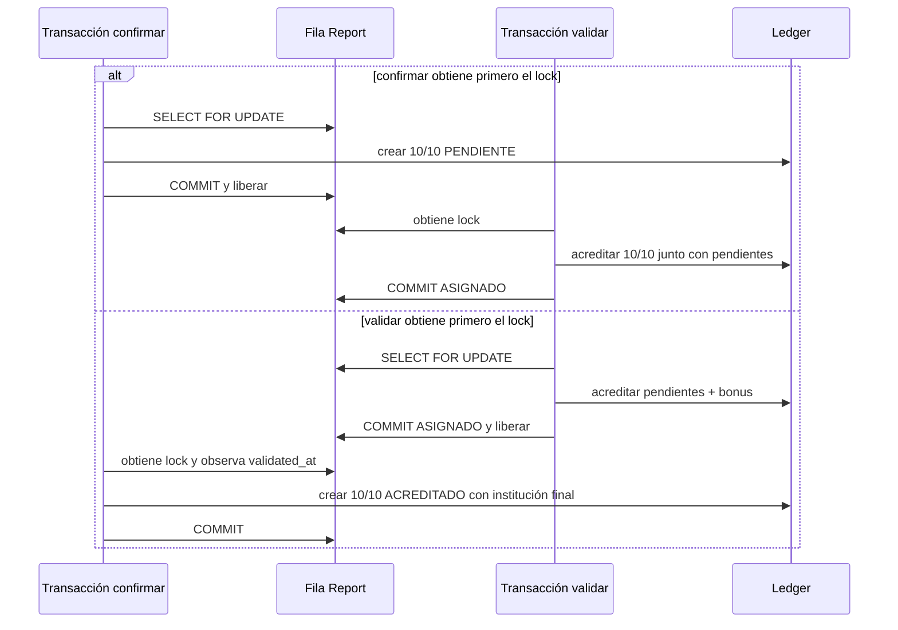

En ambos órdenes, la postcondición es que la confirmación exista una vez y no quede pendiente después de una validación completada.

## 20. Anexos actuales

La tesis revisada contiene ocho anexos. **Todos requieren actualización; ninguno debe copiarse sin conciliación.**

| Anexo existente | Objetivo actualizado | Cambios necesarios | Fuentes del repositorio | Automatizable / manual | Prioridad |
|---|---|---|---|---|---|
| **A. Diseño completo de la base de datos** | Documentar las 18 entidades, relaciones, constraints e índices reales. | Sustituir SQL/DER histórico; PostgreSQL 17.6 y PostGIS; agregar campos IA, identidad, privacidad, ledger y estados; marcar tablas sin servicio. | `backend/apps/*/models.py`, migraciones, `docs/DICCIONARIO_DATOS.md`, §10/19.5. | DER base automatizable desde Mermaid; revisión de cardinalidades/constraints manual. | P1 |
| **B. Especificación detallada de la API REST** | Describir únicamente endpoints existentes y contratos verificables. | Incorporar mapa/detalle, reportes/confirmación y consulta/decisión institucional S9; actualizar permisos, errores, throttles y ejemplos sin secretos. | `backend/config/urls.py`, `apps/*/urls*.py`, serializers/views, `docs/API.md`. | Inventario parcialmente automatizable; ejemplos/códigos y seguridad manual. | P1 |
| **C. Diagramas técnicos complementarios y wireframes** | Reunir arquitectura, componentes, DER, estados y secuencias vigentes. | Auditar/reemplazar los ocho diagramas y cuatro wireframes PNG embebidos que anticipan capacidades; renderizar Mermaid de §19; crear capturas reales de pantallas existentes y marcar futuros. | PNG internos del DOCX, §19, `frontend/src/app/`, `frontend/src/features/`. | Mermaid automatizable; no hay fuente editable de los PNG; capturas/wireframes requieren revisión manual. | P1 |
| **D. Casos de uso detallados** | Especificar el catálogo CU-01–CU-20 propuesto. | Renumerar, separar consulta/validación/rechazo, ampliar auditoría, retirar Telegram y marcar X/resolución/canje futuros. | §8; RF/RN; vistas/servicios/tests. | Tabla/fichas parcialmente automatizables; validación académica manual. | P1 |
| **E. Roadmap, backlog MVP y análisis de riesgos** | Reflejar el estado por integración y las dependencias restantes. | Corregir S8/R2/CA-4 y S9-A/B1/B2/B3; agregar riesgos de proveedor, pipeline, backups, reversión, privacidad y deuda documental. | `docs/PLAN_DESARROLLO.md`, `BACKLOG.md`, `PROGRESO_SPRINTS.md`, PR/commits. | Resumen automatizable; fechas/propietarios/riesgo residual manuales. | P1 |
| **F. Cronograma semanal del trabajo** | Mostrar plan, ejecución real y desvíos. | Unificar ventana 01/08–15/11/2026 con fechas reales; no conservar “primer/segundo trimestre” incompatible; actualizar hitos S8/S9. | `docs/Cronograma_Ciudadania_Activa_Anexo_F.docx`, `PROGRESO_SPRINTS.md`, CT-27/29. | Manual por valor académico y firmas/fechas. | P1 |
| **G. Cuestionario completo de encuesta ciudadana** | Preservar instrumento y evidencia empírica. | Verificar versión administrada, muestra, consentimiento, fechas y resultados; separar preguntas previstas de datos recogidos. No inferir respuestas del sistema. | DOCX revisado y artefactos de encuesta que aporte el equipo. | Manual; requiere fuente primaria y control ético. | P1 |
| **H. Dataset sintético, prompts IA, plan de pruebas y resultados esperados** | Versionar dataset, contrato/prompts y evidencia experimental/técnica. | Corregir seis campos y slugs; distinguir fake/R1/R2; marcar R2 no ejecutado y CA-4 no demostrado; actualizar métricas CI y ausencia de carga. | `backend/apps/ai_client_app/evaluation/`, `prompts/`, `contracts.py`, workflows y §12/16. | Dataset/tablas parcialmente automatizables; resultados sólo tras ejecución controlada. | P1 |

### Cobertura de materiales pedidos dentro de los anexos existentes

- DER, modelo/diccionario de datos: Anexo A.
- API/endpoints: Anexo B.
- arquitectura lógica/física, componentes, secuencias, estados, wireframes y capturas: Anexo C.
- catálogo y fichas de CU: Anexo D.
- roadmap/riesgos/trabajo futuro: Anexo E.
- calendario: Anexo F.
- instrumento/resultados de encuesta: Anexo G.
- IA, dataset, pruebas y resultados técnicos/experimentales: Anexo H.

## 21. Anexos nuevos requeridos

Se recomiendan **seis anexos nuevos**. Si la facultad limita el número, pueden integrarse como subsecciones de A–H sin perder el contenido indicado.

| Nuevo anexo | Objetivo | Contenido mínimo | Fuente | Automatizable / captura-manual | Prioridad |
|---|---|---|---|---|---|
| **I. Catálogo consolidado de RF, RNF, RN y trazabilidad** | Dar una única referencia normativa y vincularla con objetivos/CU/evidencia. | Tablas de §5–8 y §23; estados al corte; equivalencias con IDs antiguos; criterios de aceptación. | Este documento, código/tests citados. | Tablas reutilizables; revisión de numeración y formato institucional manual. | P1 |
| **J. Integridad, ledger, auditoría y concurrencia** | Explicar las decisiones transaccionales que ahora forman parte sustantiva del prototipo. | Eventos/deltas/estados; fórmulas; locks/orden; carreras; rollback; payloads; limitaciones; diagramas 19.14–19.16. | Servicios/modelos/tests de reports/rewards/core, ADR-0004/0010/0013. | Texto/diagramas parcialmente automatizables; evidencia de DB/CI manual. | P1 |
| **K. Registro de decisiones arquitectónicas** | Preservar por qué se eligieron tecnologías/políticas y qué cambió. | Índice de 15 ADR, resumen/estado/impacto; ADR-0013 `ACCEPTED` e implementada localmente en S10; discrepancias pendientes. | `docs/adr/`, §18. | Índice automatizable; síntesis y aprobación manual. | P2 |
| **L. Evidencias técnicas, CI/CD y despliegue** | Separar resultados reproducibles de afirmaciones generales. | Commits/runs/jobs; versiones; resultados de tests; deployments; health; matriz de evidencia; redacción de datos sensibles; fecha de corte. | `.github/workflows/`, GitHub, Vercel/Railway/Supabase y §16/17. | Metadatos parcialmente automatizables; capturas y redacción manual. | P1 |
| **M. Manual de usuario del prototipo** | Permitir reproducir los flujos realmente disponibles. | Login, verificación, mapa, crear, duplicados, panel, historial, confirmar y revisión admin; roles/precondiciones/errores. Flujos de operador futuros separados. | `frontend/src/app/`, `features/`, API y pruebas E2E. | Texto base reutilizable; capturas y validación de recorrido manual. | P2 |
| **N. Manual técnico de instalación, despliegue y operación** | Hacer reproducible el entorno sin revelar secretos. | Requisitos, variables por nombre, Docker, migraciones, worker, seeds, tests, backup/restore, deployment, troubleshooting y límites operativos. | `README.md`, `.env.example`, Dockerfiles/Compose, workflows, ADR-0003/0015. | Comandos base reutilizables; paneles/capturas/checklists manuales. | P2 |

Auditoría, seguridad, IA y ledger no necesitan cuatro anexos aislados adicionales si quedan tratados con profundidad en J, H, K y N. Evitar duplicación: el capítulo principal explica la decisión; el anexo conserva especificación/evidencia.

## 22. Anexos obsoletos

### 22.1 Anexos completos a retirar

**Ninguno de los ocho anexos completos debe retirarse**: todos siguen cumpliendo una función académica, aunque deben reescribirse. Conteo de anexos completos obsoletos: **0**.

### 22.2 Contenido obsoleto que sí debe eliminarse o reemplazarse

1. Flujos, diagramas y fichas de **Telegram** como parte del MVP; conservar sólo una nota de decisión descartada.
2. Cualquier integración **real** con X, hashtag `#ReportePY`, OAuth, scraping, Zapier o Make; reemplazar por X sintético futuro.
3. Arquitecturas con Flask, Cloudflare, FCM, SMTP, Celery Beat, Flower o PWA como componentes implementados.
4. DER/SQL con `institution_categories`, balances almacenados, estado `VALIDADO`, prioridad `CRÍTICA` o campos IA anteriores al modelo actual.
5. API que anuncie validar, rechazar, resolver, ranking o canje como endpoints existentes.
6. Prompt que pida nombres libres o `hubo_cambio`; reemplazar por slugs cerrados y `has_changes` derivado.
7. Resultados esperados o valores de fake presentados como resultado de Gemini/producción.
8. Diagramas/wireframes rasterizados y sin fuente editable independiente que mezclan presente y futuro; reemplazarlos por renderizados versionados/revisados.

## 23. Matriz de trazabilidad

Los textos oficiales de OE-1 a OE-6 son los transcritos literalmente en §4.3. La matriz usa esos IDs para no repetir párrafos extensos, sin alterar su formulación.

| Objetivo | RF | CU | Módulo | Tests/evidencia | Estado de trazabilidad |
|---|---|---|---|---|---|
| Objetivo general | RF-01–36 según alcance | CU-01–20 | Monorepo completo | CI, deployments y anexos; encuesta/evaluación aún separadas | 🟡 Viabilidad técnica parcial; no cumplimiento integral demostrado. |
| OE-1 — caracterización empírica ciudadana | No es satisfecho por un RF de software; RF-07/16/29 reflejan conceptos encuestables | CU-04, CU-09, CU-18/19 | Instrumento académico | Anexo G y dataset/resultados primarios requeridos | ⚠️ No evaluar desde el repositorio. |
| OE-2 — identificar/caracterizar requisitos | RF-01–36; RNF-01–21; RN-01–50 | CU-01–20 | Documentación + dominios | §5–8, tests, `docs/CAMBIOS_TESIS_PENDIENTES.md` | ✅ Catálogo propuesto; requiere aprobación académica. |
| OE-3 — diseñar arquitectura, datos, asincronía, interfaces y seguridad | RF-01–24, RF-33; RNF-01–12/18/21 | CU-01–16 | frontend, config, auth/admin/reports/map/AI/notifications/core | Modelos/migraciones, ADR-0001/2/3/5–9/14/15, CI | ✅ diseño y amplia implementación; escalabilidad ⚠️ no medida. |
| OE-4 — módulo de incentivos | RF-07, RF-16, RF-25–32 | CU-04, CU-05, CU-09, CU-13/14, CU-18/19 | `rewards_app`, reportes y perfil | Tests de ledger/modelos/confirmación/S9-B1; ADR-0004/10/11 | 🟡 creación, confirmación y efectos de validación/rechazo integrados; consulta/ranking/canje incompletos. |
| OE-5 — implementar prototipo frontend/backend/geoespacial/asíncrono/IA API | RF-01–28, RF-33 | CU-01–16 | frontend, Django apps, PostGIS, Celery/Redis, Gemini adapter | CI + deployments; S8 tests; S9-A | 🟡 Componentes presentes; proveedor canónico y ciclo institucional completo faltan. |
| OE-6 — validar técnicamente con unitarias/integración/carga/E2E/dataset sintético | Todos los RF implementados | CU implementados | suites backend/frontend/evaluation | 1.807 backend, 341 Vitest, 48 Playwright; dataset de 28 casos | 🟡 Unitarias/integración/concurrencia/E2E sintético sí; carga y R2 no. |
| OE-2/OE-5 — identidad y acceso | RF-01–08 | CU-01–04, CU-15 | `auth_app`, `admin_app`, frontend auth/identity | tests auth/admin/frontend; ADR-0005/6/14/15 | ✅ salvo ranking funcional. |
| OE-2/OE-5 — participación geoespacial | RF-09–16 | CU-05–09 | `reports_app`, `map_app`, frontend map/reports | tests API/servicio/privacidad/geo/E2E | ✅ para flujos indicados. |
| OE-3/OE-5 — clasificación asistida | RF-17 | CU-10 | `ai_client_app`, Celery, Storage | parser/policy/adapter/orchestration/retry/evaluation tests | 🟡 implementación técnica; desempeño ⚠️. |
| OE-3/OE-5 — operación institucional | RF-18–24, RF-30/31 | CU-11–17 | `reports_app`, `core`, `rewards_app` | pruebas S9-A/B1/B2 | 🟡 lectura y decisión integradas; resolución futura. |
| OE-3/OE-4 — integridad y trazabilidad | RF-22–27 | CU-13/14/16 | validation, ledger, audit, history | pruebas de carrera/rollback/constraints | ✅ alcance de decisión de Sprint 9 integrado. |

Antes de la entrega final, cada fila debe vincularse a un identificador de prueba/evidencia estable en el Anexo L; no basta una captura sin commit/fecha.

## 24. Discrepancias detectadas

### 24.1 Matriz de discrepancias

| ID | Qué dice o implica la documentación | Qué hace/demuestra el sistema | Fuente que debe prevalecer | Cambio exigido | Severidad |
|---|---|---|---|---|---|
| D-01 | `docs/AI_CLASSIFICATION_CONTRACT.md` y ADR-0009 indican que JSON inválido crea placeholder y avanza a `CLASIFICADO`. | `orchestration.py` captura `ClassificationParseError`, no escribe clasificación/historia/audit y deja `CREADO`; tests lo fijan. | Código + tests actuales. | Reescribir contrato/ADR/tesis o decidir e implementar otro comportamiento en una tarea aparte. | **CRÍTICA** |
| D-02 | La tesis revisada describe validación/rechazo y efectos como parte del flujo funcional. | S9-B1/B2 están integrados con dominio, API y UI. | `origin/main`, PR #35/#37 y pruebas. | Presentar el alcance S9 como integrado sin extenderlo a resolución/reversión. | **RESUELTA** |
| D-03 | Incentivos se narran como módulo completo con créditos, ranking, canje, resolución y reversión. | Creación/confirmación/acreditación/anulación funcionan; consulta/ranking/canje/resolución/reversión no tienen servicio completo. | `rewards_app/services/ledger.py`, modelos/tests. | Dividir implementado/parcial/diseñado y retirar claims de operación completa. | **CRÍTICA** |
| D-04 | Resultados esperados de IA/validación pueden leerse como alcanzados al redactar conclusiones. | R2 es `NOT_EXECUTED`, R1 `ABORTED` sin evidencia completa y CA-4 `NOT_DEMONSTRATED`. | `evaluation/README.md`, `recovery.py`, evidencia de ejecución. | Mantener en hipótesis/criterio pendiente; no publicar porcentaje/benchmark. | **CRÍTICA** |
| D-05 | Tesis: PostgreSQL 15. | Entorno documentado: Supabase PostgreSQL 17.6/PostGIS 3.3.7; local/CI PostGIS 17-3.5. | ADR-0003, workflows/Compose. | Corregir versiones y explicar diferencia de entorno. | **ALTA** |
| D-06 | Anexo B contiene una API histórica/completa. | `docs/API.md` y rutas incluyen consulta/validate/reject de S9; no existen HTTP de resolución/ranking/canje. | `urls*.py`, views/serializers/tests. | Regenerar Anexo B y marcar las rutas restantes como futuras. | **ALTA** |
| D-07 | `docs/DICCIONARIO_DATOS.md` presentaba `justification`/`model_name` y su migración como futuros. | Ambos campos y la migración 0002 existen; el diccionario fue corregido en `c99e769b`. | Modelo/migración IA. | Corrección aplicada; conservar el DER alineado con el modelo actual. | **RESUELTA** |
| D-08 | El tracker podía mantener estados anteriores de S9. | S9-A/B1/B2/B3 y ADR-0010 están en `main`; R2 continúa prerregistrado/no ejecutado. | Git remoto/commits/PR. | Mantener el cierre S9 sin convertir R2 en ejecutado. | **RESUELTA** |
| D-09 | Telegram aparece como caso/componente y el modelo todavía existe. | Decisión D-04/CT-43 lo retira; no hay pipeline. | Decisión vigente + ausencia de implementación. | Retirar de alcance/CU/diagramas; dejar nota histórica y futura migración de eliminación. | **ALTA** |
| D-10 | X/#ReportePY/Zapier/Make puede aparecer como integración. | Sólo existe `XMockMessage`; sin loader, API, tarea o proveedor real. | `social_ingestion_app/models.py` y árbol de código. | Describir exclusivamente simulación futura. | **ALTA** |
| D-11 | Flujos antiguos pueden incluir estado `VALIDADO` o transición libre. | No existe `VALIDADO`; validar lleva a `ASIGNADO`; sólo creación, clasificación, validación y rechazo tienen servicios actuales. | enums + servicios/tests. | Sustituir tabla/diagrama de estados. | **ALTA** |
| D-12 | Arquitectura/UI sugiere ranking y rewards completos. | La UI de operador S9 existe; no hay páginas de ranking/recompensas. | `frontend/src/app/`. | Actualizar operador y marcar las interfaces de incentivos como futuras. | **ALTA** |
| D-13 | Alcance: “no se contempla despliegue productivo”. | Existen deployments técnicos Vercel/Railway/Supabase, sin implantación institucional. | evidencia de deployment + ADR-0003. | Reformular “despliegue técnico del prototipo, no operación institucional”. | **ALTA** |
| D-14 | Anexo H solicita `hubo_cambio`, nombres libres y puede incluir prioridad crítica. | Contrato usa seis campos, slugs cerrados, deriva `has_changes` y sólo admite BAJA/MEDIA/ALTA. | `contracts.py`, `policy.py`, `core/enums.py`. | Reemplazar prompt/schema/dataset del anexo. | **ALTA** |
| D-15 | La cantidad de módulos se presenta ambiguamente como diez dominios. | Son nueve apps de dominio + `core` transversal; dos están inmaduras. | `INSTALLED_APPS`, árbol backend, ADR-0002. | Corregir figura/texto y madurez. | **MEDIA** |
| D-16 | Frontend se denomina PWA. | No hay manifest, service worker ni configuración PWA. | `frontend/next.config.ts`, árbol frontend. | Usar “aplicación web responsive”; PWA sólo futuro. | **MEDIA** |
| D-17 | Arquitecturas históricas listan Cloudflare, FCM, Beat, Flower, k6/estructured logging. | No se encontró implementación/configuración; sí worker Celery, Redis y Brevo. | código/config/workflows. | Eliminar como actual; pasar a recomendación cuando proceda. | **MEDIA** |
| D-18 | Seguridad puede atribuir RLS, revocación de refresh o controles absolutos de PII. | Autorización es Django; no hay RLS verificado ni blacklist; raw IA puede repetir texto. | settings, permisos, servicios. | Documentar controles y límites exactos. | **MEDIA** |
| D-19 | Sección 3.4 ubica encuesta/desarrollo en primer/segundo trimestre 2026. | Cronograma F fija 01/08–15/11/2026 y progreso registra fechas reales. | cronograma + Git/progreso. | Unificar plan/real y explicar desvíos. | **MEDIA** |
| D-20 | Auditoría puede describirse como total/inmutable y CU-08 sólo IA. | Cobertura es explícita/parcial; admin read-only, sin protección criptográfica; múltiples dominios generan eventos. | modelo/servicio/audit calls. | Ampliar alcance y calificar garantía. | **MEDIA** |
| D-21 | Un pasaje de ADR-0003 sugiere fotos públicas firmadas. | ADR-0007/código/config usan bucket privado y URL temporal a autorizados. | ADR-0007 + storage services. | Homogeneizar “privado”. | **MEDIA** |
| D-22 | Cifras históricas de tests/E2E podrían presentarse como corte actual o full-stack. | Corte S9-B2: 1.807 backend, 341 Vitest y 48 Playwright; E2E usa interceptación. | logs CI + specs/workflows. | Actualizar tabla y declarar alcance de cada suite. | **MEDIA** |
| D-23 | El DOCX incorpora figuras como evidencia visual vigente. | Contiene 13 PNG internos (logotipo, ocho diagramas y cuatro wireframes), pero no fuentes editables independientes; varios muestran PostgreSQL 15, Beat/FCM o ranking/canje/resolución como presentes. | Inspección del paquete DOCX + código. | Reemplazar/rotular por estado, renderizar §19 y conservar fuente editable/versionada. | **BAJA** |
| D-24 | Declaración de herramientas de asistencia puede quedar limitada a una herramienta histórica. | El historial/documentación menciona distintas asistencias; esta actualización también fue producida con Codex. | historial Git y declaración metodológica del equipo. | Declarar con transparencia las herramientas efectivamente usadas, su función y revisión humana, sin atribuir autoría técnica falsa. | **BAJA** |

### 24.2 Conteo por severidad

| Severidad | Cantidad |
|---|---:|
| CRÍTICA | **3** |
| ALTA | **8** |
| MEDIA | **8** |
| BAJA | **2** |
| RESUELTA | **3** |
| **Total** | **24** |

> **HALLAZGO TÉCNICO — contrato IA:** D-01 no se corrigió durante esta auditoría porque la única modificación autorizada es este documento. Hasta que el proyecto decida si cambia la documentación o el servicio, el comportamiento normativo para describir el prototipo es el fijado por `orchestration.py` y sus pruebas.
>
> **HALLAZGO TÉCNICO — autorización institucional integrada:** `validate_report()` y `reject_report()` protegen las invariantes de dominio; la API S9-B2 bloquea y revalida el usuario y la membresía activa antes de invocarlos. Las pruebas cubren revocaciones concurrentes de rol/membresía sin mutación parcial.
>
> **HALLAZGO TÉCNICO — coordenadas en query string:** la consulta autenticada de posibles duplicados recibe `lat`/`lng` exactos por `GET`. Aunque la respuesta es privada, `no-store` y minimizada, una URL puede quedar en logs de navegador, proxy o infraestructura. Conviene evaluar en una tarea futura un cuerpo `POST` o redacción explícita de query strings. Fuente: `backend/apps/reports_app/views.py`, `serializers.py`; no se modificó el endpoint en esta auditoría.

## 25. Lista exacta de cambios para Guadalupe

### PRIORIDAD 1 — OBLIGATORIO

- [ ] **Agregar en la portada metodológica o al inicio del capítulo técnico un corte de versión.**

  - **Dónde:** introducción del prototipo y capítulo de resultados técnicos.
  - **Motivo:** fijar exactamente el estado integrado que sustenta las afirmaciones.
  - **Contenido nuevo:** fecha de corte, `origin/main=730d69e` y S9-A/B1/B2/B3 integrados; S9-B3 mediante merge `7e95856c`.
  - **Fuente:** §1; Git; `docs/PROGRESO_SPRINTS.md` sólo como historia.
  - **Diagrama/anexo/captura:** actualizar Anexo E; captura del PR/checks opcional y redactada.

- [ ] **Conservar los objetivos textuales y corregir su grado de cumplimiento.**

  - **Dónde:** objetivos, resultados y conclusiones.
  - **Motivo:** ranking/canje/carga/benchmark no permiten afirmar cumplimiento total de OE-4/OE-6.
  - **Contenido nuevo:** textos exactos de §4.3 y evaluación parcial por objetivo de §23.
  - **Fuente:** `docs/Tesis_Ciudadania_Activa_Revisada_Recompensas.docx`, §4.3 y §23.
  - **Diagrama/anexo/captura:** Anexo I; no requiere captura.

- [ ] **Reformular el alcance de despliegue.**

  - **Dónde:** alcance, infraestructura, limitaciones y conclusión.
  - **Motivo:** “sin despliegue productivo” contradice Vercel/Railway/Supabase, pero “en producción institucional” excedería la evidencia.
  - **Contenido nuevo:** “despliegue técnico de prototipo; sin implantación institucional, usuarios públicos sostenidos ni SLA”.
  - **Fuente:** ADR-0003, `README.md`, deployments del merge `4ecf5023` y §11.5/17.
  - **Diagrama/anexo/captura:** diagrama 19.3; Anexo L; capturas de deployment/health sin secretos.

- [ ] **Reescribir por completo la descripción de IA.**

  - **Dónde:** marco teórico, metodología, arquitectura, capítulo IA, resultados, Anexo H.
  - **Motivo:** evitar ML propio, autoridad automática o métricas inexistentes y resolver D-01.
  - **Contenido nuevo:** adapter Gemini Interactions API, allowlist, seis campos, parser/policy, umbral 0,75, `store=False`, doble guarda/lock, humano en circuito, fallos y auditoría; R2 no ejecutado y CA-4 no demostrado.
  - **Fuente:** `backend/apps/ai_client_app/`, ADR-0008/0009, `evaluation/README.md`, §12.
  - **Diagrama/anexo/captura:** diagramas 19.9 y 19.15; actualizar Anexo H; no capturar un “resultado” inexistente.

- [ ] **Corregir el contrato de respuesta IA inválida.**

  - **Dónde:** contrato técnico, estados, secuencia IA, limitaciones y ADR comentado.
  - **Motivo:** docs dicen placeholder/`CLASIFICADO`; código/tests dejan `CREADO` sin filas.
  - **Contenido nuevo:** comportamiento vigente de D-01 y nota de decisión pendiente.
  - **Fuente:** `backend/apps/ai_client_app/orchestration.py`, tests de orquestación, `docs/AI_CLASSIFICATION_CONTRACT.md`.
  - **Diagrama/anexo/captura:** Anexo H y diagrama 19.9; sin captura.

- [ ] **Sustituir el catálogo y diagrama de estados.**

  - **Dónde:** requisitos, reglas, casos institucionales, capítulo de datos y Anexo C/D.
  - **Motivo:** no existe estado `VALIDADO`; varias transiciones son sólo diseño.
  - **Contenido nuevo:** siete estados; transiciones y estados de evidencia de §9; validación como evento que produce `ASIGNADO`.
  - **Fuente:** `backend/apps/core/enums.py`, modelos y servicios.
  - **Diagrama/anexo/captura:** renderizar 19.6; actualizar A, C y D.

- [ ] **Separar consulta institucional, validación y rechazo.**

  - **Dónde:** requisitos/CU, arquitectura, API, resultados y roadmap.
  - **Motivo:** S9 separa lectura institucional de decisiones humanas, aunque comparten el mismo scope efectivo.
  - **Contenido nuevo:** contratos de RF-18–22/CU-11–14, filtros, foto temporal, motivos/conflictos y autorización transaccional.
  - **Fuente:** `operator_views.py`, `operator_serializers.py`, `selectors.py`, `services/validation.py`, tests.
  - **Diagrama/anexo/captura:** diagramas 19.10–19.12; Anexos B/D/J; capturas de la bandeja y el detalle implementados.

- [ ] **Reescribir puntos/créditos y marcar su madurez.**

  - **Dónde:** objetivo 4, marco teórico, requisitos, modelo de datos, resultados y Anexo A/H.
  - **Motivo:** el documento mezcla dos dimensiones y presenta funciones futuras como completas.
  - **Contenido nuevo:** tabla §13.2; pendiente/acreditado/anulado/revertido; 20/20, 10/10, 30/30; institución final, autor nulo, fórmulas e invariantes; resolución/reversión/ranking/canje futuros.
  - **Fuente:** `rewards_app/models.py`, `services/ledger.py`, ADR-0004/0010/0011, pruebas.
  - **Diagrama/anexo/captura:** 19.14; Anexos A/J; evidencia CI, no saldo UI inexistente.

- [ ] **Actualizar los requisitos, reglas y casos de uso con IDs consistentes.**

  - **Dónde:** sección de especificación y Anexo D/I.
  - **Motivo:** listas históricas de 9/18 CU no reflejan sesión BFF, privacidad, duplicados, panel, S9 ni retiro de Telegram.
  - **Contenido nuevo:** §5–8, más tabla de equivalencias; conservar estado de cada CU.
  - **Fuente:** vistas/servicios/tests y §5–8.
  - **Diagrama/anexo/captura:** 19.1; Anexos D/I; sin captura obligatoria.

- [ ] **Regenerar el modelo de datos y corregir el diccionario.**

  - **Dónde:** capítulo de DB, Anexo A y `docs/DICCIONARIO_DATOS.md` al hacer la actualización documental general.
  - **Motivo:** versión PostgreSQL y campos IA están atrasados; esquema no equivale a funcionalidad.
  - **Contenido nuevo:** 18 entidades, cardinalidades/constraints, `Point(4326)`, nullable relevantes, ledger derivado y modelos residuales/futuros.
  - **Fuente:** todos los `models.py` y migraciones, ADR-0003/0004, §10.
  - **Diagrama/anexo/captura:** renderizar 19.5; revisar manualmente claves/cardinalidades; captura de esquema sólo si aporta.

- [ ] **Regenerar la especificación de API.**

  - **Dónde:** capítulo de interfaces y Anexo B.
  - **Motivo:** el anexo histórico no coincide con rutas actuales y puede anticipar endpoints.
  - **Contenido nuevo:** tabla §11.4 con métodos, permisos, parámetros, respuestas, errores/throttles/cache; ausencia explícita de validación/rechazo HTTP.
  - **Fuente:** `backend/config/urls.py`, `apps/*/urls*.py`, views/serializers, `docs/API.md`.
  - **Diagrama/anexo/captura:** Anexo B; ejemplos reproducibles redactados; sin Swagger inexistente.

- [ ] **Retirar Telegram y toda afirmación de integración real con X.**

  - **Dónde:** alcance, arquitectura, CU, DER, roadmap y trabajo futuro.
  - **Motivo:** D-04/CT-43 cambió el alcance y sólo quedan modelos.
  - **Contenido nuevo:** Telegram como decisión descartada; X mock futuro basado en dataset interno; sin OAuth/hashtag/Zapier/Make.
  - **Fuente:** `social_ingestion_app/models.py`, `docs/PROGRESO_SPRINTS.md`, CT-43.
  - **Diagrama/anexo/captura:** retirar nodos activos de C/D; conservar entidades residuales marcadas en A; no captura.

- [ ] **Actualizar resultados y pruebas sin extrapolar.**

  - **Dónde:** metodología, validación, resultados, limitaciones, conclusión y Anexo H/L.
  - **Motivo:** números históricos y E2E interceptado pueden producir claims falsos.
  - **Contenido nuevo:** métricas exactas de §16, entorno de CI, tipos de test, alcance de E2E y lista de ausencias.
  - **Fuente:** `.github/workflows/ci-backend.yml`, `ci-frontend.yml`, logs CI, tests.
  - **Diagrama/anexo/captura:** Anexos H/L; capturas/log extract con commit/run y fecha.

- [ ] **Unificar cronograma planificado y real.**

  - **Dónde:** metodología/sección temporal y Anexo F/E.
  - **Motivo:** primer/segundo trimestre contradice 01/08–15/11/2026.
  - **Contenido nuevo:** plan original, fechas reales verificables, desviaciones y estado S8/S9 al corte.
  - **Fuente:** `Cronograma_Ciudadania_Activa_Anexo_F.docx`, `PROGRESO_SPRINTS.md`, Git.
  - **Diagrama/anexo/captura:** cronograma/Gantt manual actualizado; sin evidencia inventada.

### PRIORIDAD 2 — IMPORTANTE

- [ ] **Reemplazar las figuras de arquitectura.**

  - **Dónde:** arquitectura y Anexo C.
  - **Motivo:** los ocho diagramas PNG embebidos reflejan stack/capacidades históricas y no tienen fuente editable independiente.
  - **Contenido nuevo:** arquitectura lógica, deployment y componentes de §11.
  - **Fuente:** package/requirements/settings/Docker/ADRs.
  - **Diagrama/anexo/captura:** renderizar 19.2–19.4; revisar leyendas/versiones manualmente.

- [ ] **Actualizar seguridad y privacidad con límites explícitos.**

  - **Dónde:** capítulo de seguridad, RNF y manual técnico.
  - **Motivo:** no atribuir RLS, biometría, revocación o protección absoluta inexistentes.
  - **Contenido nuevo:** Google/JWT/BFF, deny-by-default, memberships, HMAC, Storage privado, minimización, CORS/HTTPS/throttles y brechas de §4.12/6.
  - **Fuente:** settings, permisos, auth/admin/map/report services, ADR-0005/6/7.
  - **Diagrama/anexo/captura:** Anexo J/N; capturas de cookies/headers sólo redactadas y si son necesarias.

- [ ] **Agregar una subsección diferenciada de auditoría e historial.**

  - **Dónde:** requisitos, arquitectura, seguridad y Anexo J.
  - **Motivo:** CU histórico limita auditoría a IA y “inmutable” sería demasiado fuerte.
  - **Contenido nuevo:** tabla de acciones §14, actor types, payloads, cobertura ausente y garantía real.
  - **Fuente:** `core/services/audit.py`, `admin_app/models.py`, llamadas `audit.log`.
  - **Diagrama/anexo/captura:** 19.15; captura del admin sólo con datos sintéticos/redactados.

- [ ] **Agregar concurrencia/transacciones como decisión arquitectónica.**

  - **Dónde:** arquitectura detallada, RNF, pruebas y Anexo J.
  - **Motivo:** es comportamiento explícito y evaluado, no detalle incidental.
  - **Contenido nuevo:** agregado Report, orden de locks, tres carreras, rollback, constraints y límites.
  - **Fuente:** `services/validation.py`, `services/confirmations.py`, ledger y tests.
  - **Diagrama/anexo/captura:** 19.16 y secuencias 19.11/12; evidencia CI del test PostgreSQL.

- [ ] **Corregir frontend, PWA y madurez de interfaces.**

  - **Dónde:** arquitectura, implementación, capturas y manual de usuario.
  - **Motivo:** no hay PWA ni páginas operador/ranking/rewards.
  - **Contenido nuevo:** rutas reales de §11.3 y backlog de interfaces faltantes.
  - **Fuente:** `frontend/src/app/`, `frontend/next.config.ts`, package.
  - **Diagrama/anexo/captura:** Anexo C/M; capturar únicamente pantallas existentes.

- [ ] **Actualizar notificaciones e infraestructura asíncrona.**

  - **Dónde:** arquitectura, requisitos, seguridad y deployment.
  - **Motivo:** Brevo HTTPS reemplazó SMTP y no existe FCM/Beat/Flower.
  - **Contenido nuevo:** email de identidad, estado/reenvío manual, worker Celery y tipos futuros.
  - **Fuente:** `notifications_app/`, `config/celery.py`, ADR-0015.
  - **Diagrama/anexo/captura:** 19.2/19.3; Anexo N; captura de estado sólo con destinatario oculto.

- [ ] **Construir la matriz de trazabilidad final con evidencias estables.**

  - **Dónde:** metodología/resultados y Anexo I/L.
  - **Motivo:** vincular objetivos con implementación sin usar cobertura como sustituto.
  - **Contenido nuevo:** §23 y, para cada fila, test/run/commit/fecha o `PENDIENTE DE EVIDENCIA`.
  - **Fuente:** objetivos del DOCX, requisitos/CU y CI.
  - **Diagrama/anexo/captura:** Anexos I/L; capturas sólo como apoyo.

- [ ] **Actualizar roadmap/riesgos y deuda documental.**

  - **Dónde:** limitaciones, trabajo futuro y Anexo E.
  - **Motivo:** el tracker mezcla estados históricos con el corte actual.
  - **Contenido nuevo:** dependencias de §27, D-01, migraciones antes de fin de CI, backups, proveedor, etapas posteriores a S9 y evidencia pendiente.
  - **Fuente:** `PLAN_DESARROLLO.md`, `BACKLOG.md`, `PROGRESO_SPRINTS.md`, §24/27.
  - **Diagrama/anexo/captura:** Anexo E; tablero/Gantt manual opcional.

### PRIORIDAD 3 — MEJORA

- [ ] **Preparar un manual de usuario basado en recorridos reales.**

  - **Dónde:** nuevo Anexo M.
  - **Motivo:** facilitar evaluación/reproducción sin mezclar funciones futuras.
  - **Contenido nuevo:** precondiciones, pasos, resultados, errores y roles para login, identidad, mapa, creación, panel y confirmación.
  - **Fuente:** frontend, API y tests E2E.
  - **Diagrama/anexo/captura:** capturas actuales con datos sintéticos; registrar versión/fecha.

- [ ] **Preparar manual técnico y runbook.**

  - **Dónde:** nuevo Anexo N.
  - **Motivo:** reproducibilidad y operación segura.
  - **Contenido nuevo:** stack/versiones, variables por nombre, Docker, migraciones, worker, CI, backup/restore y troubleshooting.
  - **Fuente:** `README.md`, `.env.example`, Dockerfiles/Compose, workflows y ADR.
  - **Diagrama/anexo/captura:** 19.3; capturas de panel redactadas.

- [ ] **Crear un paquete versionado de diagramas.**

  - **Dónde:** Anexo C y, en una tarea futura autorizada, directorio de fuentes gráficas.
  - **Motivo:** hoy hay PNG embebidos desactualizados, pero no fuente editable independiente; Mermaid en este documento aún no está renderizado.
  - **Contenido nuevo:** 16 diagramas de §19, numeración, leyenda, fuente y estado.
  - **Fuente:** §19 y código citado.
  - **Diagrama/anexo/captura:** exportar SVG/PNG, comprobar accesibilidad y legibilidad impresa.

- [ ] **Revisar glosario y bibliografía técnica.**

  - **Dónde:** marco teórico, glosario y referencias.
  - **Motivo:** incorporar BFF, JWT, HMAC, PostGIS, ledger, lock pesimista, zero-shot, salida estructurada y humano en circuito.
  - **Contenido nuevo:** definiciones neutrales y referencias académicas/oficiales vigentes; no usar ADR como única fuente teórica.
  - **Fuente:** decisiones de este documento; búsqueda bibliográfica separada y citada.
  - **Diagrama/anexo/captura:** no requiere captura.

- [ ] **Convertir accesibilidad, observabilidad y performance en criterios medibles.**

  - **Dónde:** RNF, limitaciones y trabajo futuro.
  - **Motivo:** actualmente son parciales/no demostrados.
  - **Contenido nuevo:** estándar WCAG/nivel, presupuesto de latencia/carga, SLO, logs/métricas/alertas y método de prueba antes de asignar resultados.
  - **Fuente:** RNF-13–19 y futuras evidencias.
  - **Diagrama/anexo/captura:** Anexo E/L/N cuando se ejecuten; hoy marcar pendiente.

- [ ] **Actualizar la declaración de asistencia por herramientas de IA.**

  - **Dónde:** metodología, agradecimientos o declaración exigida por la universidad.
  - **Motivo:** trazabilidad y honestidad académica.
  - **Contenido nuevo:** herramientas realmente utilizadas, tareas realizadas, ausencia de sustitución de evidencia y revisión/autoría humana. Incluir Codex para esta auditoría si se usa su contenido.
  - **Fuente:** historial de trabajo y política institucional aplicable.
  - **Diagrama/anexo/captura:** no requiere captura; revisión humana obligatoria.

## 26. Información que todavía NO debe incorporarse como resultado demostrado

| Afirmación no autorizada | Estado correcto al corte | Evidencia necesaria antes de convertirla en resultado |
|---|---|---|
| “Gemini alcanzó X % de precisión/concordancia.” | R2 no ejecutado; CA-4 no demostrado. | Corrida canónica R2 completa, artefactos íntegros y análisis prerregistrado. |
| “La IA reduce tiempos/mejora clasificación.” | Hipótesis, no resultado causal. | Diseño comparativo y medición válida. |
| “El modelo fue entrenado.” | Falso para esta implementación; es API zero-shot. | Sólo sería válido si aparece un proceso de entrenamiento documentado, hoy inexistente. |
| “El sistema escala a X usuarios/reportes.” | No demostrado. | Prueba de carga reproducible con entorno, dataset, percentiles y límites. |
| “Disponibilidad/SLA de X %.” | No demostrado. | Monitoreo continuo y ventana/método definidos. |
| “E2E completo en CI contra producción/backend real.” | Los 48 Playwright usan APIs interceptadas. | Suite full-stack controlada y evidencia del entorno. |
| “Todo el ciclo institucional está disponible en producción.” | S10 lo implementa en rama; no está integrado ni desplegado. | Autorización, despliegue y smoke tests productivos posteriores. |
| “El ciclo ASIGNADO→CERRADO funciona en producción.” | El flujo tiene servicios/API/UI/pruebas locales S10; producción permanece en el corte anterior. | Despliegue autorizado y evidencia productiva redactada. |
| “Ranking y canje funcionan.” | Preferencia/esquema solamente; servicios ausentes. | S11/S12 integrados y pruebas/evidencia. |
| “Hay integración con X/Telegram.” | No existe; Telegram fuera de alcance. | X sólo podría llamarse simulado tras loader/flujo; integración real requeriría otra decisión/evidencia. |
| “Las instituciones usan el sistema.” | No demostrado. | Acuerdo, usuarios/entorno y estudio de adopción documentados. |
| “La ciudadanía aumentó su participación.” | No demostrado. | Estudio empírico con muestra/método y análisis. |
| “La encuesta obtuvo X resultado.” | No derivable del repositorio. | Dataset/informe primario validado y ética/consentimiento según corresponda. |
| “Los datos seed son representativos de Asunción.” | Son configuración/datos sintéticos. | Diseño y justificación del muestreo/dataset. |
| “No se almacena ninguna PII en logs/auditoría.” | Payloads están minimizados, pero descripción/raw IA pueden contener texto sensible. | Auditoría de contenido/retención y controles adicionales. |
| “La base aplica RLS.” | No se encontró evidencia versionada. | Políticas SQL activas, pruebas y documentación del entorno. |
| “Auditoría inmutable.” | Política append-only de aplicación/admin read-only. | Mecanismo técnico fuerte definido (trigger/WORM/firma) y verificado, si se requiere el término. |
| “Backups/restore garantizan recuperación.” | Procedimiento manual y una verificación histórica documentada; no garantía continua. | Calendario, retención, ejecuciones y simulacros periódicos. |
| “La cobertura 99 % demuestra calidad total.” | Sólo cobertura global de líneas de la suite candidata. | La calidad requiere trazabilidad, criterios funcionales/no funcionales y evidencia adicional. |

Las verificaciones productivas puntuales registradas en `docs/PROGRESO_SPRINTS.md` pueden citarse con fecha, commit, alcance y responsable. No deben extrapolarse a disponibilidad sostenida, población real o desempeño general.

## 27. Elementos pendientes del proyecto

### 27.1 Pendientes inmediatos de integración y documentación

1. Alinear `docs/AI_CLASSIFICATION_CONTRACT.md` y ADR-0009 con `orchestration.py`, o aprobar un cambio técnico separado.
2. Versionar e integrar el baseline documental que contiene ADR-0013 `ACCEPTED` y realizar la
   auditoría de datos persistentes en modo solo lectura antes de diseñar o aplicar el backfill.
3. Mantener el contrato de S9 cerrado y evitar trasladar a este sprint capacidades asignadas a S11–S13.

### 27.2 Pendientes funcionales

1. Autorizar e integrar/desplegar S10 mediante su gate operativo; hasta entonces permanece sólo en
   la rama de implementación.
2. Implementar en S11 `GET /api/v1/rewards/summary/`, `GET /api/v1/rewards/transactions/`,
   `/recompensas` y ranking con privacidad.
4. Implementar catálogo/consulta/canje simulado en S12 con atomicidad, saldo suficiente y límites.
5. Completar notificaciones sólo después de definir destinatarios, contenido, privacidad, idempotencia, asociación con reportes, fallos del broker, momento de emisión y `on_commit`.
6. Implementar, si se mantiene, el dataset/loader de X simulado en S13; eliminar controladamente el modelo Telegram.
7. Definir/implementar dashboards y analítica en S13 sólo después de fijar métricas y privacidad.
8. Construir páginas de ranking y recompensas en sus sprints asignados; PWA sólo si vuelve a aprobarse como alcance.

### 27.3 Pendientes de evidencia y calidad

1. Ejecutar R2 exactamente conforme al prerregistro y conservar artefactos persistentes; no cambiar parámetros después de observar resultados.
2. Ejecutar prueba de carga con hipótesis, entorno y métricas definidos.
3. Agregar E2E full-stack controlado para flujos institucionales y ledger cuando existan.
4. Evaluar accesibilidad con criterio WCAG declarado.
5. Realizar revisión de seguridad/pentest proporcional; decidir revocación, CSP/HSTS, retención, RLS y TLS `verify-full`.
6. Implementar observabilidad: logs estructurados redactados, correlación, métricas y alertas.
7. Mantener y ensayar backup/restore; revisar el orden deploy-migración-CI.
8. Reunir evidencia primaria de encuesta y cualquier prueba con usuarios, separada de fixtures.

### 27.4 Pendientes académicos

1. Ejecutar la checklist de §25 y resolver las 24 discrepancias.
2. Renderizar/revisar los 16 diagramas.
3. Actualizar los ocho anexos y crear/integrar los seis nuevos.
4. Completar la matriz de trazabilidad con IDs estables de evidencia.
5. Revisar bibliografía, formato universitario, ética/consentimiento y declaración de asistencia IA.
6. Repetir el corte Git/CI antes de entregar: el estado del proyecto puede cambiar después de este documento.

## 28. Fuentes internas utilizadas

### 28.1 Documentos académicos

- `docs/Tesis_Ciudadania_Activa_Revisada_Recompensas.docx` — fuente principal de estructura, objetivos y Anexos A–H; contenido extraído y leído; 13 PNG internos extraídos temporalmente e inspeccionados (un logotipo, ocho diagramas y cuatro wireframes).
- `docs/Tesis_Ciudadania_Activa.pdf` — versión original/histórica; contenido extraído y leído.
- `docs/Matriz_Modificaciones_Ciudadania_Activa.docx` — matriz histórica de modificaciones; contenido extraído y leído.
- `docs/Cronograma_Ciudadania_Activa_Anexo_F.docx` — cronograma; contenido extraído y leído.

### 28.2 Documentación técnica y de planificación

- `README.md`.
- `docs/PLAN_DESARROLLO.md`.
- `docs/PROGRESO_SPRINTS.md`.
- `docs/BACKLOG.md`.
- `docs/CAMBIOS_TESIS_PENDIENTES.md` (CT-01–CT-54).
- `docs/DICCIONARIO_DATOS.md`.
- `docs/API.md`.
- `docs/AI_CLASSIFICATION_CONTRACT.md`.
- `docs/decisiones-incentivos.md`.
- `docs/PROMPT_PLANIFICACION_CLAUDE.md`, usado sólo como contexto histórico y no como fuente superior al código.

### 28.3 ADR leídos íntegramente

- `docs/adr/ADR-0001-monorepo.md`.
- `docs/adr/ADR-0002-django-modular-por-apps.md`.
- `docs/adr/ADR-0003-postgis-y-alojamiento-en-supabase.md`.
- `docs/adr/ADR-0004-ledger-auditable.md`.
- `docs/adr/ADR-0005-autenticacion-oauth-jwt.md`.
- `docs/adr/ADR-0006-identidad-hmac-y-almacenamiento-privado.md`.
- `docs/adr/ADR-0007-almacenamiento-de-fotografias.md`.
- `docs/adr/ADR-0008-integracion-gemini-desacoplada.md`.
- `docs/adr/ADR-0009-clasificacion-asincrona-celery.md`.
- `docs/adr/ADR-0010-creditos-por-institucion-y-conversion-1-1.md` — integrado mediante PR #35.
- `docs/adr/ADR-0011-privacidad-configurable-del-ranking.md`.
- `docs/adr/ADR-0012-deteccion-de-duplicados-por-proximidad.md`.
- `docs/adr/ADR-0013-politica-de-reversion.md` — `ACCEPTED`, implementada localmente en la rama
  S10; producción no desplegada.
- `docs/adr/ADR-0014-custom-user-desde-la-primera-migracion.md`.
- `docs/adr/ADR-0015-correo-transaccional-por-api-https.md`.

ADR-0013 existe en el baseline documental y está `ACCEPTED`; la rama S10 constituye evidencia de
implementación funcional local, pero todavía no está integrada en `main` ni desplegada.

### 28.4 Código y configuración

- Frontend: `frontend/package.json`, `frontend/next.config.ts`, `frontend/src/app/`, `frontend/src/features/`, `frontend/src/lib/` y specs bajo `frontend/e2e/`.
- Backend/base: `backend/requirements/`, `backend/Dockerfile*`, `backend/config/settings/`, `backend/config/urls.py`, `backend/config/celery.py`.
- Identidad: `backend/apps/auth_app/`, `backend/apps/admin_app/`, `backend/apps/notifications_app/`.
- Reportes/mapa: `backend/apps/reports_app/`, `backend/apps/map_app/`.
- IA: `backend/apps/ai_client_app/`, incluido `evaluation/` y `prompts/`.
- Incentivos: `backend/apps/rewards_app/`.
- Social/analítica: `backend/apps/social_ingestion_app/`, `backend/apps/analytics_app/`.
- Transversal: `backend/apps/core/`.
- Infraestructura: `infra/docker-compose.yml`, `.env.example`, `.github/workflows/ci-backend.yml`, `.github/workflows/ci-frontend.yml`.
- Todos los modelos y las 21 migraciones de aplicación presentes al corte S10.

### 28.5 Pruebas y evidencia remota verificadas

- Suite backend y frontend bajo los directorios `tests/`, `__tests__/` y `frontend/e2e/`.
- Git: `origin/main` en `730d69ede7033c3487b68f79b1828fe6f2f43180`; merge de S9-B3 en `7e95856c1b494d562ce1c267c06d5bebaec28cc8` y dos commits administrativos posteriores autorizados.
- PR #34 (S9-A), #35 (S9-B1), #37 (S9-B2) y #38 (S9-B3): mergeados.
- Validación integrada S9-B2: 1.807 backend, 341 Vitest y 48 Playwright.
- Verificación focal S9-B3: 153 backend, 14 frontend y 2 Playwright.
- Checks post-merge S9-B2: Backend, Frontend build, Frontend E2E, Vercel, Railway backend y worker exitosos.

La evidencia remota se usa para fijar estado de integración/CI/deployment; no sustituye a las fuentes internas que definen el comportamiento. Durante el cierre S9-B3 no se ejecutaron Gemini, R2, benchmark, despliegues manuales ni migraciones.

### 28.6 Control de interpretación

Toda afirmación marcada como futura, diseñada, preregistrada o no demostrada debe conservar esa etiqueta hasta que exista nueva evidencia. Si `main` cambia, la persona que actualice la tesis debe repetir al menos: `git fetch`, comparación `origin/main...HEAD`, estado del PR, CI aplicable, rutas/modelos/migraciones y deployments; luego actualizar fecha, hashes, métricas y conteos de anexos/discrepancias de este documento.
